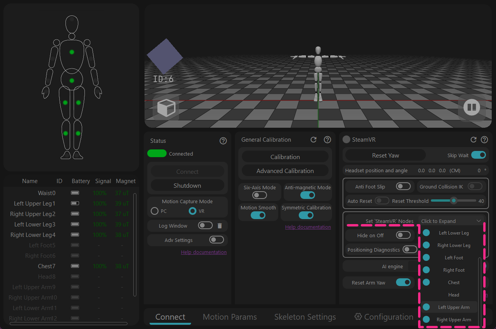
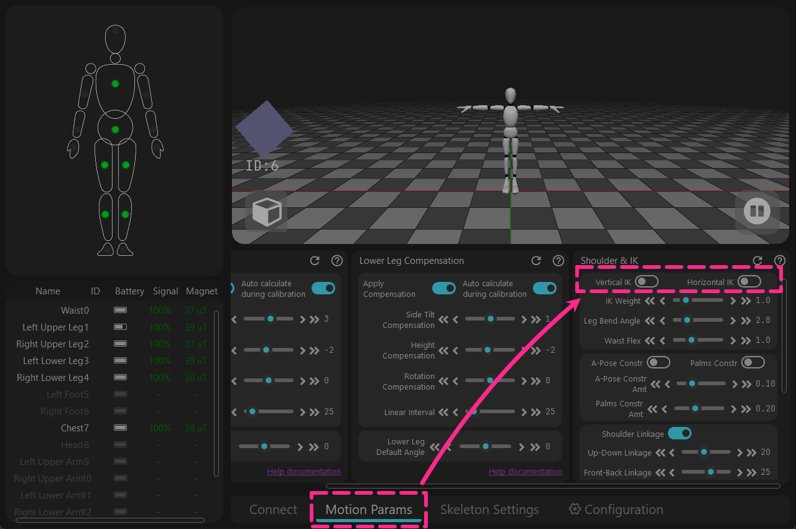
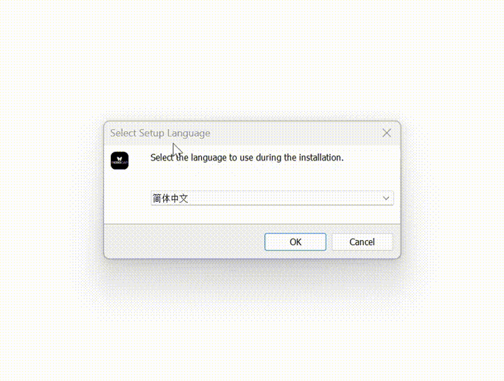

<!-- ==================== Flag A: Install software Start ==================== -->
<div style="border-left: 6px solid #88b49c; padding-left: 20px; margin-top: 10px; margin-bottom: 20px;">

<span id="software-download" class="legacy-anchor-alias" aria-hidden="true"></span>

## Download {#software-download-toc}
<h2 class="tutorial-heading-flag" style="background: #88b49c; margin-top: 0; display: inline-block;">Download</h2>

<div class="os-switch">
<input type="radio" name="os-platform" id="os-platform-win" />
<input type="radio" name="os-platform" id="os-platform-linux" />
<input type="radio" name="os-platform" id="os-platform-android" />

<div class="os-switch-tabs" role="group" aria-label="Select operating system">
<label class="os-switch-tab os-switch-tab-win" for="os-platform-win">
<svg class="os-switch-tab-icon" viewBox="0 0 24 24" width="22" height="22" aria-hidden="true" focusable="false"><path d="M0,0H11.377V11.372H0ZM12.623,0H24V11.372H12.623ZM0,12.623H11.377V24H0Zm12.623,0H24V24H12.623"></path></svg>
<span class="os-switch-tab-name">Windows</span>
</label>
<label class="os-switch-tab os-switch-tab-linux" for="os-platform-linux">
<svg class="os-switch-tab-icon" viewBox="0 0 24 24" width="22" height="22" aria-hidden="true" focusable="false"><path d="M12.504 0c-.155 0-.315.008-.48.021-4.226.333-3.105 4.807-3.17 6.298-.076 1.092-.3 1.953-1.05 3.02-.885 1.051-2.127 2.75-2.716 4.521-.278.832-.41 1.684-.287 2.489a.424.424 0 00-.11.135c-.26.268-.45.6-.663.839-.199.199-.485.267-.797.4-.313.136-.658.269-.864.68-.09.189-.136.394-.132.602 0 .199.027.4.055.536.058.399.116.728.04.97-.249.68-.28 1.145-.106 1.484.174.334.535.47.94.601.81.2 1.91.135 2.774.6.926.466 1.866.67 2.616.47.526-.116.97-.464 1.208-.946.587-.003 1.23-.269 2.26-.334.699-.058 1.574.267 2.577.2.025.134.063.198.114.333l.003.003c.391.778 1.113 1.132 1.884 1.071.771-.06 1.592-.536 2.257-1.306.631-.765 1.683-1.084 2.378-1.503.348-.199.629-.469.649-.853.023-.4-.2-.811-.714-1.376v-.097l-.003-.003c-.17-.2-.25-.535-.338-.926-.085-.401-.182-.786-.492-1.046h-.003c-.059-.054-.123-.067-.188-.135a.357.357 0 00-.19-.064c.431-1.278.264-2.55-.173-3.694-.533-1.41-1.465-2.638-2.175-3.483-.796-1.005-1.576-1.957-1.56-3.368.026-2.152.236-6.133-3.544-6.139zm.529 3.405h.013c.213 0 .396.062.584.198.19.135.33.332.438.533.105.259.158.459.166.724 0-.02.006-.04.006-.06v.105a.086.086 0 01-.004-.021l-.004-.024a1.807 1.807 0 01-.15.706.953.953 0 01-.213.335.71.71 0 00-.088-.042c-.104-.045-.198-.064-.284-.133a1.312 1.312 0 00-.22-.066c.05-.06.146-.133.183-.198.053-.128.082-.264.088-.402v-.02a1.21 1.21 0 00-.061-.4c-.045-.134-.101-.2-.183-.333-.084-.066-.167-.132-.267-.132h-.016c-.093 0-.176.03-.262.132a.8.8 0 00-.205.334 1.18 1.18 0 00-.09.4v.019c.002.089.008.179.02.267-.193-.067-.438-.135-.607-.202a1.635 1.635 0 01-.018-.2v-.02a1.772 1.772 0 01.15-.768c.082-.22.232-.406.43-.533a.985.985 0 01.594-.2zm-2.962.059h.036c.142 0 .27.048.399.135.146.129.264.288.344.465.09.199.14.4.153.667v.004c.007.134.006.2-.002.266v.08c-.03.007-.056.018-.083.024-.152.055-.274.135-.393.2.012-.09.013-.18.003-.267v-.015c-.012-.133-.04-.2-.082-.333a.613.613 0 00-.166-.267.248.248 0 00-.183-.064h-.021c-.071.006-.13.04-.186.132a.552.552 0 00-.12.27.944.944 0 00-.023.33v.015c.012.135.037.2.08.334.046.134.098.2.166.268.01.009.02.018.034.024-.07.057-.117.07-.176.136a.304.304 0 01-.131.068 2.62 2.62 0 01-.275-.402 1.772 1.772 0 01-.155-.667 1.759 1.759 0 01.08-.668 1.43 1.43 0 01.283-.535c.128-.133.26-.2.418-.2zm1.37 1.706c.332 0 .733.065 1.216.399.293.2.523.269 1.052.468h.003c.255.136.405.266.478.399v-.131a.571.571 0 01.016.47c-.123.31-.516.643-1.063.842v.002c-.268.135-.501.333-.775.465-.276.135-.588.292-1.012.267a1.139 1.139 0 01-.448-.067 3.566 3.566 0 01-.322-.198c-.195-.135-.363-.332-.612-.465v-.005h-.005c-.4-.246-.616-.512-.686-.71-.07-.268-.005-.47.193-.6.224-.135.38-.271.483-.336.104-.074.143-.102.176-.131h.002v-.003c.169-.202.436-.47.839-.601.139-.036.294-.065.466-.065zm2.8 2.142c.358 1.417 1.196 3.475 1.735 4.473.286.534.855 1.659 1.102 3.024.156-.005.33.018.513.064.646-1.671-.546-3.467-1.089-3.966-.22-.2-.232-.335-.123-.335.59.534 1.365 1.572 1.646 2.757.13.535.16 1.104.021 1.67.067.028.135.06.205.067 1.032.534 1.413.938 1.23 1.537v-.043c-.06-.003-.12 0-.18 0h-.016c.151-.467-.182-.825-1.065-1.224-.915-.4-1.646-.336-1.77.465-.008.043-.013.066-.018.135-.068.023-.139.053-.209.064-.43.268-.662.669-.793 1.187-.13.533-.17 1.156-.205 1.869v.003c-.02.334-.17.838-.319 1.35-1.5 1.072-3.58 1.538-5.348.334a2.645 2.645 0 00-.402-.533 1.45 1.45 0 00-.275-.333c.182 0 .338-.03.465-.067a.615.615 0 00.314-.334c.108-.267 0-.697-.345-1.163-.345-.467-.931-.995-1.788-1.521-.63-.4-.986-.87-1.15-1.396-.165-.534-.143-1.085-.015-1.645.245-1.07.873-2.11 1.274-2.763.107-.065.037.135-.408.974-.396.751-1.14 2.497-.122 3.854a8.123 8.123 0 01.647-2.876c.564-1.278 1.743-3.504 1.836-5.268.048.036.217.135.289.202.218.133.38.333.59.465.21.201.477.335.876.335.039.003.075.006.11.006.412 0 .73-.134.997-.268.29-.134.52-.334.74-.4h.005c.467-.135.835-.402 1.044-.7zm2.185 8.958c.037.6.343 1.245.882 1.377.588.134 1.434-.333 1.791-.765l.211-.01c.315-.007.577.01.847.268l.003.003c.208.199.305.53.391.876.085.4.154.78.409 1.066.486.527.645.906.636 1.14l.003-.007v.018l-.003-.012c-.015.262-.185.396-.498.595-.63.401-1.746.712-2.457 1.57-.618.737-1.37 1.14-2.036 1.191-.664.053-1.237-.2-1.574-.898l-.005-.003c-.21-.4-.12-1.025.056-1.69.176-.668.428-1.344.463-1.897.037-.714.076-1.335.195-1.814.12-.465.308-.797.641-.984l.045-.022zm-10.814.049h.01c.053 0 .105.005.157.014.376.055.706.333 1.023.752l.91 1.664.003.003c.243.533.754 1.064 1.189 1.637.434.598.77 1.131.729 1.57v.006c-.057.744-.48 1.148-1.125 1.294-.645.135-1.52.002-2.395-.464-.968-.536-2.118-.469-2.857-.602-.369-.066-.61-.2-.723-.4-.11-.2-.113-.602.123-1.23v-.004l.002-.003c.117-.334.03-.752-.027-1.118-.055-.401-.083-.71.043-.94.16-.334.396-.4.69-.533.294-.135.64-.202.915-.47h.002v-.002c.256-.268.445-.601.668-.838.19-.201.38-.336.663-.336zm7.159-9.074c-.435.201-.945.535-1.488.535-.542 0-.97-.267-1.28-.466-.154-.134-.28-.268-.373-.335-.164-.134-.144-.333-.074-.333.109.016.129.134.199.2.096.066.215.2.36.333.292.2.68.467 1.167.467.485 0 1.053-.267 1.398-.466.195-.135.445-.334.648-.467.156-.136.149-.267.279-.267.128.016.034.134-.147.332a8.097 8.097 0 01-.69.468zm-1.082-1.583V5.64c-.006-.02.013-.042.029-.05.074-.043.18-.027.26.004.063 0 .16.067.15.135-.006.049-.085.066-.135.066-.055 0-.092-.043-.141-.068-.052-.018-.146-.008-.163-.065zm-.551 0c-.02.058-.113.049-.166.066-.047.025-.086.068-.14.068-.05 0-.13-.02-.136-.068-.01-.066.088-.133.15-.133.08-.031.184-.047.259-.005.019.009.036.03.03.05v.02h.003z"></path></svg>
<span class="os-switch-tab-name">Linux</span>
</label>
<label class="os-switch-tab os-switch-tab-android" for="os-platform-android">
<svg class="os-switch-tab-icon" viewBox="0 0 24 24" width="22" height="22" aria-hidden="true" focusable="false"><path d="M18.4395 5.5586c-.675 1.1664-1.352 2.3318-2.0274 3.498-.0366-.0155-.0742-.0286-.1113-.043-1.8249-.6957-3.484-.8-4.42-.787-1.8551.0185-3.3544.4643-4.2597.8203-.084-.1494-1.7526-3.021-2.0215-3.4864a1.1451 1.1451 0 0 0-.1406-.1914c-.3312-.364-.9054-.4859-1.379-.203-.475.282-.7136.9361-.3886 1.5019 1.9466 3.3696-.0966-.2158 1.9473 3.3593.0172.031-.4946.2642-1.3926 1.0177C2.8987 12.176.452 14.772 0 18.9902h24c-.119-1.1108-.3686-2.099-.7461-3.0683-.7438-1.9118-1.8435-3.2928-2.7402-4.1836a12.1048 12.1048 0 0 0-2.1309-1.6875c.6594-1.122 1.312-2.2559 1.9649-3.3848.2077-.3615.1886-.7956-.0079-1.1191a1.1001 1.1001 0 0 0-.8515-.5332c-.5225-.0536-.9392.3128-1.0488.5449zm-.0391 8.461c.3944.5926.324 1.3306-.1563 1.6503-.4799.3197-1.188.0985-1.582-.4941-.3944-.5927-.324-1.3307.1563-1.6504.4727-.315 1.1812-.1086 1.582.4941zM7.207 13.5273c.4803.3197.5506 1.0577.1563 1.6504-.394.5926-1.1038.8138-1.584.4941-.48-.3197-.5503-1.0577-.1563-1.6504.4008-.6021 1.1087-.8106 1.584-.4941z"></path></svg>
<span class="os-switch-tab-name">Android</span>
</label>
</div>

<div class="os-switch-panel os-switch-panel-win">

The Windows version is currently available in Release and Beta versions. Click the download links below.<br />
The Beta version is a public test build that performs better in areas with significant magnetic interference, but has not yet been extensively validated.

<div class="os-switch-downloads">
<a class="os-switch-download" href="https://doc.rebocap.com/img/files/rebocap_release_v01.exe">
<span class="os-switch-download-main">Download Rebocap V01</span>
<span class="os-switch-download-meta">Stable version · Current Release</span>
<span class="os-switch-download-date">Uploaded: 2025.12.03</span>
</a>
<a class="os-switch-download" href="https://doc.rebocap.com/img/files/rebocap_release_v02_beta02.exe">
<span class="os-switch-download-main">Download Rebocap V02 Beta02</span>
<span class="os-switch-download-meta">Beta version · Public test</span>
<span class="os-switch-download-date">Uploaded: 2026.02.24</span>
</a>
<a class="os-switch-download" data-gray-release-download="true" href="https://doc.rebocap.com/files/rebocap_v02_beta02.2_gray02-2.exe">
<span class="os-switch-download-main">Download Rebocap V02 Beta02.2</span>
<span class="os-switch-download-meta">Beta version · Gray release</span>
<span class="os-switch-download-date">Uploaded: 2026.11.11</span>
</a>
</div>


- Version Selection:\
  V01 - Suitable for environments with stable magnetic fields, recommended for dancing.<br />
  V02 Beta02.2 - For trying some of the new UI modules, and for play areas with poor magnetic environments, such as areas with many metal parts or trampolines.<br />


- It is recommended to install on a non-system drive (do not install on the C drive).

<!-- ==================== Details Start ==================== -->

<details>
<summary> [ Firmware ] Supported versions and operating instructions.</summary>
   &emsp;&emsp; Some firmware versions have major algorithm changes and are incompatible with older software versions. <br /> 


   &emsp;&emsp; When switching back to an older software version, the firmware must be downgraded accordingly.<br /> 

   &emsp;&emsp;&emsp; release_v01 - ◼️tracker : V6 / V7  ,  📡receiver : V6 / V7 <br /> 

   &emsp;&emsp;&emsp; release_v02 beta02 - ◼️tracker : V15  ,  📡receiver : V6 / V7 <br /> 

   &emsp;&emsp;&emsp; (Unpublished) release_v02 beta02.1 - ◼️tracker : V16  ,  📡receiver : V6 / V7 / V8 <br /> 

   &emsp;&emsp;&emsp; release_v02 beta02.2 - ◼️tracker : V16  ,  📡receiver : V6 / V7 / V8 <br /> 


<div style="display: flex; flex-direction: row; gap: 20px; flex-wrap: wrap; align-items: center; margin: 15px 0;">
<div style="flex: 1; min-width: 250px; text-align: center;">

<video autoPlay loop muted playsInline width="100%" src="/img/softawre_install/show_version_log.mp4"></video>

</div>
<div style="flex: 1.5; min-width: 250px;">

**Firmware operating instructions**<br />
- Open the log window to see each tracker actual firmware version <br /> 
(the log window is located under "Connect & Power Off" in the software).

</div>
</div>

<br/>

- The trackers are updated wirelessly 📶 — no USB cable is needed.<br /> 
🚫 Do not update the tracker and receiver at the same time.<br /> 


- If the update fails, need restart the tracker and click update again.<br /> 
&emsp;&emsp;🟩Green – fast blink: Tracker working normally<br /> 
&emsp;&emsp;🟩Green – slow blink: Tracker waiting for receiver signal<br /> 
&emsp;&emsp;🟦Blue: Tracker is receiving firmware data<br /> 
&emsp;&emsp;🟨Yellow: Update failed (manually press the 🔘 button to restart, then retry the update)<br /> 
&emsp;&emsp;⬜White: Update successful (usually auto‑restarts after 10s; if not, restart manually)<br /> 

-  When 📡receiver update done, unplug and replug the USB, and 🔄restart the software.


</details>
<!-- ==================== Details End ==================== -->


<!-- ==================== Details Start ==================== -->
<details>
<summary>If using the V01 version in VR mode, the following settings need to be changed.</summary>

<div style="display: flex; flex-direction: row; gap: 20px; flex-wrap: wrap; align-items: center; margin: 15px 0;">
<div style="flex: 1; min-width: 250px; text-align: center;">



</div>
<div style="flex: 1.5; min-width: 250px;">
<strong>1 - When there is no upper arm tracker, manually turn off the extra displayed tracking points.</strong><br />
Open [Configure 'SteamVR' output nodes] → Turn off [Left/Right Upper Arm]
<details className="plain-details"><summary>Details</summary>
The software originally planned to use the [Auto-hide joints] function to automatically hide unused tracking points,<br />
but it was found that this function could not automatically check. This has been fixed in the V02 Beta02 software.
</details>

</div>
</div>

<div style="display: flex; flex-direction: row; gap: 20px; flex-wrap: wrap; align-items: center; margin: 15px 0;">
<div style="flex: 1; min-width: 250px; text-align: center;">



</div>
<div style="flex: 1.5; min-width: 250px;">
<strong>2 - Turn off functions that may incorrectly get stuck working globally.</strong><br />
→ [Motion Parameters] → Turn off [Vertical IK & Horizontal IK]
<details className="plain-details"><summary>Details</summary>
This function was originally a sub-function in the [Anti-slip] module,<br />
but it would unexpectedly remain active globally. This has been fixed in the V02 Beta02 software.

</details>
</div>
</div>

</details>
<!-- ==================== Details End ==================== -->

Notes:
> The current **Windows version** only supports Windows 10 and above.<br>
> The software must be used while connected to the internet. If you wish to use it offline, please connect through a mobile hotspot, start the software, wait for 30 seconds, and then disconnect the network.<br>
> (As long as the [Log window] shows that the network verification was successful, you can disconnect the network)

</div>

<div class="os-switch-panel os-switch-panel-linux">

Linux is currently a Preview version. This release is mainly intended to observe the stability of the program core in the Linux environment.<br>
If you encounter bugs while using it, feel free to leave feedback on the relevant Twitter (X) posts and Discord.

<div class="os-switch-downloads">
<a class="os-switch-download" data-preview-download="true" href="https://doc.rebocap.com/files/rebocap-linux-preview-0.1-1.run">
<span class="os-switch-download-main">Download Rebocap Linux Preview 0.1</span>
<span class="os-switch-download-meta">Linux · Preview version</span>
<span class="os-switch-download-date">Uploaded: 2026.11.11</span>
</a>
</div>

The default installation path on Linux is `~/.local/opt/rebocap`.

<!-- ==================== Details Start ==================== -->

<details>
<summary> [ Firmware ] Supported versions and operating instructions.</summary>
   &emsp;&emsp; Some firmware versions have major algorithm changes and are incompatible with older software versions. <br /> 


   &emsp;&emsp; When switching back to an older software version, the firmware must be downgraded accordingly.<br /> 

 
   &emsp;&emsp;&emsp; Linux Preview 0.1 - ◼️tracker : V16 / V17 ,  📡receiver : V6 / V7 / V8 <br /> 


<div style="display: flex; flex-direction: row; gap: 20px; flex-wrap: wrap; align-items: center; margin: 15px 0;">
<div style="flex: 1; min-width: 250px; text-align: center;">

<video autoPlay loop muted playsInline width="100%" src="/img/softawre_install/show_version_log.mp4"></video>

</div>
<div style="flex: 1.5; min-width: 250px;">

**Firmware operating instructions**<br />
- Open the log window to see each tracker actual firmware version <br /> 
(the log window is located under "Connect & Power Off" in the software).

</div>
</div>

<br/>

- The trackers are updated wirelessly 📶 — no USB cable is needed.<br /> 
🚫 Do not update the tracker and receiver at the same time.<br /> 


- If the update fails, need restart the tracker and click update again.<br /> 
&emsp;&emsp;🟩Green – fast blink: Tracker working normally<br /> 
&emsp;&emsp;🟩Green – slow blink: Tracker waiting for receiver signal<br /> 
&emsp;&emsp;🟦Blue: Tracker is receiving firmware data<br /> 
&emsp;&emsp;🟨Yellow: Update failed (manually press the 🔘 button to restart, then retry the update)<br /> 
&emsp;&emsp;⬜White: Update successful (usually auto‑restarts after 10s; if not, restart manually)<br /> 

-  When 📡receiver update done, unplug and replug the USB, and 🔄restart the software.


</details>
<!-- ==================== Details End ==================== -->

Notes:
> The current Linux version requires the system permissions to be set; you can check this in the [Log window].<br>
> If the permissions were not set successfully, it may affect the USB receiver connection, repeatedly showing "state -3".<br>
> <br>
> The software must be used while connected to the internet. If you wish to use it offline, please connect through a mobile hotspot, start the software, wait for 30 seconds, and then disconnect the network.<br>
> (As long as the [Log window] shows that the network verification was successful, you can disconnect the network)

</div>

<div class="os-switch-panel os-switch-panel-android">

Android is currently a Preview version. This release is mainly intended to observe the stability of the program core in the Android environment.<br>
If you encounter bugs while using it, feel free to leave feedback on the relevant Twitter (X) posts and Discord.

<div class="os-switch-downloads">
<a class="os-switch-download" data-preview-download="true" href="https://doc.rebocap.com/files/ReboCapAndroid-Preview-0.2.apk">
<span class="os-switch-download-main">Download Rebocap Android Preview 0.2</span>
<span class="os-switch-download-meta">Android · Preview version</span>
<span class="os-switch-download-date">Uploaded: 2026.11.13</span>
</a>
</div>

<div class="os-switch-aux">
<div class="os-switch-aux-title">Companion tools (optional)</div>
<div class="os-switch-aux-grid">
<a class="os-switch-aux-tool" href="https://doc.rebocap.com/files/RebocapTransmitter-v1.0.21.apk">
<div class="os-switch-aux-info">
<span class="os-switch-aux-name">Rebocap Receiver Bridge App</span>
<span class="os-switch-aux-meta">Android APK · v1.0.21</span>
<span class="os-switch-aux-date">Uploaded: 2026.11.13</span>
</div>
<span class="os-switch-aux-btn">Download ↓</span>
</a>
<a class="os-switch-aux-tool" href="https://doc.rebocap.com/files/RBC_OSC_forward_v1.0.0.apk">
<div class="os-switch-aux-info">
<span class="os-switch-aux-name">VRChat OSC Forwarding App</span>
<span class="os-switch-aux-meta">Android APK · v1.0.0</span>
<span class="os-switch-aux-date">Uploaded: 2026.11.11</span>
</div>
<span class="os-switch-aux-btn">Download ↓</span>
</a>
</div>
</div>

<div class="os-switch-otg">
<span class="os-switch-otg-label">Buy an OTG cable:</span>
<a class="os-switch-otg-link" href="https://store.rebocap.site/products/otg-adapter-with-pd-charging">International Store</a>
</div>
<p class="os-switch-otg-note">Note: This OTG cable is intended for Quest or Pico standalone headsets and is not included by default. The OTG cable in the official store supports PD charging. If you do not need charging, you can buy a standard OTG adapter or adapter cable yourself. If you do not need PD charging (for example, Quest 2), a regular OTG charging cable (5 V/2 A) is also an option.</p>


<!-- ==================== Details Start ==================== -->

<details>
<summary> [ Firmware ] Supported versions and operating instructions.</summary>
   &emsp;&emsp; Some firmware versions have major algorithm changes and are incompatible with older software versions. <br /> 


   &emsp;&emsp; When switching back to an older software version, the firmware must be downgraded accordingly.<br /> 


   &emsp;&emsp;&emsp; Android Preview 0.2 - ◼️tracker : V16 / V17 ,  📡receiver : V6 / V7 / V8 <br /> 


<div style="display: flex; flex-direction: row; gap: 20px; flex-wrap: wrap; align-items: center; margin: 15px 0;">
<div style="flex: 1; min-width: 250px; text-align: center;">

<video autoPlay loop muted playsInline width="100%" src="/img/softawre_install/show_version_log.mp4"></video>

</div>
<div style="flex: 1.5; min-width: 250px;">

**Firmware operating instructions**<br />
- Open the log window to see each tracker actual firmware version <br /> 
(the log window is located under "Connect & Power Off" in the software).

</div>
</div>

<br/>

- The trackers are updated wirelessly 📶 — no USB cable is needed.<br /> 
🚫 Do not update the tracker and receiver at the same time.<br /> 


- If the update fails, need restart the tracker and click update again.<br /> 
&emsp;&emsp;🟩Green – fast blink: Tracker working normally<br /> 
&emsp;&emsp;🟩Green – slow blink: Tracker waiting for receiver signal<br /> 
&emsp;&emsp;🟦Blue: Tracker is receiving firmware data<br /> 
&emsp;&emsp;🟨Yellow: Update failed (manually press the 🔘 button to restart, then retry the update)<br /> 
&emsp;&emsp;⬜White: Update successful (usually auto‑restarts after 10s; if not, restart manually)<br /> 

-  When 📡receiver update done, unplug and replug the USB, and 🔄restart the software.


</details>
<!-- ==================== Details End ==================== -->

Notes:
> You need to use an OTG cable to connect the USB receiver to the device running the Rebocap software.<br>
> For firmware updates, gyroscope and magnetic field calibration, using a phone is recommended.<br>
> If the data port is worn and connections drop easily, you can use an OSC forwarding app or a receiver bridge app to keep the software connected.<br>
> <br>
> The software must be used while connected to the internet. If you wish to use it offline, start the software, wait for 30 seconds, and then disconnect the network.<br>
> (As long as the [Log window] shows that the network verification was successful, you can disconnect the network)

</div>
</div>


</div>
<!-- ==================== Flag A: Install software End ==================== -->


## Software Installation

<div class="os-switch-install os-switch-install-win">

1. Double-click rebocap_release_v01.exe (the current version is rebocap_release_v01.exe)
2. Install according to the steps shown in the figure below
3. Open the Rebocap software
   * Open from the Start Menu
   * Open via the desktop shortcut



</div>

<div class="os-switch-install os-switch-install-linux">

The Linux version uses a `.run` installer package:

1. Open a terminal in the directory containing the installer and grant execute permission first: `chmod +x rebocap-linux-preview-0.1-1.run`
2. Run the installer: `./rebocap-linux-preview-0.1-1.run`
3. Follow the prompts to complete the installation; the default installation path is `~/.local/opt/rebocap`
4. After installation, launch Rebocap from the application menu or the installation directory

If automatic system authorization fails, you can apply the permissions manually:

**Device permission configuration (required; otherwise the receiver cannot connect)**

```bash
sudo bash ~/.local/opt/rebocap/linux/install_linux_permissions.sh --install --user "$USER"
```

After running it, unplug and replug the receiver once, then start the software.

</div>

<div class="os-switch-install os-switch-install-android">

The Android version uses an `.apk` installer package:

1. Transfer `ReboCapAndroid-Preview-0.2.apk` to your phone and tap to install
2. If prompted by the system, allow "Install unknown apps"
3. After installation, open Rebocap
4. Connect the USB receiver with an OTG cable, and follow the software prompts to complete the connection

</div>

## Software Update Notes

### Changelog

#### 2026-11-11 Update

**Firmware**
1. 📡 Receiver firmware V8:
    > Dropped the traditional CDC serial port driver and switched to vendor mode, giving a faster transfer rate (basically no impact),<br> mainly because the serial port driver is easily disturbed by other programs on the system, or affected by system components, and its stability is too poor.<br>Note: Once upgraded to the new firmware, only the latest software version can be used. Older versions cannot recognize it, and the receiver firmware must be rolled back to use older software.

2. ◼️ Tracker firmware V16:
    > Fixed the inconsistent default orientation between the new and old algorithms (with v15 firmware, the tracker faces 90° to the right after a button restart),<br>added support for non-anti-magnetic mode (previously the anti-magnetic switch had no effect on v15 firmware, making it unsuitable for dancing).

**Software**
1. Added Linux and Android versions, mainly to observe whether users encounter core bugs, and changed the operation logic of some UI
    > The Linux UI stays consistent with Windows; the Android UI is redesigned, but its interaction flow remains close to Windows, and it supports switching between portrait and landscape.

2. Replaced the 3D viewer with OGRE
    > However, NVIDIA graphics card drivers may normalize GPU usage, incorrectly showing GPU usage of 20%~40%; AMD graphics cards do not have this "wondrous" display, which awaits further investigation and adjustment.

3. Firmware upgrade is now a separate window
    >Upgrading firmware from v7 to v15 was a hurdle for many people, hence this window was improved.

4. [Six-axis mode] renamed to [Geomagnetic assist], and the switch is inverted
    >Players in every language were found to mistake 6-axis for a 6-tracker mode.

5. Motion calibration logic adjusted
    >Added an [Emergency Stop] button, so you can stop if calibration is triggered by mistake.<br>Added a collapsible extension panel; after appropriate adjustment the calibration countdown becomes very short, and the previous calibration record can be retained (if not enabled, it expires 7 minutes after the software is closed).

6. Tracker knock changed to [Tap assignment]
    > Allows players to customize tap macros, freely choosing whom to tap, the tap interval, and which shortcut to trigger.

7. Added a volume slider
    > Makes it convenient to turn the software notification sounds on or off directly.

8. Fixed the VMC height offset bug
    > The previous bug where VMC was higher than the ground was because the ground-to-hips height was incorrectly output at 2x.

9. Removed the [Advanced Settings] control for some frequently used features
  

**end.** UI interaction improvements will continue, and there are still many items from the usage feedback statistics that need adjustment.


#### 2026-02-04 Update: Rebocap Release V02 Beta02
1. Updated firmware to v15, optimized anti-magnetic and 6-axis algorithms, improved anti-magnetic stability, improved 6-axis stability
   > Under dynamic conditions, e.g., dancing continuously in a poor magnetic environment, performance is still close to that of 6-axis mode. With the new firmware, as long as the magnetic field is good, dynamic dancing can be continuously corrected (the previous firmware relied on intermittent static moments for correction)
2. Added delayed auto-shutdown function, requires upgrading the receiver firmware.
3. Reworked heading calibration and added PC heading calibration function：
   > Note: When performing PC heading calibration, use a full-body A-pose; raising the forearms and palms forward works better. Alternatively, you can directly perform an S-Pose, or sit down and stretch your arms straight forward also works）
4. If the software crashes unexpectedly and is reopened within 5 minutes, the previous calibration results will be applied automatically; no need to recalibrate
5. During heading calibration, the magnetic field will be reset (directly reset to a relative field of 1.0). In other words, if you are lying in bed, it will use the magnetic field at the calibration moment as the initial reference to correct.
6. Removed the restriction on magnetic field calibration; the simple magnetic calibration (drawing a figure-8) is now clickable by default
   > By default, calibration is limited to 8 sensors at a time. If you add the file: `data/__no_limit_max_nodes__` in the data directory, the limit will be removed
7. Fixed a bug where foot movement after lying down could cause the character’s skeleton to split.

Other updates：
1. The software title bar now displays the version number
2. Fixed a bug where the auto-hide powered-off sensors function did not take effect
3. When foot anti-slip mode is disabled, feet can go below the ground, and IK has been removed
4. Resolved a bug where the avatar pose froze after unplugging the receiver
5. Added VR lateral offset in the skeleton settings (for models whose HMD mount point is not centered on the forehead but slightly to the side, you can adjust as needed)


#### 2025-12-03 Update: Rebocap Release V01
**VR Section：**
1. Added in-place walking function: when stepping in place, the joystick is simulated to move forward steadily and slowly, see the Help document for details (Advanced Feature)
2. Added VR virtual ground height adjustment, range -100 cm~100 cm (Advanced Feature)
3. Added controller replacement function: when enabled, hand trackers replace the controller’s position and orientation, see the Help document for details (Advanced Feature)
4. Upgraded the SteamVR plugin and attempted to fix the issue where trackers are recognized as controllers
5. Fixed incorrect foot locator when importing a skeleton in VR mode (mainly affecting IK calculation) that caused the avatar’s feet and overall body to sink.
6. After heading reset, the Auto Re-center function will be triggered proactively
7. Added switch to automatically hide powered-off nodes; when enabled, powered-off nodes will be hidden automatically
8. Restored the VR chest/waist follow-HMD feature

**PC Section：**
1. Updated motion calibration algorithm: relaxed T-pose arm posture requirements, resolving asymmetrical arm issues for some users
2. Added arm IK. The Clasped-Hands IK minimizes arm crossing when hands are together, and the A-Pose IK addresses severe clipping when the avatar’s shoulders are too narrow and arms are vertical.
3. Added MMD motion export and PMX model import. Note, VMD motions do not contain IK; you need to remove IK constraints manually.
4. Fixed the bug where animation frame rate jump was capped at 999

**General：**
1. UI updated: reorganized by function, improved some term translations, and made feature descriptions more user-friendly
2. Added Advanced Settings toggle, along with settings export/import and Restore Defaults functions
3. Removed the issue where calibration could not proceed due to failed motionless detection
4. Added auto-connect feature; no need to click the connect button manually anymore
5. Added receiver firmware upgrade to resolve high CPU load and packet loss issues (especially on AMD CPUs)
6. Upgraded trackers to v07 firmware for overall improved stability
7. Added the ability to select specific nodes for 6-axis mode (Advanced Feature)
8. Fixed a bug where some gyroscopes did not return to zero after calibration

**Others:**
1. Added a startup splash screen to avoid long periods of background waiting  
2. Enhanced 3D window stability  
3. Increased the number of authentication servers to three (China, Hong Kong, and the United States); authentication succeeds as long as any one server passes  
4. Fixed an occasional bug where data appeared to fail to send during calibration (it was actually sent successfully)  
5. Changed the default skeleton to the community-recommended default skeleton and modified other default parameters  
6. Added a recalibration prompt when toggling the six-axis switch on or off  
7. Fixed the six-axis lateral tilt compensation issue  


### TODO (in no particular order, only major update points are listed here)

- Optimize IK performance  
- Improve software stability  
- Support VR 3-point mode  
- Support PC full-body 6-point mode  
- Add documentation in other languages (to be added once documentation is stabilized)  


### Historical Versions
> **Note: Versions prior to preview05 do not support new hardware released after 2025-11-29. For new hardware, please download the latest Release version or Beta version.**
