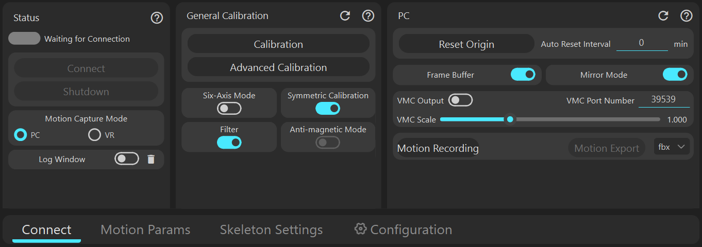
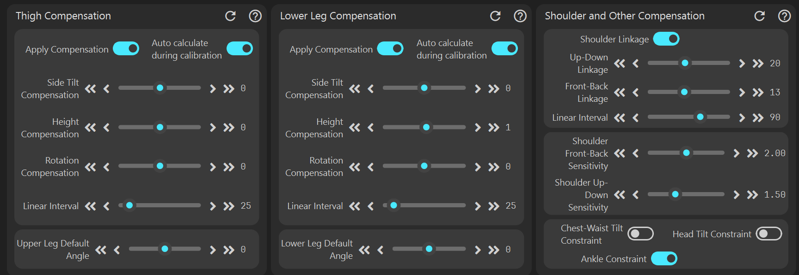
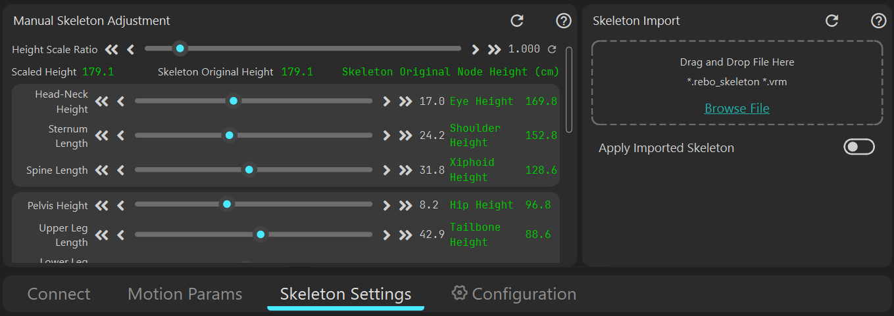
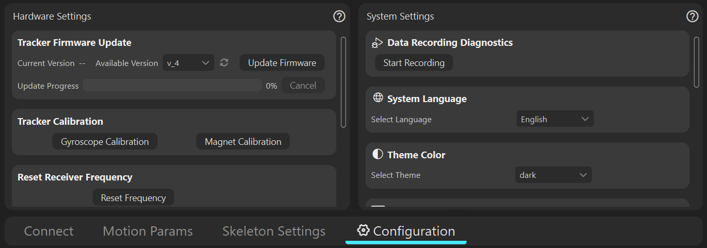

# [Connection Panel](connect)

[Click to view details](connect)

# [Motion Capture Parameters Panel](cap_param)

[Click to view details](cap_param)

# [Skeleton Adjustment Panel](skeleton_setting)

[Click to view details](skeleton_setting)

# [Settings Panel](config)

[Click to view details](config)

                     