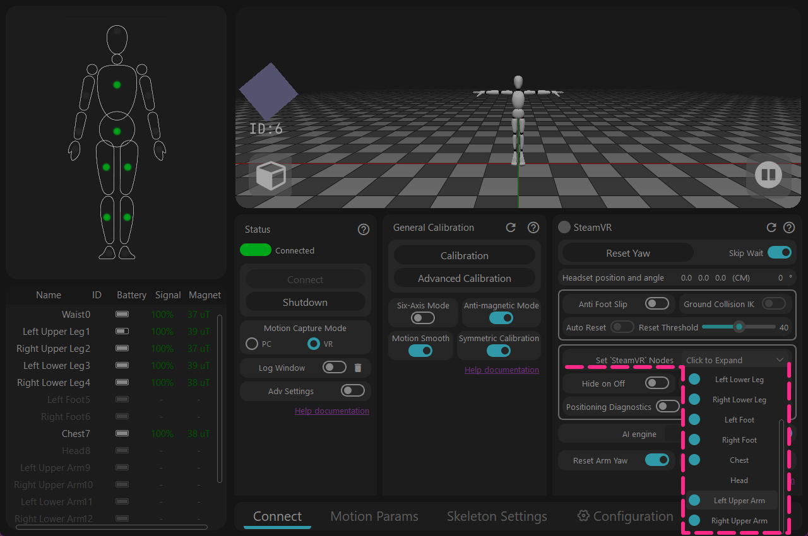
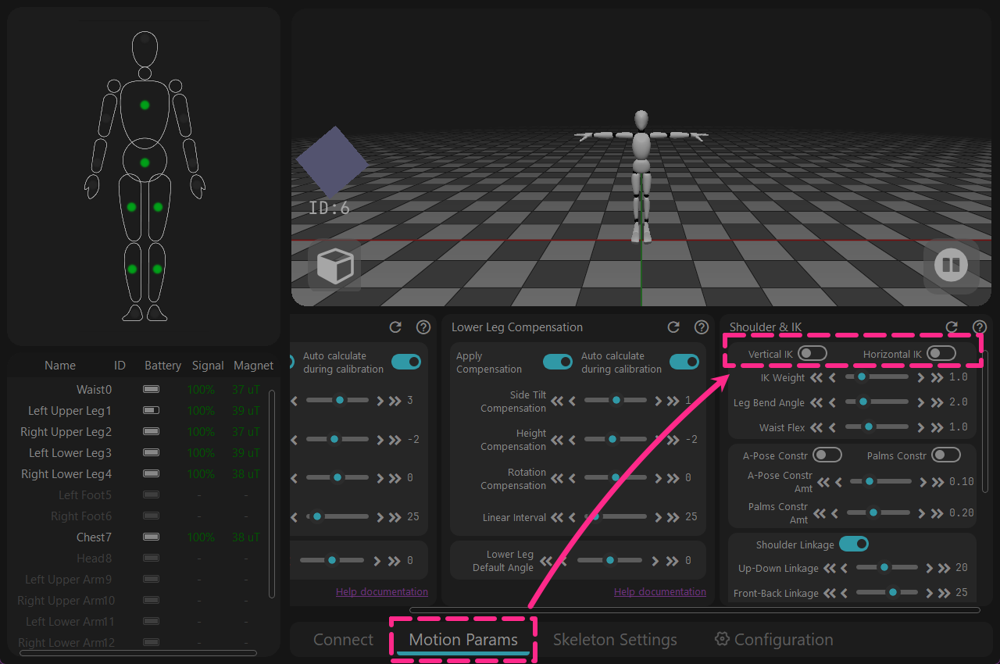
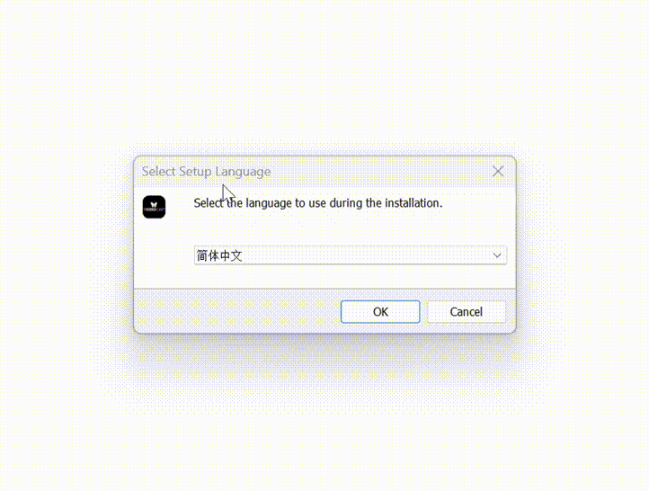

<!-- ==================== Flag A: Install software Start ==================== -->
<div style="border-left: 6px solid #88b49c; padding-left: 20px; margin-top: 10px; margin-bottom: 20px;">

## Téléchargement {#software-download-toc}
<h2 class="tutorial-heading-flag" style="background: #88b49c; margin-top: 0; display: inline-block;">Téléchargement</h2>

<div class="os-switch">
<input type="radio" name="os-platform" id="os-platform-win" />
<input type="radio" name="os-platform" id="os-platform-linux" />
<input type="radio" name="os-platform" id="os-platform-android" />

<div class="os-switch-tabs" role="group" aria-label="Sélection du système d'exploitation">
<label class="os-switch-tab os-switch-tab-win" for="os-platform-win">
<svg class="os-switch-tab-icon" viewBox="0 0 24 24" width="22" height="22" aria-hidden="true" focusable="false"><path d="M0,0H11.377V11.372H0ZM12.623,0H24V11.372H12.623ZM0,12.623H11.377V24H0Zm12.623,0H24V24H12.623"></path></svg>
<span class="os-switch-tab-name">Windows</span>
</label>
<label class="os-switch-tab os-switch-tab-linux" for="os-platform-linux">
<svg class="os-switch-tab-icon" viewBox="0 0 24 24" width="22" height="22" aria-hidden="true" focusable="false"><path d="M12.504 0c-.155 0-.315.008-.48.021-4.226.333-3.105 4.807-3.17 6.298-.076 1.092-.3 1.953-1.05 3.02-.885 1.051-2.127 2.75-2.716 4.521-.278.832-.41 1.684-.287 2.489a.424.424 0 00-.11.135c-.26.268-.45.6-.663.839-.199.199-.485.267-.797.4-.313.136-.658.269-.864.68-.09.189-.136.394-.132.602 0 .199.027.4.055.536.058.399.116.728.04.97-.249.68-.28 1.145-.106 1.484.174.334.535.47.94.601.81.2 1.91.135 2.774.6.926.466 1.866.67 2.616.47.526-.116.97-.464 1.208-.946.587-.003 1.23-.269 2.26-.334.699-.058 1.574.267 2.577.2.025.134.063.198.114.333l.003.003c.391.778 1.113 1.132 1.884 1.071.771-.06 1.592-.536 2.257-1.306.631-.765 1.683-1.084 2.378-1.503.348-.199.629-.469.649-.853.023-.4-.2-.811-.714-1.376v-.097l-.003-.003c-.17-.2-.25-.535-.338-.926-.085-.401-.182-.786-.492-1.046h-.003c-.059-.054-.123-.067-.188-.135a.357.357 0 00-.19-.064c.431-1.278.264-2.55-.173-3.694-.533-1.41-1.465-2.638-2.175-3.483-.796-1.005-1.576-1.957-1.56-3.368.026-2.152.236-6.133-3.544-6.139zm.529 3.405h.013c.213 0 .396.062.584.198.19.135.33.332.438.533.105.259.158.459.166.724 0-.02.006-.04.006-.06v.105a.086.086 0 01-.004-.021l-.004-.024a1.807 1.807 0 01-.15.706.953.953 0 01-.213.335.71.71 0 00-.088-.042c-.104-.045-.198-.064-.284-.133a1.312 1.312 0 00-.22-.066c.05-.06.146-.133.183-.198.053-.128.082-.264.088-.402v-.02a1.21 1.21 0 00-.061-.4c-.045-.134-.101-.2-.183-.333-.084-.066-.167-.132-.267-.132h-.016c-.093 0-.176.03-.262.132a.8.8 0 00-.205.334 1.18 1.18 0 00-.09.4v.019c.002.089.008.179.02.267-.193-.067-.438-.135-.607-.202a1.635 1.635 0 01-.018-.2v-.02a1.772 1.772 0 01.15-.768c.082-.22.232-.406.43-.533a.985.985 0 01.594-.2zm-2.962.059h.036c.142 0 .27.048.399.135.146.129.264.288.344.465.09.199.14.4.153.667v.004c.007.134.006.2-.002.266v.08c-.03.007-.056.018-.083.024-.152.055-.274.135-.393.2.012-.09.013-.18.003-.267v-.015c-.012-.133-.04-.2-.082-.333a.613.613 0 00-.166-.267.248.248 0 00-.183-.064h-.021c-.071.006-.13.04-.186.132a.552.552 0 00-.12.27.944.944 0 00-.023.33v.015c.012.135.037.2.08.334.046.134.098.2.166.268.01.009.02.018.034.024-.07.057-.117.07-.176.136a.304.304 0 01-.131.068 2.62 2.62 0 01-.275-.402 1.772 1.772 0 01-.155-.667 1.759 1.759 0 01.08-.668 1.43 1.43 0 01.283-.535c.128-.133.26-.2.418-.2zm1.37 1.706c.332 0 .733.065 1.216.399.293.2.523.269 1.052.468h.003c.255.136.405.266.478.399v-.131a.571.571 0 01.016.47c-.123.31-.516.643-1.063.842v.002c-.268.135-.501.333-.775.465-.276.135-.588.292-1.012.267a1.139 1.139 0 01-.448-.067 3.566 3.566 0 01-.322-.198c-.195-.135-.363-.332-.612-.465v-.005h-.005c-.4-.246-.616-.512-.686-.71-.07-.268-.005-.47.193-.6.224-.135.38-.271.483-.336.104-.074.143-.102.176-.131h.002v-.003c.169-.202.436-.47.839-.601.139-.036.294-.065.466-.065zm2.8 2.142c.358 1.417 1.196 3.475 1.735 4.473.286.534.855 1.659 1.102 3.024.156-.005.33.018.513.064.646-1.671-.546-3.467-1.089-3.966-.22-.2-.232-.335-.123-.335.59.534 1.365 1.572 1.646 2.757.13.535.16 1.104.021 1.67.067.028.135.06.205.067 1.032.534 1.413.938 1.23 1.537v-.043c-.06-.003-.12 0-.18 0h-.016c.151-.467-.182-.825-1.065-1.224-.915-.4-1.646-.336-1.77.465-.008.043-.013.066-.018.135-.068.023-.139.053-.209.064-.43.268-.662.669-.793 1.187-.13.533-.17 1.156-.205 1.869v.003c-.02.334-.17.838-.319 1.35-1.5 1.072-3.58 1.538-5.348.334a2.645 2.645 0 00-.402-.533 1.45 1.45 0 00-.275-.333c.182 0 .338-.03.465-.067a.615.615 0 00.314-.334c.108-.267 0-.697-.345-1.163-.345-.467-.931-.995-1.788-1.521-.63-.4-.986-.87-1.15-1.396-.165-.534-.143-1.085-.015-1.645.245-1.07.873-2.11 1.274-2.763.107-.065.037.135-.408.974-.396.751-1.14 2.497-.122 3.854a8.123 8.123 0 01.647-2.876c.564-1.278 1.743-3.504 1.836-5.268.048.036.217.135.289.202.218.133.38.333.59.465.21.201.477.335.876.335.039.003.075.006.11.006.412 0 .73-.134.997-.268.29-.134.52-.334.74-.4h.005c.467-.135.835-.402 1.044-.7zm2.185 8.958c.037.6.343 1.245.882 1.377.588.134 1.434-.333 1.791-.765l.211-.01c.315-.007.577.01.847.268l.003.003c.208.199.305.53.391.876.085.4.154.78.409 1.066.486.527.645.906.636 1.14l.003-.007v.018l-.003-.012c-.015.262-.185.396-.498.595-.63.401-1.746.712-2.457 1.57-.618.737-1.37 1.14-2.036 1.191-.664.053-1.237-.2-1.574-.898l-.005-.003c-.21-.4-.12-1.025.056-1.69.176-.668.428-1.344.463-1.897.037-.714.076-1.335.195-1.814.12-.465.308-.797.641-.984l.045-.022zm-10.814.049h.01c.053 0 .105.005.157.014.376.055.706.333 1.023.752l.91 1.664.003.003c.243.533.754 1.064 1.189 1.637.434.598.77 1.131.729 1.57v.006c-.057.744-.48 1.148-1.125 1.294-.645.135-1.52.002-2.395-.464-.968-.536-2.118-.469-2.857-.602-.369-.066-.61-.2-.723-.4-.11-.2-.113-.602.123-1.23v-.004l.002-.003c.117-.334.03-.752-.027-1.118-.055-.401-.083-.71.043-.94.16-.334.396-.4.69-.533.294-.135.64-.202.915-.47h.002v-.002c.256-.268.445-.601.668-.838.19-.201.38-.336.663-.336zm7.159-9.074c-.435.201-.945.535-1.488.535-.542 0-.97-.267-1.28-.466-.154-.134-.28-.268-.373-.335-.164-.134-.144-.333-.074-.333.109.016.129.134.199.2.096.066.215.2.36.333.292.2.68.467 1.167.467.485 0 1.053-.267 1.398-.466.195-.135.445-.334.648-.467.156-.136.149-.267.279-.267.128.016.034.134-.147.332a8.097 8.097 0 01-.69.468zm-1.082-1.583V5.64c-.006-.02.013-.042.029-.05.074-.043.18-.027.26.004.063 0 .16.067.15.135-.006.049-.085.066-.135.066-.055 0-.092-.043-.141-.068-.052-.018-.146-.008-.163-.065zm-.551 0c-.02.058-.113.049-.166.066-.047.025-.086.068-.14.068-.05 0-.13-.02-.136-.068-.01-.066.088-.133.15-.133.08-.031.184-.047.259-.005.019.009.036.03.03.05v.02h.003z"></path></svg>
<span class="os-switch-tab-name">Linux</span>
</label>
<label class="os-switch-tab os-switch-tab-android" for="os-platform-android">
<svg class="os-switch-tab-icon" viewBox="0 0 24 24" width="22" height="22" aria-hidden="true" focusable="false"><path d="M18.4395 5.5586c-.675 1.1664-1.352 2.3318-2.0274 3.498-.0366-.0155-.0742-.0286-.1113-.043-1.8249-.6957-3.484-.8-4.42-.787-1.8551.0185-3.3544.4643-4.2597.8203-.084-.1494-1.7526-3.021-2.0215-3.4864a1.1451 1.1451 0 0 0-.1406-.1914c-.3312-.364-.9054-.4859-1.379-.203-.475.282-.7136.9361-.3886 1.5019 1.9466 3.3696-.0966-.2158 1.9473 3.3593.0172.031-.4946.2642-1.3926 1.0177C2.8987 12.176.452 14.772 0 18.9902h24c-.119-1.1108-.3686-2.099-.7461-3.0683-.7438-1.9118-1.8435-3.2928-2.7402-4.1836a12.1048 12.1048 0 0 0-2.1309-1.6875c.6594-1.122 1.312-2.2559 1.9649-3.3848.2077-.3615.1886-.7956-.0079-1.1191a1.1001 1.1001 0 0 0-.8515-.5332c-.5225-.0536-.9392.3128-1.0488.5449zm-.0391 8.461c.3944.5926.324 1.3306-.1563 1.6503-.4799.3197-1.188.0985-1.582-.4941-.3944-.5927-.324-1.3307.1563-1.6504.4727-.315 1.1812-.1086 1.582.4941zM7.207 13.5273c.4803.3197.5506 1.0577.1563 1.6504-.394.5926-1.1038.8138-1.584.4941-.48-.3197-.5503-1.0577-.1563-1.6504.4008-.6021 1.1087-.8106 1.584-.4941z"></path></svg>
<span class="os-switch-tab-name">Android</span>
</label>
</div>

<div class="os-switch-panel os-switch-panel-win">

La version Windows est actuellement disponible en Release et en Beta ; cliquez sur le lien de téléchargement ci-dessous.<br />
La version Beta est une version de test publique ; elle est plus efficace dans les zones où les interférences magnétiques sont marquées, mais elle n'a pas encore été validée à grande échelle.

<div class="os-switch-downloads">
<a class="os-switch-download" href="https://doc.rebocap.com/img/files/rebocap_release_v01.exe">
<span class="os-switch-download-main">Télécharger Rebocap V01</span>
<span class="os-switch-download-meta">Version officielle · Release actuelle</span>
</a>
<a class="os-switch-download" style="display: none;" href="https://doc.rebocap.com/img/files/rebocap_release_v02_beta02.exe">
<span class="os-switch-download-main">Télécharger Rebocap V02 Beta02</span>
<span class="os-switch-download-meta">Version Beta · Test public</span>
</a>
<a class="os-switch-download" href="https://doc.rebocap.com/img/files/rebocap_release_v02%20beta02.2_gray02-1.exe">
<span class="os-switch-download-main">Télécharger Rebocap V02 Beta02.2</span>
<span class="os-switch-download-meta">Version Beta · Déploiement progressif</span>
</a>
</div>


- Sélection de la Version :\
  V01 - Convient aux environnements à champ magnétique stable et à la danse.<br />
  V02 Beta02.2 - Pour découvrir certains nouveaux modules d'interface utilisateur, et pour les zones où l'environnement magnétique est médiocre (nombreuses pièces métalliques, trampolines, etc.).<br />


- Il est recommandé de l'installer sur un disque non système (ne pas installer sur le lecteur C).

<!-- ==================== Details Start ==================== -->

<details>
<summary> [ Firmware ] Versions prises en charge et instructions d'utilisation.</summary>
   &emsp;&emsp; Certaines versions de firmware ont des changements majeurs d'algorithme et sont incompatibles avec les anciennes versions du logiciel. <br /> 


   &emsp;&emsp; Lors du retour à une ancienne version du logiciel, le firmware doit être rétrogradé en conséquence.<br /> 

   &emsp;&emsp;&emsp; release_v01 - ◼️tracker : V6 / V7  ,  📡récepteur : V6 / V7 <br /> 

   &emsp;&emsp;&emsp; release_v02 beta02 - ◼️tracker : V15  ,  📡récepteur : V6 / V7 <br /> 

   &emsp;&emsp;&emsp; (Non publié) release_v02 beta02.1 - ◼️tracker : V16  ,  📡récepteur : V6 / V7 / V8 <br /> 

   &emsp;&emsp;&emsp; release_v02 beta02.2 - ◼️tracker : V16 / V17 ,  📡récepteur : V6 / V7 / V8 <br /> 


<div style="display: flex; flex-direction: row; gap: 20px; flex-wrap: wrap; align-items: center; margin: 15px 0;">
<div style="flex: 1; min-width: 250px; text-align: center;">

<video autoPlay loop muted playsInline width="100%" src="/img/softawre_install/show_version_log.mp4"></video>

</div>
<div style="flex: 1.5; min-width: 250px;">

**Instructions d'utilisation du firmware**<br />
- Ouvrez la fenêtre du journal pour voir la version de firmware actuelle de chaque tracker <br /> 
(la fenêtre du journal est située sous "Connecter & Éteindre" dans le logiciel).

</div>
</div>

<br/>

- Les trackers sont mis à jour sans fil 📶 — aucun câble USB n'est nécessaire.<br /> 
🚫 Ne mettez pas à jour le tracker et le récepteur en même temps.<br /> 


- Si la mise à jour échoue, il faut redémarrer le tracker et cliquer à nouveau sur mettre à jour.<br /> 
&emsp;&emsp;🟩Vert – clignotement rapide : Le tracker fonctionne normalement<br /> 
&emsp;&emsp;🟩Vert – clignotement lent : Le tracker attend le signal du récepteur<br /> 
&emsp;&emsp;🟦Bleu : Le tracker reçoit les données de firmware<br /> 
&emsp;&emsp;🟨Jaune : La mise à jour a échoué (appuyez manuellement sur le bouton 🔘 pour redémarrer, puis réessayez la mise à jour)<br /> 
&emsp;&emsp;⬜Blanc : Mise à jour réussie (généralement, redémarrage automatique après 10 s ; sinon, redémarrez manuellement)<br /> 

- Lorsque la mise à jour du 📡récepteur est terminée, débranchez et rebranchez l'USB, puis 🔄redémarrez le logiciel.


</details>
<!-- ==================== Details End ==================== -->


<!-- ==================== Details Start ==================== -->
<details>
<summary>Si vous utilisez la version V01 en mode VR, les paramètres suivants doivent être modifiés.</summary>

<div style="display: flex; flex-direction: row; gap: 20px; flex-wrap: wrap; align-items: center; margin: 15px 0;">
<div style="flex: 1; min-width: 250px; text-align: center;">



</div>
<div style="flex: 1.5; min-width: 250px;">
<strong>1 - Lorsqu'il n'y a pas de capteur pour le haut du bras, désactivez manuellement les points de suivi supplémentaires.</strong><br />
Ouvrez [Configurer les nœuds de sortie 'SteamVR'] → Désactivez [Bras Supérieur Gauche/Droit]
<details className="plain-details"><summary>Détails</summary>
Le logiciel prévoyait à l'origine d'utiliser la fonction [Masquer automatiquement les articulations] pour masquer automatiquement les points de suivi inutilisés,<br />
mais il s'est avéré que cette fonction ne pouvait pas vérifier automatiquement. Cela a été corrigé dans le logiciel V02 Beta02.
</details>


</div>
</div>

<div style="display: flex; flex-direction: row; gap: 20px; flex-wrap: wrap; align-items: center; margin: 15px 0;">
<div style="flex: 1; min-width: 250px; text-align: center;">



</div>
<div style="flex: 1.5; min-width: 250px;">
<strong>2 - Désactivez les fonctions qui peuvent se bloquer de manière incorrecte en fonctionnement global.</strong><br />
→ [Paramètres de Mouvement] → Désactivez [IK Vertical & IK Horizontal]
<details className="plain-details"><summary>Détails</summary>
Cette fonction était à l'origine une sous-fonction dans le module [Antidérapant],<br />
mais elle restait active de manière inattendue de manière globale. Cela a été corrigé dans le logiciel V02 Beta02.

</details>
</div>
</div>

</details>
<!-- ==================== Details End ==================== -->

Notes :
> La **version Windows** ne prend actuellement en charge que Windows 10 et les versions supérieures.<br>
> Le logiciel doit être utilisé avec une connexion Internet. Si vous souhaitez l'utiliser hors ligne, utilisez un point d'accès mobile : démarrez le logiciel, attendez 30 secondes, puis déconnectez le réseau.<br>
> (Tant que la [Fenêtre du journal] indique que la vérification réseau a réussi, vous pouvez déconnecter le réseau)

</div>

<div class="os-switch-panel os-switch-panel-linux">

Linux est actuellement en version Preview ; cette publication vise principalement à observer la stabilité du cœur du programme dans l'environnement Linux.<br>
Si vous rencontrez des bugs lors de l'utilisation, n'hésitez pas à laisser un commentaire sur la publication correspondante sur Twitter (X) et sur Discord.

<div class="os-switch-downloads">
<a class="os-switch-download" href="https://doc.rebocap.com/img/files/rebocap-linux-preview-0.1-1.run">
<span class="os-switch-download-main">Télécharger Rebocap Linux Preview 0.1</span>
<span class="os-switch-download-meta">Linux · Version Preview</span>
</a>
</div>

Le chemin d'installation par défaut sous Linux est `~/.local/opt/rebocap`.

<!-- ==================== Details Start ==================== -->

<details>
<summary> [ Firmware ] Versions prises en charge et instructions d'utilisation.</summary>
   &emsp;&emsp; Certaines versions de firmware ont des changements majeurs d'algorithme et sont incompatibles avec les anciennes versions du logiciel. <br /> 


   &emsp;&emsp; Lors du retour à une ancienne version du logiciel, le firmware doit être rétrogradé en conséquence.<br /> 

 
   &emsp;&emsp;&emsp; Linux Preview 0.1 - ◼️tracker : V16 / V17 ,  📡récepteur : V6 / V7 / V8 <br /> 


<div style="display: flex; flex-direction: row; gap: 20px; flex-wrap: wrap; align-items: center; margin: 15px 0;">
<div style="flex: 1; min-width: 250px; text-align: center;">

<video autoPlay loop muted playsInline width="100%" src="/img/softawre_install/show_version_log.mp4"></video>

</div>
<div style="flex: 1.5; min-width: 250px;">

**Instructions d'utilisation du firmware**<br />
- Ouvrez la fenêtre du journal pour voir la version de firmware actuelle de chaque tracker <br /> 
(la fenêtre du journal est située sous "Connecter & Éteindre" dans le logiciel).

</div>
</div>

<br/>

- Les trackers sont mis à jour sans fil 📶 — aucun câble USB n'est nécessaire.<br /> 
🚫 Ne mettez pas à jour le tracker et le récepteur en même temps.<br /> 


- Si la mise à jour échoue, il faut redémarrer le tracker et cliquer à nouveau sur mettre à jour.<br /> 
&emsp;&emsp;🟩Vert – clignotement rapide : Le tracker fonctionne normalement<br /> 
&emsp;&emsp;🟩Vert – clignotement lent : Le tracker attend le signal du récepteur<br /> 
&emsp;&emsp;🟦Bleu : Le tracker reçoit les données de firmware<br /> 
&emsp;&emsp;🟨Jaune : La mise à jour a échoué (appuyez manuellement sur le bouton 🔘 pour redémarrer, puis réessayez la mise à jour)<br /> 
&emsp;&emsp;⬜Blanc : Mise à jour réussie (généralement, redémarrage automatique après 10 s ; sinon, redémarrez manuellement)<br /> 

- Lorsque la mise à jour du 📡récepteur est terminée, débranchez et rebranchez l'USB, puis 🔄redémarrez le logiciel.


</details>
<!-- ==================== Details End ==================== -->

Notes :
> Pour la version Linux actuelle, il est indispensable de configurer les permissions système ; vous pouvez vérifier cela dans la [Fenêtre du journal],<br>
> si la modification n'a pas réussi, la connexion au récepteur USB peut être affectée et le message « state -3 » apparaîtra de façon répétée.<br>
> <br>
> Le logiciel doit être utilisé avec une connexion Internet. Si vous souhaitez l'utiliser hors ligne, utilisez un point d'accès mobile : démarrez le logiciel, attendez 30 secondes, puis déconnectez le réseau.<br>
> (Tant que la [Fenêtre du journal] indique que la vérification réseau a réussi, vous pouvez déconnecter le réseau)

</div>

<div class="os-switch-panel os-switch-panel-android">

Android est actuellement en version Preview ; cette publication vise principalement à observer la stabilité du cœur du programme dans l'environnement Android.<br>
Si vous rencontrez des bugs lors de l'utilisation, n'hésitez pas à laisser un commentaire sur la publication correspondante sur Twitter (X) et sur Discord.

<div class="os-switch-downloads">
<a class="os-switch-download" href="https://doc.rebocap.com/img/files/ReboCapAndroid-Preview-0.1.apk">
<span class="os-switch-download-main">Télécharger Rebocap Android Preview 0.1</span>
<span class="os-switch-download-meta">Android · Version Preview</span>
</a>
</div>

<div class="os-switch-aux">
<div class="os-switch-aux-title">Outils complémentaires (facultatif)</div>
<div class="os-switch-aux-grid">
<a class="os-switch-aux-tool" href="https://doc.rebocap.com/img/files/RebocapTransmitter-v1.0.18.apk">
<div class="os-switch-aux-info">
<span class="os-switch-aux-name">Application de pont du récepteur Rebocap</span>
<span class="os-switch-aux-meta">Android APK · v1.0.18</span>
</div>
<span class="os-switch-aux-btn">Télécharger ↓</span>
</a>
<a class="os-switch-aux-tool" href="https://doc.rebocap.com/img/files/RBC_OSC_forward_v1.0.0.apk">
<div class="os-switch-aux-info">
<span class="os-switch-aux-name">Application de transfert OSC VRChat</span>
<span class="os-switch-aux-meta">Android APK · v1.0.0</span>
</div>
<span class="os-switch-aux-btn">Télécharger ↓</span>
</a>
</div>
</div>

<div class="os-switch-otg">
<span class="os-switch-otg-label">Acheter un câble OTG :</span>
<a class="os-switch-otg-link" href="https://store.rebocap.site/products/otg-adapter-with-pd-charging">Boutique internationale</a>
</div>


<!-- ==================== Details Start ==================== -->

<details>
<summary> [ Firmware ] Versions prises en charge et instructions d'utilisation.</summary>
   &emsp;&emsp; Certaines versions de firmware ont des changements majeurs d'algorithme et sont incompatibles avec les anciennes versions du logiciel. <br /> 


   &emsp;&emsp; Lors du retour à une ancienne version du logiciel, le firmware doit être rétrogradé en conséquence.<br /> 


   &emsp;&emsp;&emsp; Android Preview 0.1 - ◼️tracker : V16 / V17 ,  📡récepteur : V6 / V7 / V8 <br /> 


<div style="display: flex; flex-direction: row; gap: 20px; flex-wrap: wrap; align-items: center; margin: 15px 0;">
<div style="flex: 1; min-width: 250px; text-align: center;">

<video autoPlay loop muted playsInline width="100%" src="/img/softawre_install/show_version_log.mp4"></video>

</div>
<div style="flex: 1.5; min-width: 250px;">

**Instructions d'utilisation du firmware**<br />
- Ouvrez la fenêtre du journal pour voir la version de firmware actuelle de chaque tracker <br /> 
(la fenêtre du journal est située sous "Connecter & Éteindre" dans le logiciel).

</div>
</div>

<br/>

- Les trackers sont mis à jour sans fil 📶 — aucun câble USB n'est nécessaire.<br /> 
🚫 Ne mettez pas à jour le tracker et le récepteur en même temps.<br /> 


- Si la mise à jour échoue, il faut redémarrer le tracker et cliquer à nouveau sur mettre à jour.<br /> 
&emsp;&emsp;🟩Vert – clignotement rapide : Le tracker fonctionne normalement<br /> 
&emsp;&emsp;🟩Vert – clignotement lent : Le tracker attend le signal du récepteur<br /> 
&emsp;&emsp;🟦Bleu : Le tracker reçoit les données de firmware<br /> 
&emsp;&emsp;🟨Jaune : La mise à jour a échoué (appuyez manuellement sur le bouton 🔘 pour redémarrer, puis réessayez la mise à jour)<br /> 
&emsp;&emsp;⬜Blanc : Mise à jour réussie (généralement, redémarrage automatique après 10 s ; sinon, redémarrez manuellement)<br /> 

- Lorsque la mise à jour du 📡récepteur est terminée, débranchez et rebranchez l'USB, puis 🔄redémarrez le logiciel.


</details>
<!-- ==================== Details End ==================== -->

Notes :
> Utilisez un câble de données OTG pour connecter le récepteur USB à l'appareil exécutant le logiciel Rebocap.<br>
> Il est recommandé d'effectuer la mise à jour du firmware ainsi que la calibration du gyroscope et du champ magnétique sur un téléphone.<br>
> Si le port de données est usé et que la connexion se coupe facilement, vous pouvez utiliser l'application de transfert OSC ou l'application de pont du récepteur pour maintenir la connexion du logiciel.<br>
> <br>
> Le logiciel doit être utilisé avec une connexion Internet ; pour une utilisation hors ligne, démarrez le logiciel, attendez 30 secondes, puis déconnectez le réseau.<br>
> (Tant que la [Fenêtre du journal] indique que la vérification réseau a réussi, vous pouvez déconnecter le réseau)

</div>
</div>


</div>
<!-- ==================== Flag A: Install software End ==================== -->


## Installation du logiciel

<div class="os-switch-install os-switch-install-win">

1. Double-cliquez sur rebocap_release_v01.exe (la version actuelle est rebocap_release_v01.exe)
2. Effectuez l'installation comme indiqué sur la figure ci-dessous
3. Ouvrez le logiciel Rebocap
   * Ouvrir depuis le Menu Démarrer
   * Ouvrir via le raccourci bureau



</div>

<div class="os-switch-install os-switch-install-linux">

La version Linux utilise le paquet d'installation `.run` :

1. Ouvrez un terminal dans le répertoire du paquet d'installation et accordez d'abord les droits d'exécution : `chmod +x rebocap-linux-preview-0.1-1.run`
2. Lancez le programme d'installation : `./rebocap-linux-preview-0.1-1.run`
3. Suivez les indications pour terminer l'installation ; le chemin d'installation par défaut est `~/.local/opt/rebocap`
4. Une fois l'installation terminée, lancez Rebocap depuis le menu des applications ou le répertoire d'installation

Si l'autorisation automatique du système échoue, vous pouvez la compléter manuellement :

**Configuration des permissions de l'appareil (obligatoire ; sinon le récepteur ne pourra pas se connecter)**

```bash
sudo bash ~/.local/opt/rebocap/linux/install_linux_permissions.sh --install --user "$USER"
```

Après l'exécution, débranchez puis rebranchez le récepteur une fois, puis démarrez le logiciel.

</div>

<div class="os-switch-install os-switch-install-android">

La version Android utilise le paquet d'installation `.apk` :

1. Transférez `ReboCapAndroid-Preview-0.1.apk` sur votre téléphone et touchez-le pour l'installer
2. Si le système vous le demande, autorisez « l'installation d'applications inconnues »
3. Une fois l'installation terminée, ouvrez Rebocap
4. Connectez le récepteur USB à l'aide d'un câble OTG, puis suivez les indications du logiciel pour établir la connexion

</div>

## Notes de Mise à Jour du Logiciel

### Journal des modifications

#### Mise à jour du 2026-11-11

**Firmware**
1. 📡Firmware du récepteur V8 :
    > Abandon du pilote de port série CDC traditionnel au profit du mode vendor ; le débit de transmission est plus rapide (impact quasi nul),<br> la raison principale étant que le pilote de port série est facilement perturbé par d'autres programmes du système, ou influencé par des composants du système, ce qui rend sa stabilité très mauvaise.<br>Attention : une fois le nouveau firmware installé, seul le logiciel le plus récent peut être utilisé ; les anciennes versions ne le reconnaissent pas et il faut rétrograder le firmware du récepteur pour pouvoir utiliser les anciennes versions du logiciel.

2. ◼️Firmware des trackers V17 :
    > Correction du problème d'orientation par défaut incohérente entre l'ancien et le nouvel algorithme (avec le firmware v15, le tracker pointe vers la droite à 90° après un redémarrage par le bouton),<br>prise en charge du mode non anti-magnétique (auparavant, le commutateur anti-magnétique était sans effet sur le firmware v15, ce qui le rendait inadapté à la danse),<br>correction du problème d'affichage anormal lorsque le biais du magnétomètre dépasse 400 (car des utilisateurs approchaient le tracker d'un aimant).

**Logiciel**
1. Ajout des versions Linux et Android, principalement pour observer si des bugs de cœur apparaissent, ainsi que pour modifier la logique de manipulation d'une partie de l'interface utilisateur
    > L'interface Linux reste cohérente avec celle de Windows ; celle d'Android est entièrement repensée, mais le flux d'interaction reste proche de celui de Windows, avec prise en charge du basculement entre le mode portrait et le mode paysage.

2. Le visualiseur 3D est remplacé par OGRE
    > Toutefois, les pilotes de cartes graphiques NVIDIA peuvent normaliser l'affichage de l'utilisation du GPU, ce qui fait apparaître à tort une utilisation du GPU de 20 % à 40 % ; les cartes AMD ne présentent pas cet affichage « étrange ». Cela reste à examiner et à ajuster ultérieurement.

3. La mise à niveau du firmware devient une fenêtre indépendante
    > La mise à niveau du firmware de la v7 à la v15 était un obstacle pour beaucoup de personnes, d'où cette amélioration de la fenêtre.

4. [Mode six axes] renommé en [Assistance géomagnétique], et l'interrupteur est inversé
    > Nous avons constaté que des joueurs de toutes les langues confondaient le mode 6 axes avec un mode à 6 trackers.

5. Ajustement de la logique de calibration des mouvements
    > Ajout d'un bouton [Arrêt d'urgence] pour arrêter en cas de fausse manipulation pendant la calibration.<br>Ajout d'un panneau dépliable : après un réglage approprié, le compte à rebours de calibration devient très court, et l'enregistrement de la dernière calibration est conservé (il expire 7 minutes après la fermeture du logiciel s'il n'est pas activé).

6. Le « tapotement » des trackers devient [Attribution des tapotements]
    > Les joueurs peuvent personnaliser des macros de tapotement et choisir librement qui tapoter, l'intervalle entre les tapotements et le raccourci à déclencher.

7. Ajout d'un curseur de volume
    > Pour activer ou désactiver directement les sons de notification du logiciel

8. Correction du bug de décalage de hauteur VMC
    > Auparavant, le bug où VMC était plus haut que le sol venait du fait que la hauteur entre le sol et les hips était multipliée par 2 par erreur.

9. Suppression du contrôle [Paramètres avancés] pour certaines fonctions fréquemment utilisées
  

**end.** Les améliorations de l'interaction de l'interface utilisateur se poursuivent ; de nombreux éléments issus des statistiques de ressenti des utilisateurs restent à ajuster.


#### Mise à jour du 2026-02-04 : Rebocap Release V02 Beta02
1. Firmware mis à jour vers v15, algorithmes anti-magnétiques et 6 axes optimisés, stabilité anti-magnétique améliorée, stabilité 6 axes améliorée
   > Dans des conditions dynamiques, par ex., danser continuellement dans un mauvais environnement magnétique, les performances restent proches de celles du mode 6 axes. Avec le nouveau firmware, tant que le champ magnétique est bon, la danse dynamique peut être corrigée continuellement (l'ancien firmware dépendait de moments statiques intermittents pour la correction)
2. Ajout de la fonction d'arrêt automatique retardé, nécessite la mise à jour du firmware du récepteur.
3. Reprise de la calibration du cap (heading) et ajout de la fonction de calibration du cap sur PC :
   > Remarque : Lors de l'exécution de la calibration du cap sur PC, utilisez une pose A complète pour tout le corps ; lever les avant-bras et les paumes vers l'avant donne de meilleurs résultats. Sinon, vous pouvez exécuter directement une pose S, ou vous asseoir et étirer les bras droit devant vous fonctionne aussi）
4. Si le logiciel plante de manière inattendue et est rouvert dans les 5 minutes, les résultats de calibration précédents seront appliqués automatiquement ; pas besoin de recalibrer
5. Pendant la calibration du cap, le champ magnétique sera réinitialisé (réinitialisé directement à un champ relatif de 1.0). En d'autres termes, si vous êtes couché dans votre lit, il utilisera le champ magnétique au moment de la calibration comme référence initiale pour corriger.
6. Suppression de la restriction sur la calibration du champ magnétique ; la calibration magnétique simple (dessiner un chiffre 8) est désormais cliquable par défaut
   > Par défaut, la calibration est limitée à 8 capteurs à la fois. Si vous ajoutez le fichier : `data/__no_limit_max_nodes__` dans le répertoire data, la limite sera levée
7. Correction d'un bug où le mouvement des pieds après s'être allongé pouvait faire se séparer le squelette du personnage.

Autres mises à jour :
1. La barre de titre du logiciel affiche désormais le numéro de version
2. Correction d'un bug où la fonction pour masquer automatiquement les capteurs éteints ne prenait pas effet
3. Lorsque le mode antidérapant pour les pieds est désactivé, les pieds peuvent aller en dessous du sol, et l'IK a été retiré
4. Résolution d'un bug où la pose de l'avatar gelait après avoir débranché le récepteur
5. Ajout d'un décalage latéral VR dans les paramètres du squelette (pour les modèles dont le point de montage du HMD n'est pas centré sur le front mais légèrement sur le côté, vous pouvez ajuster selon les besoins)


#### Mise à jour du 2025-12-03 : Rebocap Release V01
**Section VR :**
1. Ajout de la fonction de marche sur place : lors d'une marche sur place, le joystick simule un mouvement vers l'avant régulier et lent, voir le document d'Aide pour plus de détails (Fonction Avancée)
2. Ajout de l'ajustement de la hauteur du sol virtuel VR, plage -100 cm~100 cm (Fonction Avancée)
3. Ajout de la fonction de remplacement de contrôleur : lorsqu'elle est activée, les trackers manuels remplacent la position et l'orientation du contrôleur, voir le document d'Aide pour plus de détails (Fonction Avancée)
4. Mise à jour du plugin SteamVR et tentative de correction du problème où les trackers sont reconnus comme des contrôleurs
5. Correction du localisateur de pied incorrect lors de l'importation d'un squelette en mode VR (affectant principalement le calcul de l'IK) qui faisait s'enfoncer les pieds de l'avatar et l'ensemble de son corps.
6. Après la réinitialisation du cap, la fonction de Recentrage Automatique sera déclenchée de manière proactive
7. Ajout d'un commutateur pour masquer automatiquement les nœuds éteints ; lorsqu'il est activé, les nœuds éteints seront masqués automatiquement
8. Restauration de la fonctionnalité VR de suivi du HMD par la poitrine/la taille

**Section PC :**
1. Mise à jour de l'algorithme de calibration de mouvement : assouplissement des exigences de posture des bras en pose T, résolution des problèmes de bras asymétriques pour certains utilisateurs
2. Ajout de l'IK pour les bras. L'IK à Mains Jointes minimise le croisement des bras lorsque les mains sont ensemble, et l'IK en Pose A résout le chevauchement sévère lorsque les épaules de l'avatar sont trop étroites et les bras sont verticaux.
3. Ajout de l'exportation de mouvement MMD et de l'importation de modèle PMX. Notez que les mouvements VMD ne contiennent pas d'IK ; vous devez retirer manuellement les contraintes IK.
4. Correction du bug où le saut de taux de trames d'animation était plafonné à 999

**Général :**
1. Interface utilisateur mise à jour : réorganisée par fonction, amélioration de la traduction de certains termes, et descriptions des fonctionnalités rendues plus conviviales
2. Ajout du bouton des Paramètres Avancés, avec les fonctions d'exportation/importation de paramètres et de Restauration des Valeurs par Défaut
3. Suppression du problème où la calibration ne pouvait pas se poursuivre en raison de l'échec de la détection de l'immobilité
4. Ajout de la fonction de connexion automatique ; plus besoin de cliquer manuellement sur le bouton de connexion désormais
5. Ajout de la mise à jour du firmware du récepteur pour résoudre les problèmes de charge CPU élevée et de perte de paquets (en particulier sur les CPU AMD)
6. Mise à jour des trackers vers le firmware v07 pour une stabilité globale améliorée
7. Ajout de la possibilité de sélectionner des nœuds spécifiques pour le mode 6 axes (Fonction Avancée)
8. Correction d'un bug où certains gyroscopes ne revenaient pas à zéro après la calibration

**Autres :**
1. Ajout d'un écran de démarrage pour éviter de longues périodes d'attente en arrière-plan  
2. Amélioration de la stabilité de la fenêtre 3D  
3. Augmentation du nombre de serveurs d'authentification à trois (Chine, Hong Kong, et États-Unis) ; l'authentification réussit tant qu'un serveur passe  
4. Correction d'un bug occasionnel où les données semblaient ne pas être envoyées pendant la calibration (elles étaient en fait envoyées avec succès)  
5. Remplacement du squelette par défaut par le squelette par défaut recommandé par la communauté et modification d'autres paramètres par défaut  
6. Ajout d'une invite de recalibration lors de l'activation ou de la désactivation du commutateur six axes  
7. Correction du problème de compensation de l'inclinaison latérale à six axes  


### À FAIRE (sans ordre particulier, seuls les points de mise à jour majeurs sont listés ici)

- Optimiser les performances de l'IK  
- Améliorer la stabilité du logiciel  
- Prendre en charge le mode VR 3 points  
- Prendre en charge le mode PC 6 points complet  
- Ajouter la documentation dans d'autres langues (à ajouter une fois la documentation stabilisée)  


### Versions Historiques
> **Remarque : Les versions antérieures à la preview05 ne prennent pas en charge le nouveau matériel publié après le 29-11-2025. Pour le nouveau matériel, veuillez télécharger la dernière version Release ou la version Beta.**
