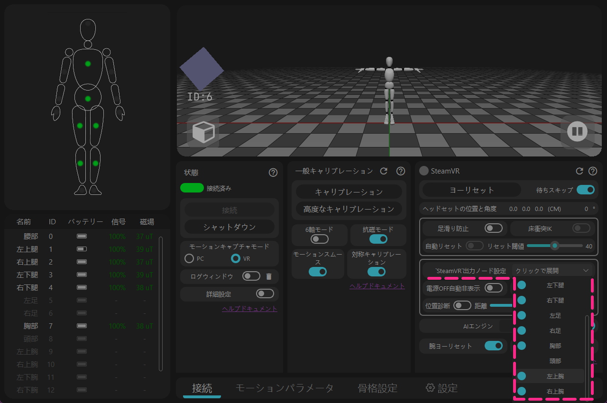
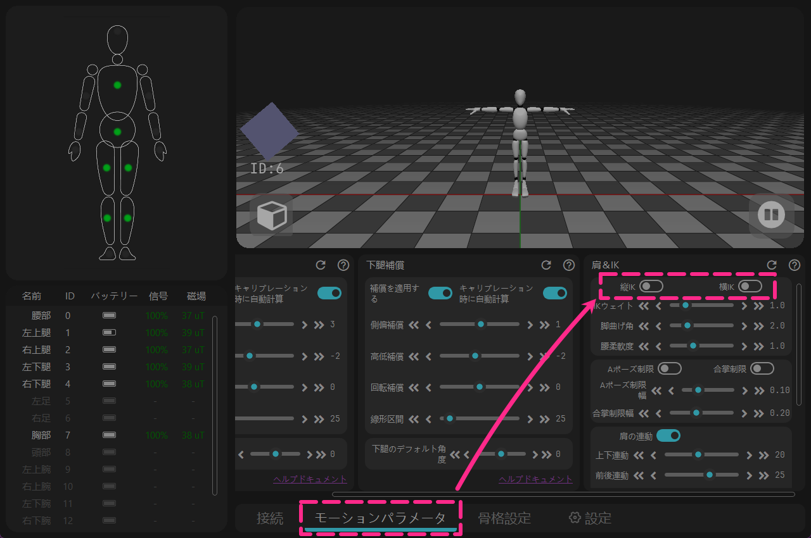
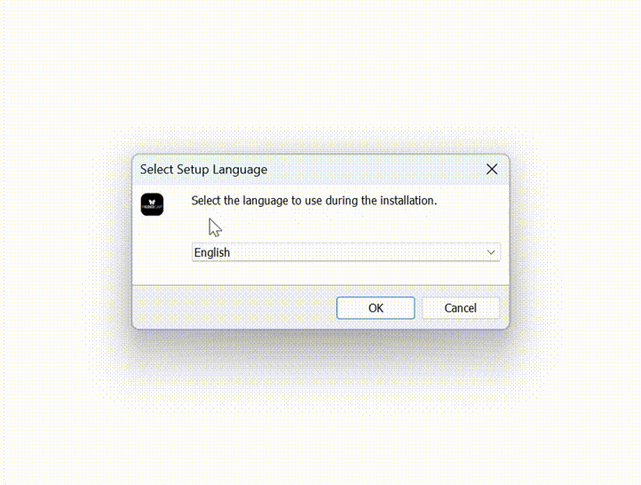

<!-- ==================== Flag A: Install software Start ==================== -->
<div style="border-left: 6px solid #88b49c; padding-left: 20px; margin-top: 10px; margin-bottom: 20px;">

<span id="ソフトウェアダウンロード" class="legacy-anchor-alias" aria-hidden="true"></span>

## ダウンロード {#software-download-toc}
<h2 class="tutorial-heading-flag" style="background: #88b49c; margin-top: 0; display: inline-block;">ダウンロード</h2>

<div class="os-switch">
<input type="radio" name="os-platform" id="os-platform-win" />
<input type="radio" name="os-platform" id="os-platform-linux" />
<input type="radio" name="os-platform" id="os-platform-android" />

<div class="os-switch-tabs" role="group" aria-label="オペレーティングシステムを選択">
<label class="os-switch-tab os-switch-tab-win" for="os-platform-win">
<svg class="os-switch-tab-icon" viewBox="0 0 24 24" width="22" height="22" aria-hidden="true" focusable="false"><path d="M0,0H11.377V11.372H0ZM12.623,0H24V11.372H12.623ZM0,12.623H11.377V24H0Zm12.623,0H24V24H12.623"></path></svg>
<span class="os-switch-tab-name">Windows</span>
</label>
<label class="os-switch-tab os-switch-tab-linux" for="os-platform-linux">
<svg class="os-switch-tab-icon" viewBox="0 0 24 24" width="22" height="22" aria-hidden="true" focusable="false"><path d="M12.504 0c-.155 0-.315.008-.48.021-4.226.333-3.105 4.807-3.17 6.298-.076 1.092-.3 1.953-1.05 3.02-.885 1.051-2.127 2.75-2.716 4.521-.278.832-.41 1.684-.287 2.489a.424.424 0 00-.11.135c-.26.268-.45.6-.663.839-.199.199-.485.267-.797.4-.313.136-.658.269-.864.68-.09.189-.136.394-.132.602 0 .199.027.4.055.536.058.399.116.728.04.97-.249.68-.28 1.145-.106 1.484.174.334.535.47.94.601.81.2 1.91.135 2.774.6.926.466 1.866.67 2.616.47.526-.116.97-.464 1.208-.946.587-.003 1.23-.269 2.26-.334.699-.058 1.574.267 2.577.2.025.134.063.198.114.333l.003.003c.391.778 1.113 1.132 1.884 1.071.771-.06 1.592-.536 2.257-1.306.631-.765 1.683-1.084 2.378-1.503.348-.199.629-.469.649-.853.023-.4-.2-.811-.714-1.376v-.097l-.003-.003c-.17-.2-.25-.535-.338-.926-.085-.401-.182-.786-.492-1.046h-.003c-.059-.054-.123-.067-.188-.135a.357.357 0 00-.19-.064c.431-1.278.264-2.55-.173-3.694-.533-1.41-1.465-2.638-2.175-3.483-.796-1.005-1.576-1.957-1.56-3.368.026-2.152.236-6.133-3.544-6.139zm.529 3.405h.013c.213 0 .396.062.584.198.19.135.33.332.438.533.105.259.158.459.166.724 0-.02.006-.04.006-.06v.105a.086.086 0 01-.004-.021l-.004-.024a1.807 1.807 0 01-.15.706.953.953 0 01-.213.335.71.71 0 00-.088-.042c-.104-.045-.198-.064-.284-.133a1.312 1.312 0 00-.22-.066c.05-.06.146-.133.183-.198.053-.128.082-.264.088-.402v-.02a1.21 1.21 0 00-.061-.4c-.045-.134-.101-.2-.183-.333-.084-.066-.167-.132-.267-.132h-.016c-.093 0-.176.03-.262.132a.8.8 0 00-.205.334 1.18 1.18 0 00-.09.4v.019c.002.089.008.179.02.267-.193-.067-.438-.135-.607-.202a1.635 1.635 0 01-.018-.2v-.02a1.772 1.772 0 01.15-.768c.082-.22.232-.406.43-.533a.985.985 0 01.594-.2zm-2.962.059h.036c.142 0 .27.048.399.135.146.129.264.288.344.465.09.199.14.4.153.667v.004c.007.134.006.2-.002.266v.08c-.03.007-.056.018-.083.024-.152.055-.274.135-.393.2.012-.09.013-.18.003-.267v-.015c-.012-.133-.04-.2-.082-.333a.613.613 0 00-.166-.267.248.248 0 00-.183-.064h-.021c-.071.006-.13.04-.186.132a.552.552 0 00-.12.27.944.944 0 00-.023.33v.015c.012.135.037.2.08.334.046.134.098.2.166.268.01.009.02.018.034.024-.07.057-.117.07-.176.136a.304.304 0 01-.131.068 2.62 2.62 0 01-.275-.402 1.772 1.772 0 01-.155-.667 1.759 1.759 0 01.08-.668 1.43 1.43 0 01.283-.535c.128-.133.26-.2.418-.2zm1.37 1.706c.332 0 .733.065 1.216.399.293.2.523.269 1.052.468h.003c.255.136.405.266.478.399v-.131a.571.571 0 01.016.47c-.123.31-.516.643-1.063.842v.002c-.268.135-.501.333-.775.465-.276.135-.588.292-1.012.267a1.139 1.139 0 01-.448-.067 3.566 3.566 0 01-.322-.198c-.195-.135-.363-.332-.612-.465v-.005h-.005c-.4-.246-.616-.512-.686-.71-.07-.268-.005-.47.193-.6.224-.135.38-.271.483-.336.104-.074.143-.102.176-.131h.002v-.003c.169-.202.436-.47.839-.601.139-.036.294-.065.466-.065zm2.8 2.142c.358 1.417 1.196 3.475 1.735 4.473.286.534.855 1.659 1.102 3.024.156-.005.33.018.513.064.646-1.671-.546-3.467-1.089-3.966-.22-.2-.232-.335-.123-.335.59.534 1.365 1.572 1.646 2.757.13.535.16 1.104.021 1.67.067.028.135.06.205.067 1.032.534 1.413.938 1.23 1.537v-.043c-.06-.003-.12 0-.18 0h-.016c.151-.467-.182-.825-1.065-1.224-.915-.4-1.646-.336-1.77.465-.008.043-.013.066-.018.135-.068.023-.139.053-.209.064-.43.268-.662.669-.793 1.187-.13.533-.17 1.156-.205 1.869v.003c-.02.334-.17.838-.319 1.35-1.5 1.072-3.58 1.538-5.348.334a2.645 2.645 0 00-.402-.533 1.45 1.45 0 00-.275-.333c.182 0 .338-.03.465-.067a.615.615 0 00.314-.334c.108-.267 0-.697-.345-1.163-.345-.467-.931-.995-1.788-1.521-.63-.4-.986-.87-1.15-1.396-.165-.534-.143-1.085-.015-1.645.245-1.07.873-2.11 1.274-2.763.107-.065.037.135-.408.974-.396.751-1.14 2.497-.122 3.854a8.123 8.123 0 01.647-2.876c.564-1.278 1.743-3.504 1.836-5.268.048.036.217.135.289.202.218.133.38.333.59.465.21.201.477.335.876.335.039.003.075.006.11.006.412 0 .73-.134.997-.268.29-.134.52-.334.74-.4h.005c.467-.135.835-.402 1.044-.7zm2.185 8.958c.037.6.343 1.245.882 1.377.588.134 1.434-.333 1.791-.765l.211-.01c.315-.007.577.01.847.268l.003.003c.208.199.305.53.391.876.085.4.154.78.409 1.066.486.527.645.906.636 1.14l.003-.007v.018l-.003-.012c-.015.262-.185.396-.498.595-.63.401-1.746.712-2.457 1.57-.618.737-1.37 1.14-2.036 1.191-.664.053-1.237-.2-1.574-.898l-.005-.003c-.21-.4-.12-1.025.056-1.69.176-.668.428-1.344.463-1.897.037-.714.076-1.335.195-1.814.12-.465.308-.797.641-.984l.045-.022zm-10.814.049h.01c.053 0 .105.005.157.014.376.055.706.333 1.023.752l.91 1.664.003.003c.243.533.754 1.064 1.189 1.637.434.598.77 1.131.729 1.57v.006c-.057.744-.48 1.148-1.125 1.294-.645.135-1.52.002-2.395-.464-.968-.536-2.118-.469-2.857-.602-.369-.066-.61-.2-.723-.4-.11-.2-.113-.602.123-1.23v-.004l.002-.003c.117-.334.03-.752-.027-1.118-.055-.401-.083-.71.043-.94.16-.334.396-.4.69-.533.294-.135.64-.202.915-.47h.002v-.002c.256-.268.445-.601.668-.838.19-.201.38-.336.663-.336zm7.159-9.074c-.435.201-.945.535-1.488.535-.542 0-.97-.267-1.28-.466-.154-.134-.28-.268-.373-.335-.164-.134-.144-.333-.074-.333.109.016.129.134.199.2.096.066.215.2.36.333.292.2.68.467 1.167.467.485 0 1.053-.267 1.398-.466.195-.135.445-.334.648-.467.156-.136.149-.267.279-.267.128.016.034.134-.147.332a8.097 8.097 0 01-.69.468zm-1.082-1.583V5.64c-.006-.02.013-.042.029-.05.074-.043.18-.027.26.004.063 0 .16.067.15.135-.006.049-.085.066-.135.066-.055 0-.092-.043-.141-.068-.052-.018-.146-.008-.163-.065zm-.551 0c-.02.058-.113.049-.166.066-.047.025-.086.068-.14.068-.05 0-.13-.02-.136-.068-.01-.066.088-.133.15-.133.08-.031.184-.047.259-.005.019.009.036.03.03.05v.02h.003z"></path></svg>
<span class="os-switch-tab-name">Linux</span>
</label>
<label class="os-switch-tab os-switch-tab-android" for="os-platform-android">
<svg class="os-switch-tab-icon" viewBox="0 0 24 24" width="22" height="22" aria-hidden="true" focusable="false"><path d="M18.4395 5.5586c-.675 1.1664-1.352 2.3318-2.0274 3.498-.0366-.0155-.0742-.0286-.1113-.043-1.8249-.6957-3.484-.8-4.42-.787-1.8551.0185-3.3544.4643-4.2597.8203-.084-.1494-1.7526-3.021-2.0215-3.4864a1.1451 1.1451 0 0 0-.1406-.1914c-.3312-.364-.9054-.4859-1.379-.203-.475.282-.7136.9361-.3886 1.5019 1.9466 3.3696-.0966-.2158 1.9473 3.3593.0172.031-.4946.2642-1.3926 1.0177C2.8987 12.176.452 14.772 0 18.9902h24c-.119-1.1108-.3686-2.099-.7461-3.0683-.7438-1.9118-1.8435-3.2928-2.7402-4.1836a12.1048 12.1048 0 0 0-2.1309-1.6875c.6594-1.122 1.312-2.2559 1.9649-3.3848.2077-.3615.1886-.7956-.0079-1.1191a1.1001 1.1001 0 0 0-.8515-.5332c-.5225-.0536-.9392.3128-1.0488.5449zm-.0391 8.461c.3944.5926.324 1.3306-.1563 1.6503-.4799.3197-1.188.0985-1.582-.4941-.3944-.5927-.324-1.3307.1563-1.6504.4727-.315 1.1812-.1086 1.582.4941zM7.207 13.5273c.4803.3197.5506 1.0577.1563 1.6504-.394.5926-1.1038.8138-1.584.4941-.48-.3197-.5503-1.0577-.1563-1.6504.4008-.6021 1.1087-.8106 1.584-.4941z"></path></svg>
<span class="os-switch-tab-name">Android</span>
</label>
</div>

<div class="os-switch-panel os-switch-panel-win">

Windows 版は現在 Release 版と Beta 版を提供しています。以下のダウンロードリンクをクリックしてください。<br />
Beta 版は公開テスト版であり、磁場干渉が顕著なエリアでの効果がより優れていますが、まだ大規模な検証は行われていません。

<div class="os-switch-downloads">
<a class="os-switch-download" href="https://doc.rebocap.com/img/files/rebocap_release_v01.exe">
<span class="os-switch-download-main">Rebocap V01 をダウンロード</span>
<span class="os-switch-download-meta">正式版 · 現在の Release</span>
</a>
<a class="os-switch-download" style="display: none;" href="https://doc.rebocap.com/img/files/rebocap_release_v02_beta02.exe">
<span class="os-switch-download-main">Rebocap V02 Beta02 をダウンロード</span>
<span class="os-switch-download-meta">Beta 版 · 公開テスト</span>
</a>
<a class="os-switch-download" href="https://doc.rebocap.com/img/files/rebocap_release_v02%20beta02.2_gray02-1.exe">
<span class="os-switch-download-main">Rebocap V02 Beta02.2 をダウンロード</span>
<span class="os-switch-download-meta">Beta 版 · グレーリリース</span>
</a>
</div>


- バージョンの選択：\
  V01 - 磁場が安定している環境に適しており、ダンスに適しています。<br />
  V02 Beta02.2 - 一部の新しい UI モジュールを試したい場合のほか、プレイエリアに金属部品が多い場所やトランポリンなど磁場環境が良くない場所での使用に適しています。<br />


- システムドライブ以外（Cドライブ以外）へのインストールを推奨します。

<!-- ==================== Details Start ==================== -->

<details>
<summary> [ ファームウェア ] 対応バージョンと操作説明。</summary>
   &emsp;&emsp; 一部のファームウェアバージョンにはアルゴリズムの大きな変更が含まれており、古いソフトウェアと互換性がありません。 <br /> 


   &emsp;&emsp; 古いソフトウェアバージョンに戻す場合は、ファームウェアもダウングレードする必要があります。<br /> 

   &emsp;&emsp;&emsp; release_v01 - ◼️tracker : V6 / V7  ,  📡receiver : V6 / V7 <br /> 

   &emsp;&emsp;&emsp; release_v02 beta02 - ◼️tracker : V15  ,  📡receiver : V6 / V7 <br /> 

   &emsp;&emsp;&emsp; (未公開) release_v02 beta02.1 - ◼️tracker : V16  ,  📡receiver : V6 / V7 / V8 <br /> 

   &emsp;&emsp;&emsp; release_v02 beta02.2 - ◼️tracker : V16 / V17  ,  📡receiver : V6 / V7 / V8 <br /> 


<div style="display: flex; flex-direction: row; gap: 20px; flex-wrap: wrap; align-items: center; margin: 15px 0;">
<div style="flex: 1; min-width: 250px; text-align: center;">

<video autoPlay loop muted playsInline width="100%" src="/img/softawre_install/show_version_log.mp4"></video>

</div>
<div style="flex: 1.5; min-width: 250px;">

**ファームウェア操作説明**<br />
- ログウィンドウを開いて、各トラッカーの実際のファームウェアバージョンを確認します <br /> 
（ログウィンドウは、ソフトウェアの「接続と電源オフ」の下にあります）。

</div>
</div>

<br/>

- トラッカーはワイヤレス 📶 で更新されます。USB データケーブルは不要です。<br /> 
🚫 トラッカーとレシーバーを同時に更新しないでください。<br /> 


- 更新に失敗した場合は、トラッカーを再起動して再度更新をクリックする必要があります。<br /> 
&emsp;&emsp;🟩緑ランプ – 高速点滅：トラッカーは正常に動作しています<br /> 
&emsp;&emsp;🟩緑ランプ – 低速点滅：トラッカーはレシーバーの信号を待っています<br /> 
&emsp;&emsp;🟦青ランプ：トラッカーはファームウェアデータを受信しています<br /> 
&emsp;&emsp;🟨黄ランプ：更新失敗（手動で 🔘 ボタンを押して再起動し、再度更新してください）<br /> 
&emsp;&emsp;⬜白ランプ：更新成功（通常は10秒後に自動で再起動します。自動再起動できない場合は手動で再起動してください）<br /> 

- 📡レシーバーの更新が完了したら、USB を抜き差しし、🔄ソフトウェアを再起動してください。


</details>
<!-- ==================== Details End ==================== -->


<!-- ==================== Details Start ==================== -->
<details>
<summary>VR モードで V01 バージョンを使用する場合、以下の設定を変更する必要があります。</summary>

<div style="display: flex; flex-direction: row; gap: 20px; flex-wrap: wrap; align-items: center; margin: 15px 0;">
<div style="flex: 1; min-width: 250px; text-align: center;">



</div>
<div style="flex: 1.5; min-width: 250px;">
<strong>1 - 上腕トラッカーがない場合は、余分に表示されるトラッキングポイントを手動でオフにしてください。</strong><br />
['SteamVR'出力ノードの構成]を開く → [左/右上腕]をオフにする
<details className="plain-details"><summary>詳細</summary>
ソフトウェアは当初[関節の自動非表示]機能を使用して、未使用のトラッキングポイントを自動的に非表示にする予定でした。<br />
しかし、この機能では自動チェックできないことが判明し、V02 Beta02 ソフトウェアで修正されました。
</details>

</div>
</div>

<div style="display: flex; flex-direction: row; gap: 20px; flex-wrap: wrap; align-items: center; margin: 15px 0;">
<div style="flex: 1; min-width: 250px; text-align: center;">



</div>
<div style="flex: 1.5; min-width: 250px;">
<strong>2 - 全体で誤って動作し続ける機能をオフにしてください。</strong><br />
→ [モーションパラメータ] → [縦方向 IK & 横方向 IK] をオフにする
<details className="plain-details"><summary>詳細</summary>
この機能は本来[足の滑り防止]モジュール内のサブ機能となる予定でした。<br />
しかし、予期せず全体で動作し続ける状態になっていたため、V02 Beta02 ソフトウェアで修正されました。

</details>
</div>
</div>

</details>
<!-- ==================== Details End ==================== -->

注意事項：
> 現在、**Windows 版**は Windows 10 以降の OS バージョンのみをサポートしています。<br>
> ソフトウェアはインターネット接続環境で使用する必要があります。オフラインで使用したい場合は、スマートフォンのテザリング機能を使用してネットワークに接続し、ソフトウェアを起動して30秒待ってからネットワークを切断してください。<br>
> （[ログウィンドウ]でネットワーク検証の成功が表示されていれば、ネットワークを切断しても問題ありません）

</div>

<div class="os-switch-panel os-switch-panel-linux">

Linux は現在 Preview プレビュー版です。今回のリリースは、Linux 環境におけるプログラムコアの安定性を確認することが主な目的です。<br>
使用中に Bug が発生した場合は、Twitter（X）の関連投稿や Discord へのコメントをお待ちしています。

<div class="os-switch-downloads">
<a class="os-switch-download" href="https://doc.rebocap.com/img/files/rebocap-linux-preview-0.1-1.run">
<span class="os-switch-download-main">Rebocap Linux Preview 0.1 をダウンロード</span>
<span class="os-switch-download-meta">Linux · Preview プレビュー版</span>
</a>
</div>

Linux のデフォルトのインストールパスは `~/.local/opt/rebocap` です。

<!-- ==================== Details Start ==================== -->

<details>
<summary> [ ファームウェア ] 対応バージョンと操作説明。</summary>
   &emsp;&emsp; 一部のファームウェアバージョンにはアルゴリズムの大きな変更が含まれており、古いソフトウェアと互換性がありません。 <br /> 


   &emsp;&emsp; 古いソフトウェアバージョンに戻す場合は、ファームウェアもダウングレードする必要があります。<br /> 


   &emsp;&emsp;&emsp; Linux Preview 0.1 - ◼️tracker : V16 / V17 ,  📡receiver : V6 / V7 / V8 <br /> 


<div style="display: flex; flex-direction: row; gap: 20px; flex-wrap: wrap; align-items: center; margin: 15px 0;">
<div style="flex: 1; min-width: 250px; text-align: center;">

<video autoPlay loop muted playsInline width="100%" src="/img/softawre_install/show_version_log.mp4"></video>

</div>
<div style="flex: 1.5; min-width: 250px;">

**ファームウェア操作説明**<br />
- ログウィンドウを開いて、各トラッカーの実際のファームウェアバージョンを確認します <br /> 
（ログウィンドウは、ソフトウェアの「接続と電源オフ」の下にあります）。

</div>
</div>

<br/>

- トラッカーはワイヤレス 📶 で更新されます。USB データケーブルは不要です。<br /> 
🚫 トラッカーとレシーバーを同時に更新しないでください。<br /> 


- 更新に失敗した場合は、トラッカーを再起動して再度更新をクリックする必要があります。<br /> 
&emsp;&emsp;🟩緑ランプ – 高速点滅：トラッカーは正常に動作しています<br /> 
&emsp;&emsp;🟩緑ランプ – 低速点滅：トラッカーはレシーバーの信号を待っています<br /> 
&emsp;&emsp;🟦青ランプ：トラッカーはファームウェアデータを受信しています<br /> 
&emsp;&emsp;🟨黄ランプ：更新失敗（手動で 🔘 ボタンを押して再起動し、再度更新してください）<br /> 
&emsp;&emsp;⬜白ランプ：更新成功（通常は10秒後に自動で再起動します。自動再起動できない場合は手動で再起動してください）<br /> 

- 📡レシーバーの更新が完了したら、USB を抜き差しし、🔄ソフトウェアを再起動してください。


</details>
<!-- ==================== Details End ==================== -->

注意事項：
> 現在の Linux 版では、システム権限を必ず設定してください。[ログウィンドウ]で確認できます。<br>
> 正しく設定されていない場合、USB レシーバーの接続に影響し、「state -3」が繰り返し表示されることがあります。<br>
> <br>
> ソフトウェアはインターネット接続環境で使用する必要があります。オフラインで使用したい場合は、スマートフォンのテザリング機能を使用してネットワークに接続し、ソフトウェアを起動して30秒待ってからネットワークを切断してください。<br>
> （[ログウィンドウ]でネットワーク検証の成功が表示されていれば、ネットワークを切断しても問題ありません）

</div>

<div class="os-switch-panel os-switch-panel-android">

Android は現在 Preview プレビュー版です。今回のリリースは、Android 環境におけるプログラムコアの安定性を確認することが主な目的です。<br>
使用中に Bug が発生した場合は、Twitter（X）の関連投稿や Discord へのコメントをお待ちしています。

<div class="os-switch-downloads">
<a class="os-switch-download" href="https://doc.rebocap.com/img/files/ReboCapAndroid-Preview-0.1.apk">
<span class="os-switch-download-main">Rebocap Android Preview 0.1 をダウンロード</span>
<span class="os-switch-download-meta">Android · Preview プレビュー版</span>
</a>
</div>

<div class="os-switch-aux">
<div class="os-switch-aux-title">補助ツール（任意）</div>
<div class="os-switch-aux-grid">
<a class="os-switch-aux-tool" href="https://doc.rebocap.com/img/files/RebocapTransmitter-v1.0.18.apk">
<div class="os-switch-aux-info">
<span class="os-switch-aux-name">Rebocap レシーバーブリッジ App</span>
<span class="os-switch-aux-meta">Android APK · v1.0.18</span>
</div>
<span class="os-switch-aux-btn">ダウンロード ↓</span>
</a>
<a class="os-switch-aux-tool" href="https://doc.rebocap.com/img/files/RBC_OSC_forward_v1.0.0.apk">
<div class="os-switch-aux-info">
<span class="os-switch-aux-name">VRChat OSC 転送 App</span>
<span class="os-switch-aux-meta">Android APK · v1.0.0</span>
</div>
<span class="os-switch-aux-btn">ダウンロード ↓</span>
</a>
</div>
</div>


<!-- ==================== Details Start ==================== -->

<details>
<summary> [ ファームウェア ] 対応バージョンと操作説明。</summary>
   &emsp;&emsp; 一部のファームウェアバージョンにはアルゴリズムの大きな変更が含まれており、古いソフトウェアと互換性がありません。 <br /> 


   &emsp;&emsp; 古いソフトウェアバージョンに戻す場合は、ファームウェアもダウングレードする必要があります。<br /> 


   &emsp;&emsp;&emsp; Android Preview 0.1 - ◼️tracker : V16 / V17 ,  📡receiver : V6 / V7 / V8 <br /> 


<div style="display: flex; flex-direction: row; gap: 20px; flex-wrap: wrap; align-items: center; margin: 15px 0;">
<div style="flex: 1; min-width: 250px; text-align: center;">

<video autoPlay loop muted playsInline width="100%" src="/img/softawre_install/show_version_log.mp4"></video>

</div>
<div style="flex: 1.5; min-width: 250px;">

**ファームウェア操作説明**<br />
- ログウィンドウを開いて、各トラッカーの実際のファームウェアバージョンを確認します <br /> 
（ログウィンドウは、ソフトウェアの「接続と電源オフ」の下にあります）。

</div>
</div>

<br/>

- トラッカーはワイヤレス 📶 で更新されます。USB データケーブルは不要です。<br /> 
🚫 トラッカーとレシーバーを同時に更新しないでください。<br /> 


- 更新に失敗した場合は、トラッカーを再起動して再度更新をクリックする必要があります。<br /> 
&emsp;&emsp;🟩緑ランプ – 高速点滅：トラッカーは正常に動作しています<br /> 
&emsp;&emsp;🟩緑ランプ – 低速点滅：トラッカーはレシーバーの信号を待っています<br /> 
&emsp;&emsp;🟦青ランプ：トラッカーはファームウェアデータを受信しています<br /> 
&emsp;&emsp;🟨黄ランプ：更新失敗（手動で 🔘 ボタンを押して再起動し、再度更新してください）<br /> 
&emsp;&emsp;⬜白ランプ：更新成功（通常は10秒後に自動で再起動します。自動再起動できない場合は手動で再起動してください）<br /> 

- 📡レシーバーの更新が完了したら、USB を抜き差しし、🔄ソフトウェアを再起動してください。


</details>
<!-- ==================== Details End ==================== -->

注意事項：
> USB レシーバーは OTG データケーブルを使用して、Rebocap ソフトウェアを実行するデバイスに接続する必要があります。<br>
> ファームウェアの更新、ジャイロスコープおよび磁場の校正は、スマートフォンでの操作を推奨します。<br>
> データコネクタが劣化していると接続が切れやすいため、OSC 転送アプリまたはレシーバーブリッジアプリを使用してソフトウェアの接続を維持できます。<br>
> <br>
> ソフトウェアはインターネット接続環境で使用する必要があります。オフラインで使用したい場合は、ソフトウェアを起動して30秒待ってからネットワークを切断してください。<br>
> （[ログウィンドウ]でネットワーク検証の成功が表示されていれば、ネットワークを切断しても問題ありません）

</div>
</div>


</div>
<!-- ==================== Flag A: Install software End ==================== -->


## ソフトウェアインストール

<div class="os-switch-install os-switch-install-win">

1. rebocap_release_v01.exe をダブルクリックします（現在のバージョンは rebocap_release_v01.exe）
2. 下図のとおりにインストールを行います
3. rebocap ソフトウェアを起動します
   * スタートメニューから起動
   * デスクトップのショートカットから起動



</div>

<div class="os-switch-install os-switch-install-linux">

Linux 版は `.run` インストールパッケージを使用します：

1. インストールパッケージのあるディレクトリでターミナルを開き、まず実行権限を付与します：`chmod +x rebocap-linux-preview-0.1-1.run`
2. インストーラーを実行します：`./rebocap-linux-preview-0.1-1.run`
3. 画面の指示に従ってインストールを完了します。デフォルトのインストールパスは `~/.local/opt/rebocap` です
4. インストール完了後、アプリケーションメニューまたはインストールディレクトリから Rebocap を起動します

自動システム認証に失敗した場合に手動で補えるよう、以下を実行してください：

**デバイス権限の設定（必須。設定しないとレシーバーが接続できません）**

```bash
sudo bash ~/.local/opt/rebocap/linux/install_linux_permissions.sh --install --user "$USER"
```

実行後にレシーバーを一度抜き差ししてから、ソフトウェアを起動してください。

</div>

<div class="os-switch-install os-switch-install-android">

Android 版は `.apk` インストールパッケージを使用します：

1. `ReboCapAndroid-Preview-0.1.apk` をスマートフォンに転送し、タップしてインストールします
2. システムから確認された場合は、「提供元不明のアプリ」のインストールを許可してください
3. インストール完了後、Rebocap を起動します
4. OTG データケーブルで USB レシーバーを接続し、ソフトウェアの指示に従って接続を完了します

</div>

## ソフトウェア更新情報

### 更新履歴

#### 2026-11-11 更新

**ファームウェア**
1. 📡レシーバーファームウェア V8 ：
    > 従来の CDC シリアルポートドライバを廃止し、vendor モードを使用することで転送速度がより高速になります（基本的に影響はありません）。<br> 主な理由は、シリアルポートドライバが他のシステムプログラムやシステムコンポーネントの影響を受けやすく、安定性が非常に悪いためです。<br>注意：一度新しいファームウェアにアップグレードすると、最新バージョンのソフトウェアでしか使用できません。古いバージョンでは認識されないため、古いバージョンのソフトウェアを使用するにはレシーバーのファームウェアをダウングレードする必要があります。

2. ◼️トラッカーファームウェア V17：
    > 新旧のアルゴリズムでデフォルトの向きが一致しない問題を修正（v15 ファームウェアではボタンで再起動すると右へ90°回転していました）、<br>非耐磁モードをサポート（従来は耐磁スイッチが v15 ファームウェアに効かず、ダンスに適していませんでした）、<br>磁力計のバイアスが400を超えると表示が異常になる問題を修正（トラッカーを磁石に近づける人がいたため）。

**ソフトウェア**
1. Linux 版と Android 版を新規追加。主に、コアのバグが発生するかどうか、および一部 UI の操作ロジックの変更点を観察するためです。
    > Linux 版の UI は Windows と一致させ、Android 版は再設計しましたが、操作の動線は Windows 版に近いものとし、縦画面と横画面の切り替えをサポートします。

2. 3D プレビューアを OGRE に変更
    > ただし、NVIDIA のグラフィックドライバは GPU 使用率を正規化して表示する可能性があり、GPU 使用率が誤って 20%〜40% と表示されることがあります。AMD のグラフィックカードではこの「奇妙な」表示は発生せず、今後の調査と調整が必要です。

3. ファームウェアアップグレードを独立したウィンドウとして提供
    >v7 ～ v15 のファームウェアアップグレードは多くの人にとって高いハードルとなっていたため、このウィンドウを改善しました。

4. [6軸モード]を[地磁気補助]に改名し、スイッチの向きを反転
    > 各言語のプレイヤーが6軸を6個のトラッカーモードだと誤解していることが分かりました。

5. 動作校正のロジックを調整
    > [緊急停止]ボタンを追加し、誤って校正を開始した場合に停止できるようにしました。<br>折りたたみ式の拡張バーを追加し、適切に調整すると校正のカウントダウンが非常に短くなり、前回の校正記録の保持をサポートします（有効にしない場合はソフトウェアを閉じてから7分で失効します）。

6. トラッカーの「ダブルタップ」を[タップ割り当て]に変更
    > プレイヤーがタップマクロをカスタマイズでき、誰をタップするか、タップ間隔、どのショートカットをトリガーするかを自由に組み合わせられます。

7. 音量スライダーを追加
    > ソフトウェアの通知音を直接オン／オフできるようになります

8. VMC の高さの差のバグを解消
    > 以前、VMC が地面より一段高くなるバグは、地面から hips までの高さが誤って2倍で出力されていたことが原因でした。

9. 使用率の高い一部の機能について[高度な設定]の制御を削除


**end.** UI インタラクションの改善は継続的に行っていきます。また、皆さんの使用感に関する統計項目には、まだ調整が必要なものが数多くあります。


#### 2026-02-04 更新: rebocap Release V02 Beta02
1. ファームウェアを v15 に更新し、耐磁性と6軸アルゴリズムを最適化。耐磁安定性と6軸の安定性が向上  
   > 動的状況（ずっとダンスしている、磁場が悪い等）では依然として6軸性能に近いですが、新ファームウェアは磁場が良好な場合、動的ダンスでも常に補正が可能です（旧ファームウェアは静止状態が間にあることで補正されていました）。
2. 遅延自動シャットダウン機能を追加。新しいレシーバーファームウェアへのアップグレードが必要です。
3. 方位校正をリファクタリングし、PC方位校正機能を追加：  
   > 注意：PC方位校正時も全身Aポーズで行い、前腕と手のひらを前に上げるとベターです。Sポーズでも、座って手を前に伸ばしても構いません。
4. ソフトが予期せずクラッシュしても、5分以内に再起動すれば前回の校正結果が自動適用され、再度の動作校正は不要。
5. 方位校正時に磁場をリセット（相対磁場1.0に直接リセット）。ベッドに横たわっている場合は、校正時の磁場を初期磁場としてリセットします。
6. 簡易磁場校正（8の字描き）の制限を解除し、デフォルトでクリック可能に  
   > デフォルトでは8個のセンサーを同時に校正できます。`data` ディレクトリにファイル `data/__no_limit_max_nodes__` を追加すると、校正数の制限を解除できます。
7. 横になった後に足裏の動きでキャラクタ骨格が分離する可能性があるバグを修正

その他の更新：
1. ソフト上部にバージョン番号を表示
2. 自動非表示（電源オフのセンサー）機能が無効になるバグを修正
3. 足裏滑り防止モードをオフにすると、足裏が地面より下に行くことができ、IK を削除
4. レシーバーを抜いた後にキャラクタ姿勢がフリーズするバグを解決
5. 骨格設定にVR側面オフセットを追加（モデルのHMD取付点が眉間ではなく少し横にある場合など、実際の状況に合わせて調整可能）


#### 2025-12-03 更新: rebocap Release V01
**VR 部分：**
1. その場歩行機能を追加。足踏みでスティックを安定して前進させることができます。詳細はヘルプドキュメント（高度な機能）を参照してください。
2. VR 仮想地面高さを追加し、-100cm〜100cm の範囲で調整可能（高度な機能）
3. コントローラー置き換え機能を追加。オンにすると手のひらトラッカーがコントローラーの位置と姿勢を置き換えます。詳細はヘルプドキュメント（高度な機能）を参照してください。
4. SteamVR プラグインをアップグレードし、トラッカーがコントローラーとして認識される現象を修正
5. VR モードで骨格をインポートした際、足裏の位置が誤る問題（主に IK 計算に影響）を修正し、キャラクタの足裏および全体が下がる問題を解決
6. 方位リセット後、自動リセット機能を自動的にトリガー
7. 電源オフのノードを自動非表示にするスイッチを追加。オンにすると電源オフのノードが自動で非表示になります。
8. VR の胸腰ヘッドトラッキング機能を復活

**PC 部分：**
1. 動作校正アルゴリズムを更新し、Tポーズの腕姿勢要求を緩和。両腕が非対称になる問題を解決
2. 腕 IK を追加。合掌 IK は合掌状態での腕交差問題を可能な限り低減し、Aポーズ IK は肩幅が狭いモデルで腕が垂直の際に発生する深刻な貫通問題を解決
3. MMD 動作エクスポートと PMX モデルインポートを追加。注意：VMD 動作には IK がないため、IK 制約を自分で削除する必要があります。
4. アニメーションフレームレートジャンプ、最大999のバグを修正

**共通部分：**
1. UI を更新し、機能ごとに区分。いくつかの用語翻訳を最適化し、機能説明をよりユーザーフレンドリーに
2. 高度設定スイッチ、設定エクスポート・ロード、デフォルト設定復元機能を追加
3. 静止判定が通らず校正できない問題を削除
4. 自動接続機能を追加。今後は接続ボタンを手動でクリックする必要なし
5. レシーバーファームウェアアップグレードを追加し、CPU 高負荷によるパケットロス問題を解決（特に AMD CPU）
6. トラッカーを v07 ファームウェアにアップグレードし、全体的により安定
7. 一部ノードのみを選択して6軸を行う機能を追加（高度な機能）
8. 一部ジャイロ校正後にゼロにならないバグを修正

**その他：**
1. 起動画面を追加し、長時間バックグラウンドで待機することを防止  
2. 3D ウィンドウの安定性を強化  
3. 認証サーバーを3つ（中国、香港、米国）に増設し、そのうち1つでも認証に成功すれば通過とする  
4. キャリブレーション時にまれにデータ送信失敗と表示されるバグを修正（実際には送信に成功していた）  
5. デフォルトボーンをコミュニティ推奨のボーンに変更し、その他のデフォルトパラメータも調整  
6. 6軸スイッチのオン／オフ時に再キャリブレーションの案内を追加  
7. 6軸の横方向バイアス補正問題を修正  


<span id="todo（順不同・主要な更新内容のみ）" class="legacy-anchor-alias" aria-hidden="true"></span>

### TODO（順不同・主要な更新内容のみ）

- IK 効果の最適化  
- ソフトウェアの安定性を最適化  
- VR 3点トラッキングモード対応  
- PC 全身6点トラッキングモード対応  
- ドキュメントの多言語対応（文書が安定した後に追加予定）  


### 旧バージョン
> **ご注意ください：preview05 以前のバージョンは 2025-11-29 以降の新しいハードウェアをサポートしていません。新しいハードウェアをご使用の場合は最新の Release 版または Beta 版をダウンロードしてください。**
