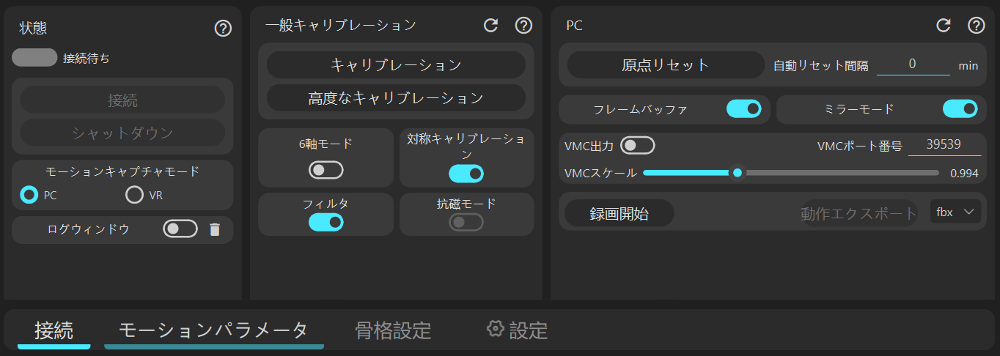
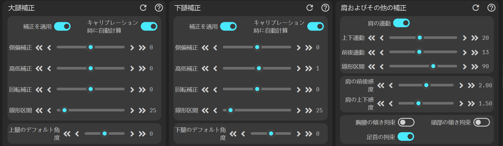
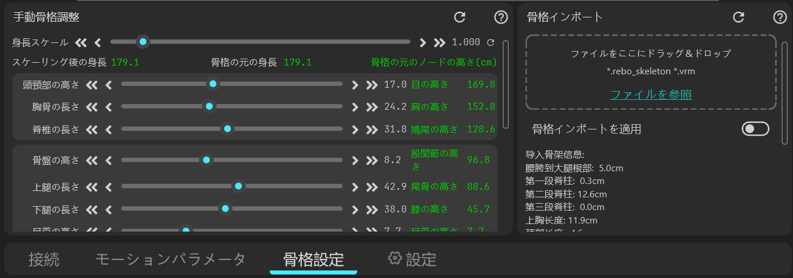
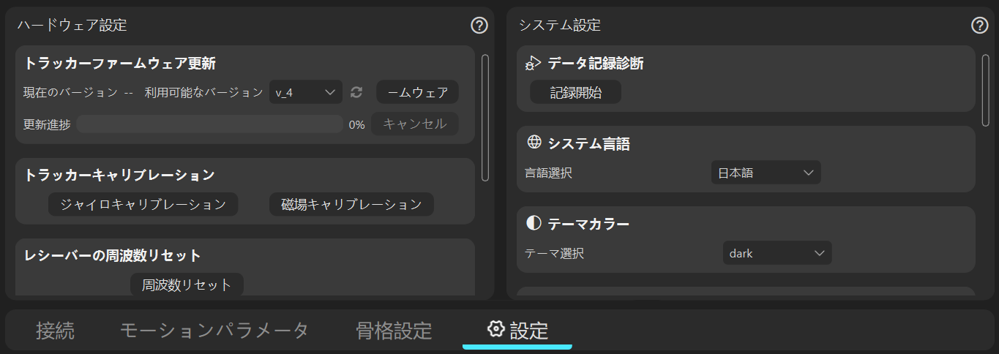

# [接続パネル](connect)

[詳細を見る](connect)

# [モーションキャプチャパラメータパネル](cap_param)

[詳細を見る](cap_param)

# [スケルトン調整パネル](skeleton_setting)

[詳細を見る](skeleton_setting)

# [設定パネル](config)

[詳細を見る](config)

                     