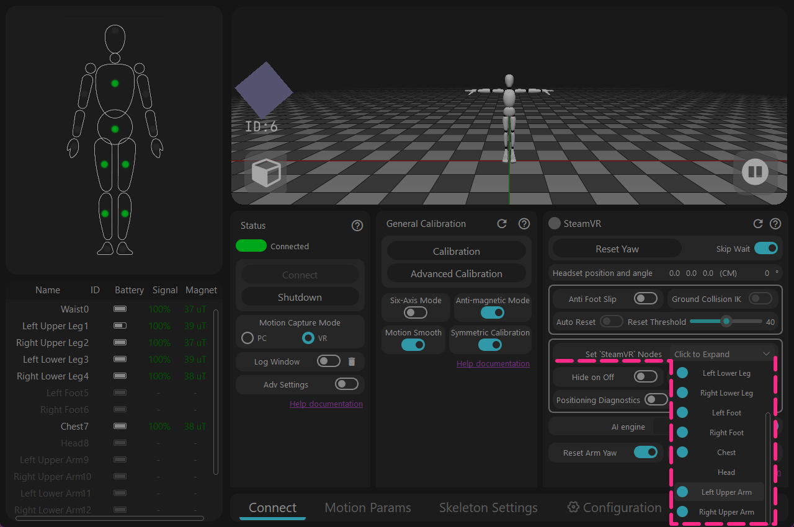
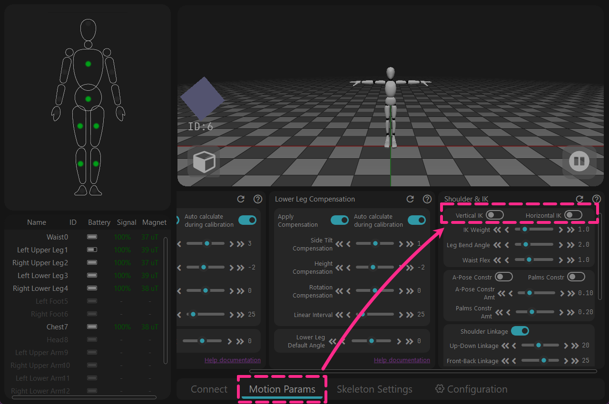
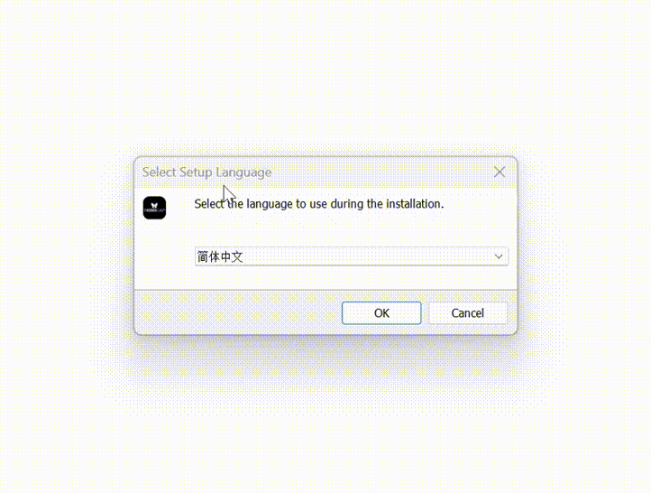

<!-- ==================== Flag A: Install software Start ==================== -->
<div style="border-left: 6px solid #88b49c; padding-left: 20px; margin-top: 10px; margin-bottom: 20px;">

## 다운로드 {#software-download-toc}
<h2 class="tutorial-heading-flag" style="background: #88b49c; margin-top: 0; display: inline-block;">다운로드</h2>

<div class="os-switch">
<input type="radio" name="os-platform" id="os-platform-win" />
<input type="radio" name="os-platform" id="os-platform-linux" />
<input type="radio" name="os-platform" id="os-platform-android" />

<div class="os-switch-tabs" role="group" aria-label="운영 체제 선택">
<label class="os-switch-tab os-switch-tab-win" for="os-platform-win">
<svg class="os-switch-tab-icon" viewBox="0 0 24 24" width="22" height="22" aria-hidden="true" focusable="false"><path d="M0,0H11.377V11.372H0ZM12.623,0H24V11.372H12.623ZM0,12.623H11.377V24H0Zm12.623,0H24V24H12.623"></path></svg>
<span class="os-switch-tab-name">Windows</span>
</label>
<label class="os-switch-tab os-switch-tab-linux" for="os-platform-linux">
<svg class="os-switch-tab-icon" viewBox="0 0 24 24" width="22" height="22" aria-hidden="true" focusable="false"><path d="M12.504 0c-.155 0-.315.008-.48.021-4.226.333-3.105 4.807-3.17 6.298-.076 1.092-.3 1.953-1.05 3.02-.885 1.051-2.127 2.75-2.716 4.521-.278.832-.41 1.684-.287 2.489a.424.424 0 00-.11.135c-.26.268-.45.6-.663.839-.199.199-.485.267-.797.4-.313.136-.658.269-.864.68-.09.189-.136.394-.132.602 0 .199.027.4.055.536.058.399.116.728.04.97-.249.68-.28 1.145-.106 1.484.174.334.535.47.94.601.81.2 1.91.135 2.774.6.926.466 1.866.67 2.616.47.526-.116.97-.464 1.208-.946.587-.003 1.23-.269 2.26-.334.699-.058 1.574.267 2.577.2.025.134.063.198.114.333l.003.003c.391.778 1.113 1.132 1.884 1.071.771-.06 1.592-.536 2.257-1.306.631-.765 1.683-1.084 2.378-1.503.348-.199.629-.469.649-.853.023-.4-.2-.811-.714-1.376v-.097l-.003-.003c-.17-.2-.25-.535-.338-.926-.085-.401-.182-.786-.492-1.046h-.003c-.059-.054-.123-.067-.188-.135a.357.357 0 00-.19-.064c.431-1.278.264-2.55-.173-3.694-.533-1.41-1.465-2.638-2.175-3.483-.796-1.005-1.576-1.957-1.56-3.368.026-2.152.236-6.133-3.544-6.139zm.529 3.405h.013c.213 0 .396.062.584.198.19.135.33.332.438.533.105.259.158.459.166.724 0-.02.006-.04.006-.06v.105a.086.086 0 01-.004-.021l-.004-.024a1.807 1.807 0 01-.15.706.953.953 0 01-.213.335.71.71 0 00-.088-.042c-.104-.045-.198-.064-.284-.133a1.312 1.312 0 00-.22-.066c.05-.06.146-.133.183-.198.053-.128.082-.264.088-.402v-.02a1.21 1.21 0 00-.061-.4c-.045-.134-.101-.2-.183-.333-.084-.066-.167-.132-.267-.132h-.016c-.093 0-.176.03-.262.132a.8.8 0 00-.205.334 1.18 1.18 0 00-.09.4v.019c.002.089.008.179.02.267-.193-.067-.438-.135-.607-.202a1.635 1.635 0 01-.018-.2v-.02a1.772 1.772 0 01.15-.768c.082-.22.232-.406.43-.533a.985.985 0 01.594-.2zm-2.962.059h.036c.142 0 .27.048.399.135.146.129.264.288.344.465.09.199.14.4.153.667v.004c.007.134.006.2-.002.266v.08c-.03.007-.056.018-.083.024-.152.055-.274.135-.393.2.012-.09.013-.18.003-.267v-.015c-.012-.133-.04-.2-.082-.333a.613.613 0 00-.166-.267.248.248 0 00-.183-.064h-.021c-.071.006-.13.04-.186.132a.552.552 0 00-.12.27.944.944 0 00-.023.33v.015c.012.135.037.2.08.334.046.134.098.2.166.268.01.009.02.018.034.024-.07.057-.117.07-.176.136a.304.304 0 01-.131.068 2.62 2.62 0 01-.275-.402 1.772 1.772 0 01-.155-.667 1.759 1.759 0 01.08-.668 1.43 1.43 0 01.283-.535c.128-.133.26-.2.418-.2zm1.37 1.706c.332 0 .733.065 1.216.399.293.2.523.269 1.052.468h.003c.255.136.405.266.478.399v-.131a.571.571 0 01.016.47c-.123.31-.516.643-1.063.842v.002c-.268.135-.501.333-.775.465-.276.135-.588.292-1.012.267a1.139 1.139 0 01-.448-.067 3.566 3.566 0 01-.322-.198c-.195-.135-.363-.332-.612-.465v-.005h-.005c-.4-.246-.616-.512-.686-.71-.07-.268-.005-.47.193-.6.224-.135.38-.271.483-.336.104-.074.143-.102.176-.131h.002v-.003c.169-.202.436-.47.839-.601.139-.036.294-.065.466-.065zm2.8 2.142c.358 1.417 1.196 3.475 1.735 4.473.286.534.855 1.659 1.102 3.024.156-.005.33.018.513.064.646-1.671-.546-3.467-1.089-3.966-.22-.2-.232-.335-.123-.335.59.534 1.365 1.572 1.646 2.757.13.535.16 1.104.021 1.67.067.028.135.06.205.067 1.032.534 1.413.938 1.23 1.537v-.043c-.06-.003-.12 0-.18 0h-.016c.151-.467-.182-.825-1.065-1.224-.915-.4-1.646-.336-1.77.465-.008.043-.013.066-.018.135-.068.023-.139.053-.209.064-.43.268-.662.669-.793 1.187-.13.533-.17 1.156-.205 1.869v.003c-.02.334-.17.838-.319 1.35-1.5 1.072-3.58 1.538-5.348.334a2.645 2.645 0 00-.402-.533 1.45 1.45 0 00-.275-.333c.182 0 .338-.03.465-.067a.615.615 0 00.314-.334c.108-.267 0-.697-.345-1.163-.345-.467-.931-.995-1.788-1.521-.63-.4-.986-.87-1.15-1.396-.165-.534-.143-1.085-.015-1.645.245-1.07.873-2.11 1.274-2.763.107-.065.037.135-.408.974-.396.751-1.14 2.497-.122 3.854a8.123 8.123 0 01.647-2.876c.564-1.278 1.743-3.504 1.836-5.268.048.036.217.135.289.202.218.133.38.333.59.465.21.201.477.335.876.335.039.003.075.006.11.006.412 0 .73-.134.997-.268.29-.134.52-.334.74-.4h.005c.467-.135.835-.402 1.044-.7zm2.185 8.958c.037.6.343 1.245.882 1.377.588.134 1.434-.333 1.791-.765l.211-.01c.315-.007.577.01.847.268l.003.003c.208.199.305.53.391.876.085.4.154.78.409 1.066.486.527.645.906.636 1.14l.003-.007v.018l-.003-.012c-.015.262-.185.396-.498.595-.63.401-1.746.712-2.457 1.57-.618.737-1.37 1.14-2.036 1.191-.664.053-1.237-.2-1.574-.898l-.005-.003c-.21-.4-.12-1.025.056-1.69.176-.668.428-1.344.463-1.897.037-.714.076-1.335.195-1.814.12-.465.308-.797.641-.984l.045-.022zm-10.814.049h.01c.053 0 .105.005.157.014.376.055.706.333 1.023.752l.91 1.664.003.003c.243.533.754 1.064 1.189 1.637.434.598.77 1.131.729 1.57v.006c-.057.744-.48 1.148-1.125 1.294-.645.135-1.52.002-2.395-.464-.968-.536-2.118-.469-2.857-.602-.369-.066-.61-.2-.723-.4-.11-.2-.113-.602.123-1.23v-.004l.002-.003c.117-.334.03-.752-.027-1.118-.055-.401-.083-.71.043-.94.16-.334.396-.4.69-.533.294-.135.64-.202.915-.47h.002v-.002c.256-.268.445-.601.668-.838.19-.201.38-.336.663-.336zm7.159-9.074c-.435.201-.945.535-1.488.535-.542 0-.97-.267-1.28-.466-.154-.134-.28-.268-.373-.335-.164-.134-.144-.333-.074-.333.109.016.129.134.199.2.096.066.215.2.36.333.292.2.68.467 1.167.467.485 0 1.053-.267 1.398-.466.195-.135.445-.334.648-.467.156-.136.149-.267.279-.267.128.016.034.134-.147.332a8.097 8.097 0 01-.69.468zm-1.082-1.583V5.64c-.006-.02.013-.042.029-.05.074-.043.18-.027.26.004.063 0 .16.067.15.135-.006.049-.085.066-.135.066-.055 0-.092-.043-.141-.068-.052-.018-.146-.008-.163-.065zm-.551 0c-.02.058-.113.049-.166.066-.047.025-.086.068-.14.068-.05 0-.13-.02-.136-.068-.01-.066.088-.133.15-.133.08-.031.184-.047.259-.005.019.009.036.03.03.05v.02h.003z"></path></svg>
<span class="os-switch-tab-name">Linux</span>
</label>
<label class="os-switch-tab os-switch-tab-android" for="os-platform-android">
<svg class="os-switch-tab-icon" viewBox="0 0 24 24" width="22" height="22" aria-hidden="true" focusable="false"><path d="M18.4395 5.5586c-.675 1.1664-1.352 2.3318-2.0274 3.498-.0366-.0155-.0742-.0286-.1113-.043-1.8249-.6957-3.484-.8-4.42-.787-1.8551.0185-3.3544.4643-4.2597.8203-.084-.1494-1.7526-3.021-2.0215-3.4864a1.1451 1.1451 0 0 0-.1406-.1914c-.3312-.364-.9054-.4859-1.379-.203-.475.282-.7136.9361-.3886 1.5019 1.9466 3.3696-.0966-.2158 1.9473 3.3593.0172.031-.4946.2642-1.3926 1.0177C2.8987 12.176.452 14.772 0 18.9902h24c-.119-1.1108-.3686-2.099-.7461-3.0683-.7438-1.9118-1.8435-3.2928-2.7402-4.1836a12.1048 12.1048 0 0 0-2.1309-1.6875c.6594-1.122 1.312-2.2559 1.9649-3.3848.2077-.3615.1886-.7956-.0079-1.1191a1.1001 1.1001 0 0 0-.8515-.5332c-.5225-.0536-.9392.3128-1.0488.5449zm-.0391 8.461c.3944.5926.324 1.3306-.1563 1.6503-.4799.3197-1.188.0985-1.582-.4941-.3944-.5927-.324-1.3307.1563-1.6504.4727-.315 1.1812-.1086 1.582.4941zM7.207 13.5273c.4803.3197.5506 1.0577.1563 1.6504-.394.5926-1.1038.8138-1.584.4941-.48-.3197-.5503-1.0577-.1563-1.6504.4008-.6021 1.1087-.8106 1.584-.4941z"></path></svg>
<span class="os-switch-tab-name">Android</span>
</label>
</div>

<div class="os-switch-panel os-switch-panel-win">

현재 Windows 버전은 `Release`와 `Beta` 버전을 제공하며, 아래의 다운로드 링크를 클릭하세요.<br />
`Beta` 버전은 공개 테스트 버전으로, 자기장 간섭이 뚜렷한 영역에서 더 좋은 효과를 보이지만 아직 대규모로 검증되지는 않았습니다.

<div class="os-switch-downloads">
<a class="os-switch-download" href="https://doc.rebocap.com/img/files/rebocap_release_v01.exe">
<span class="os-switch-download-main">Rebocap V01 다운로드</span>
<span class="os-switch-download-meta">정식 버전 · 현재 Release</span>
<span class="os-switch-download-date">업로드 날짜: 2025.12.03</span>
</a>
<a class="os-switch-download" href="https://doc.rebocap.com/img/files/rebocap_release_v02_beta02.exe">
<span class="os-switch-download-main">Rebocap V02 Beta02 다운로드</span>
<span class="os-switch-download-meta">Beta 버전 · 공개 테스트</span>
<span class="os-switch-download-date">업로드 날짜: 2026.02.24</span>
</a>
<a class="os-switch-download" data-gray-release-download="true" href="https://doc.rebocap.com/files/rebocap_v02_beta02.2_gray02-2.exe">
<span class="os-switch-download-main">Rebocap V02 Beta02.2 다운로드</span>
<span class="os-switch-download-meta">Beta 버전 · 그레이 테스트</span>
<span class="os-switch-download-date">업로드 날짜: 2026.11.11</span>
</a>
</div>


- 버전 선택: \
  V01 - 자기장이 안정적인 환경에 적합하며, 춤출 때 사용하기 좋습니다.<br />
  V02 Beta02.2 - 일부 새로운 UI 모듈을 체험하고 싶거나, 플레이 영역에 금속 부품이 많거나 트램펄린 등 자기장 환경이 좋지 않은 영역에서 사용합니다.<br />


- 시스템 드라이브가 아닌 다른 드라이브에 설치하는 것을 권장합니다 (C 드라이브에 설치하지 마세요).

<!-- ==================== Details Start ==================== -->

<details>
<summary> [ 펌웨어 ] 지원 및 조작 안내.</summary>
   &emsp;&emsp; 일부 펌웨어 버전은 알고리즘의 주요 변경 사항이 있어 이전 소프트웨어 버전과 호환되지 않습니다. <br /> 


   &emsp;&emsp; 이전 소프트웨어 버전으로 다시 전환할 때는 펌웨어도 그에 맞게 다운그레이드해야 합니다.<br /> 

   &emsp;&emsp;&emsp; release_v01 - ◼️트래커 : V6 / V7  ,  📡리시버 : V6 / V7 <br /> 

   &emsp;&emsp;&emsp; release_v02 beta02 - ◼️트래커 : V15  ,  📡리시버 : V6 / V7 <br /> 

   &emsp;&emsp;&emsp; (미공개) release_v02 beta02.1 - ◼️트래커 : V16  ,  📡리시버 : V6 / V7 / V8 <br /> 

   &emsp;&emsp;&emsp; release_v02 beta02.2 - ◼️트래커 : V16 ,  📡리시버 : V6 / V7 / V8 <br /> 


<div style="display: flex; flex-direction: row; gap: 20px; flex-wrap: wrap; align-items: center; margin: 15px 0;">
<div style="flex: 1; min-width: 250px; text-align: center;">

<video autoPlay loop muted playsInline width="100%" src="/img/softawre_install/show_version_log.mp4"></video>

</div>
<div style="flex: 1.5; min-width: 250px;">

**펌웨어 작동 지침**<br />
- 로그 창을 열어 각 트래커의 실제 펌웨어 버전을 확인하세요 <br /> 
(로그 창은 소프트웨어의 "연결 & 전원 끄기" 아래에 있습니다).

</div>
</div>

<br/>

- 트래커는 무선(📶)으로 업데이트됩니다 — USB 데이터 케이블이 필요하지 않습니다.<br /> 
🚫 트래커와 리시버를 동시에 업데이트하지 마세요.<br /> 


- 업데이트가 실패하면 트래커를 재시작하고 업데이트를 다시 클릭해야 합니다.<br /> 
&emsp;&emsp;🟩녹색 – 빠르게 깜박임: 트래커가 정상적으로 작동 중<br /> 
&emsp;&emsp;🟩녹색 – 느리게 깜박임: 트래커가 리시버 신호를 기다리는 중<br /> 
&emsp;&emsp;🟦파란색: 트래커가 펌웨어 데이터를 수신 중<br /> 
&emsp;&emsp;🟨노란색: 업데이트 실패 (🔘 버튼을 수동으로 눌러 재시작한 후 다시 업데이트)<br /> 
&emsp;&emsp;⬜흰색: 업데이트 성공 (보통 10초 후 자동 재시작되며, 자동으로 재시작되지 않으면 수동으로 재시작해야 함)<br /> 

- 📡리시버 업데이트가 완료되면 USB를 뽑았다가 다시 꽂은 후 소프트웨어를 🔄재시작하세요.


</details>
<!-- ==================== Details End ==================== -->


<!-- ==================== Details Start ==================== -->
<details>
<summary>VR 모드에서 V01 버전을 사용하는 경우 다음 설정을 변경해야 합니다.</summary>

<div style="display: flex; flex-direction: row; gap: 20px; flex-wrap: wrap; align-items: center; margin: 15px 0;">
<div style="flex: 1; min-width: 250px; text-align: center;">



</div>
<div style="flex: 1.5; min-width: 250px;">
<strong>1 - 상완 트래커가 없을 때 추가로 표시되는 트래킹 포인트를 수동으로 끄기.</strong><br />
[Configure 'SteamVR' output nodes] 열기 → [Left/Right Upper Arm] 끄기
<details className="plain-details"><summary>상세</summary>
소프트웨어는 원래 [Auto-hide joints(관절 자동 숨김)] 기능을 사용하여 사용되지 않는 트래킹 포인트를 자동으로 숨기려 했으나,<br />
이후 해당 기능을 자동으로 확인할 수 없다는 점을 발견하여 V02 Beta02 소프트웨어에서 수정되었습니다.
</details>

</div>
</div>

<div style="display: flex; flex-direction: row; gap: 20px; flex-wrap: wrap; align-items: center; margin: 15px 0;">
<div style="flex: 1; min-width: 250px; text-align: center;">



</div>
<div style="flex: 1.5; min-width: 250px;">
<strong>2 - 전역에서 잘못 활성화된 상태로 고정되는 기능을 끄기.</strong><br />
→ [Motion Parameters] → [Vertical IK & Horizontal IK] 끄기
<details className="plain-details"><summary>상세</summary>
이 기능은 원래 [Anti-slip(미끄럼 방지)] 모듈의 하위 기능이었으나,<br />
예기치 않게 전역에서 작동 상태로 유지되어 V02 Beta02 소프트웨어에서 수정되었습니다.

</details>
</div>
</div>

</details>
<!-- ==================== Details End ==================== -->

주의 사항:
> 현재 **Windows 버전**은 Windows 10 이상 시스템 버전만 지원합니다.<br>
> 소프트웨어는 인터넷에 연결된 상태에서 사용해야 합니다. 오프라인으로 사용하려면 모바일 핫스팟 네트워크를 사용하고, 소프트웨어를 실행한 후 30초 뒤에 네트워크 연결을 해제하면 됩니다.<br>
> ([로그 창(Log window)]에 네트워크 인증 성공이 표시되면 네트워크 연결을 해제할 수 있습니다)

</div>

<div class="os-switch-panel os-switch-panel-linux">

Linux는 현재 Preview 프리뷰 버전이며, 이번 릴리스는 주로 Linux 환경에서 프로그램 코어의 안정성을 관찰하기 위한 것입니다.<br>
사용 중 Bug가 발생하면 Twitter(X)의 관련 게시물과 Discord에 남겨 주세요.

<div class="os-switch-downloads">
<a class="os-switch-download" data-preview-download="true" href="https://doc.rebocap.com/files/rebocap-linux-preview-0.1-1.run">
<span class="os-switch-download-main">Rebocap Linux Preview 0.1 다운로드</span>
<span class="os-switch-download-meta">Linux · Preview 프리뷰 버전</span>
<span class="os-switch-download-date">업로드 날짜: 2026.11.11</span>
</a>
</div>

Linux의 기본 설치 경로는 `~/.local/opt/rebocap`입니다.

<!-- ==================== Details Start ==================== -->

<details>
<summary> [ 펌웨어 ] 지원 및 조작 안내.</summary>
   &emsp;&emsp; 일부 펌웨어 버전은 알고리즘의 주요 변경 사항이 있어 이전 소프트웨어 버전과 호환되지 않습니다. <br /> 


   &emsp;&emsp; 이전 소프트웨어 버전으로 다시 전환할 때는 펌웨어도 그에 맞게 다운그레이드해야 합니다.<br /> 

 
   &emsp;&emsp;&emsp; Linux Preview 0.1 - ◼️트래커 : V16 / V17 ,  📡리시버 : V6 / V7 / V8 <br /> 


<div style="display: flex; flex-direction: row; gap: 20px; flex-wrap: wrap; align-items: center; margin: 15px 0;">
<div style="flex: 1; min-width: 250px; text-align: center;">

<video autoPlay loop muted playsInline width="100%" src="/img/softawre_install/show_version_log.mp4"></video>

</div>
<div style="flex: 1.5; min-width: 250px;">

**펌웨어 작동 지침**<br />
- 로그 창을 열어 각 트래커의 실제 펌웨어 버전을 확인하세요 <br /> 
(로그 창은 소프트웨어의 "연결 & 전원 끄기" 아래에 있습니다).

</div>
</div>

<br/>

- 트래커는 무선(📶)으로 업데이트됩니다 — USB 데이터 케이블이 필요하지 않습니다.<br /> 
🚫 트래커와 리시버를 동시에 업데이트하지 마세요.<br /> 


- 업데이트가 실패하면 트래커를 재시작하고 업데이트를 다시 클릭해야 합니다.<br /> 
&emsp;&emsp;🟩녹색 – 빠르게 깜박임: 트래커가 정상적으로 작동 중<br /> 
&emsp;&emsp;🟩녹색 – 느리게 깜박임: 트래커가 리시버 신호를 기다리는 중<br /> 
&emsp;&emsp;🟦파란색: 트래커가 펌웨어 데이터를 수신 중<br /> 
&emsp;&emsp;🟨노란색: 업데이트 실패 (🔘 버튼을 수동으로 눌러 재시작한 후 다시 업데이트)<br /> 
&emsp;&emsp;⬜흰색: 업데이트 성공 (보통 10초 후 자동 재시작되며, 자동으로 재시작되지 않으면 수동으로 재시작해야 함)<br /> 

- 📡리시버 업데이트가 완료되면 USB를 뽑았다가 다시 꽂은 후 소프트웨어를 🔄재시작하세요.


</details>
<!-- ==================== Details End ==================== -->

주의 사항:
> 현재 Linux 버전은 반드시 시스템 권한을 설정해야 하며, [로그 창(Log window)]에서 확인할 수 있습니다.<br>
> 제대로 수정하지 않으면 USB 리시버 연결에 영향을 주어 "state -3"이 반복해서 표시될 수 있습니다.<br>
> <br>
> 소프트웨어는 인터넷에 연결된 상태에서 사용해야 합니다. 오프라인으로 사용하려면 모바일 핫스팟 네트워크를 사용하고, 소프트웨어를 실행한 후 30초 뒤에 네트워크 연결을 해제하면 됩니다.<br>
> ([로그 창(Log window)]에 네트워크 인증 성공이 표시되면 네트워크 연결을 해제할 수 있습니다)

</div>

<div class="os-switch-panel os-switch-panel-android">

Android는 현재 Preview 프리뷰 버전이며, 이번 릴리스는 주로 Android 환경에서 프로그램 코어의 안정성을 관찰하기 위한 것입니다.<br>
사용 중 Bug가 발생하면 Twitter(X)의 관련 게시물과 Discord에 남겨 주세요.

<div class="os-switch-downloads">
<a class="os-switch-download" data-preview-download="true" href="https://doc.rebocap.com/files/ReboCapAndroid-Preview-0.2.apk">
<span class="os-switch-download-main">Rebocap Android Preview 0.2 다운로드</span>
<span class="os-switch-download-meta">Android · Preview 프리뷰 버전</span>
<span class="os-switch-download-date">업로드 날짜: 2026.11.13</span>
</a>
</div>

<div class="os-switch-aux">
<div class="os-switch-aux-title">보조 도구 (선택 사항)</div>
<div class="os-switch-aux-grid">
<a class="os-switch-aux-tool" href="https://doc.rebocap.com/files/RebocapTransmitter-v1.0.21.apk">
<div class="os-switch-aux-info">
<span class="os-switch-aux-name">Rebocap 리시버 브리지 앱</span>
<span class="os-switch-aux-meta">Android APK · v1.0.21</span>
<span class="os-switch-aux-date">업로드 날짜: 2026.11.13</span>
</div>
<span class="os-switch-aux-btn">다운로드 ↓</span>
</a>
<a class="os-switch-aux-tool" href="https://doc.rebocap.com/files/RBC_OSC_forward_v1.0.0.apk">
<div class="os-switch-aux-info">
<span class="os-switch-aux-name">VRChat OSC 포워딩 앱</span>
<span class="os-switch-aux-meta">Android APK · v1.0.0</span>
<span class="os-switch-aux-date">업로드 날짜: 2026.11.11</span>
</div>
<span class="os-switch-aux-btn">다운로드 ↓</span>
</a>
</div>
</div>

<div class="os-switch-otg">
<span class="os-switch-otg-label">OTG 케이블 구매:</span>
<a class="os-switch-otg-link" href="https://store.rebocap.site/products/otg-adapter-with-pd-charging">국제 스토어</a>
</div>
<p class="os-switch-otg-note">참고: OTG 케이블은 Quest 또는 Pico 올인원 헤드셋 전용이며 기본 구성품에 포함되지 않습니다. 공식 스토어의 OTG 케이블은 PD 충전을 지원합니다. 사용 중 충전이 필요하지 않으면 일반 OTG 어댑터나 변환 케이블을 별도로 구매할 수 있습니다. PD 충전이 필요하지 않은 경우(예: Quest 2) 일반 OTG 충전 케이블(5V/2A)도 사용할 수 있습니다.</p>


<!-- ==================== Details Start ==================== -->

<details>
<summary> [ 펌웨어 ] 지원 및 조작 안내.</summary>
   &emsp;&emsp; 일부 펌웨어 버전은 알고리즘의 주요 변경 사항이 있어 이전 소프트웨어 버전과 호환되지 않습니다. <br /> 


   &emsp;&emsp; 이전 소프트웨어 버전으로 다시 전환할 때는 펌웨어도 그에 맞게 다운그레이드해야 합니다.<br /> 


   &emsp;&emsp;&emsp; Android Preview 0.2 - ◼️트래커 : V16 / V17 ,  📡리시버 : V6 / V7 / V8 <br /> 


<div style="display: flex; flex-direction: row; gap: 20px; flex-wrap: wrap; align-items: center; margin: 15px 0;">
<div style="flex: 1; min-width: 250px; text-align: center;">

<video autoPlay loop muted playsInline width="100%" src="/img/softawre_install/show_version_log.mp4"></video>

</div>
<div style="flex: 1.5; min-width: 250px;">

**펌웨어 작동 지침**<br />
- 로그 창을 열어 각 트래커의 실제 펌웨어 버전을 확인하세요 <br /> 
(로그 창은 소프트웨어의 "연결 & 전원 끄기" 아래에 있습니다).

</div>
</div>

<br/>

- 트래커는 무선(📶)으로 업데이트됩니다 — USB 데이터 케이블이 필요하지 않습니다.<br /> 
🚫 트래커와 리시버를 동시에 업데이트하지 마세요.<br /> 


- 업데이트가 실패하면 트래커를 재시작하고 업데이트를 다시 클릭해야 합니다.<br /> 
&emsp;&emsp;🟩녹색 – 빠르게 깜박임: 트래커가 정상적으로 작동 중<br /> 
&emsp;&emsp;🟩녹색 – 느리게 깜박임: 트래커가 리시버 신호를 기다리는 중<br /> 
&emsp;&emsp;🟦파란색: 트래커가 펌웨어 데이터를 수신 중<br /> 
&emsp;&emsp;🟨노란색: 업데이트 실패 (🔘 버튼을 수동으로 눌러 재시작한 후 다시 업데이트)<br /> 
&emsp;&emsp;⬜흰색: 업데이트 성공 (보통 10초 후 자동 재시작되며, 자동으로 재시작되지 않으면 수동으로 재시작해야 함)<br /> 

- 📡리시버 업데이트가 완료되면 USB를 뽑았다가 다시 꽂은 후 소프트웨어를 🔄재시작하세요.


</details>
<!-- ==================== Details End ==================== -->

주의 사항:
> OTG 데이터 케이블을 사용하여 USB 리시버를 Rebocap 소프트웨어가 실행되는 기기에 연결해야 합니다.<br>
> 펌웨어 업데이트, 자이로스코프 및 자기장 보정은 휴대폰에서 조작하는 것을 권장합니다.<br>
> 데이터 포트가 노후화되어 연결이 쉽게 끊기는 경우 OSC 포워딩 App 또는 리시버 브리징 App을 사용하여 소프트웨어 연결을 유지할 수 있습니다.<br>
> <br>
> 소프트웨어는 인터넷에 연결된 상태에서 사용해야 합니다. 오프라인으로 사용하려면 소프트웨어를 실행한 후 30초 뒤에 네트워크 연결을 해제하면 됩니다.<br>
> ([로그 창(Log window)]에 네트워크 인증 성공이 표시되면 네트워크 연결을 해제할 수 있습니다)

</div>
</div>


</div>
<!-- ==================== Flag A: Install software End ==================== -->


## 소프트웨어 설치

<div class="os-switch-install os-switch-install-win">

1. rebocap_release_v01.exe를 두 번 클릭합니다. (현재 버전은 rebocap_release_v01.exe입니다)
2. 아래 그림의 단계에 따라 설치합니다.
3. Rebocap 소프트웨어를 엽니다.
   * 시작 메뉴에서 열기
   * 바탕 화면 바로가기를 통해 열기



</div>

<div class="os-switch-install os-switch-install-linux">

Linux 버전은 `.run` 설치 패키지를 사용합니다:

1. 설치 패키지가 있는 디렉터리에서 터미널을 열고 먼저 실행 권한을 부여합니다: `chmod +x rebocap-linux-preview-0.1-1.run`
2. 설치 프로그램을 실행합니다: `./rebocap-linux-preview-0.1-1.run`
3. 안내에 따라 설치를 완료합니다. 기본 설치 경로는 `~/.local/opt/rebocap`입니다
4. 설치가 완료되면 애플리케이션 메뉴 또는 설치 디렉터리에서 Rebocap을 시작합니다

자동 시스템 권한 부여에 실패한 경우 수동으로 보완할 수 있습니다:

**장치 권한 설정 (필수, 설정하지 않으면 리시버가 연결되지 않습니다)**

```bash
sudo bash ~/.local/opt/rebocap/linux/install_linux_permissions.sh --install --user "$USER"
```

실행 후 리시버를 한 번 뽑았다가 다시 연결한 뒤 소프트웨어를 시작하세요.

</div>

<div class="os-switch-install os-switch-install-android">

Android 버전은 `.apk` 설치 패키지를 사용합니다:

1. `ReboCapAndroid-Preview-0.2.apk`를 휴대폰으로 전송하고 클릭하여 설치합니다
2. 시스템에서 요청하는 경우 "알 수 없는 앱 설치"를 허용합니다
3. 설치가 완료되면 Rebocap을 엽니다
4. OTG 데이터 케이블로 USB 리시버를 연결하고 소프트웨어의 안내에 따라 연결을 완료합니다

</div>

## 소프트웨어 업데이트 노트

### 변경 로그

#### 2026-11-11 업데이트

**펌웨어**
1. 📡리시버 펌웨어 V8 :
    > 기존 CDC 시리얼 드라이버를 버리고 vendor 모드를 사용하여 전송 속도가 더 빠릅니다(기본적으로 영향 없음).<br> 주로 시리얼 드라이버가 시스템의 다른 프로그램에 간섭받거나 시스템 구성 요소의 영향을 받기 쉬워 안정성이 너무 떨어지기 때문입니다.<br>주의: 새 펌웨어로 업그레이드하면 최신 버전 소프트웨어만 사용할 수 있으며, 이전 버전에서는 인식되지 않으므로 리시버 펌웨어를 롤백해야만 이전 버전 소프트웨어를 사용할 수 있습니다.

2. ◼️트래커 펌웨어 V16:
    > 신구 알고리즘의 기본 방향이 일치하지 않는 문제 수정(v15 펌웨어는 버튼으로 재시작하면 오른쪽으로 90° 향함),<br>내자기장 비활성 모드 지원(이전에는 내자기장 스위치가 v15 펌웨어에서 효과가 없어 춤에 적합하지 않았음).

**소프트웨어**
1. Linux 및 Android 버전 추가, 주로 핵심 버그가 발생하는지 관찰하고 일부 UI 조작 로직 변경
    > Linux 버전의 UI는 Windows와 동일하게 유지되며, Android 버전은 재설계되었지만 조작 동선은 Windows와 유사하게 유지되고 세로/가로 화면 전환을 지원합니다.

2. 3D 프리뷰어를 OGRE로 교체
    > 다만 nvidia 그래픽카드 드라이버는 GPU 사용량을 정규화하여 표시할 수 있어 GPU 사용률이 20%~40%로 잘못 표시될 수 있으며, AMD 그래픽카드에는 이러한 '기묘한' 표시가 없어 추후 조사와 조정이 필요합니다. 

3. 펌웨어 업그레이드를 독립 창으로 제작
    >v7 ~ v15 펌웨어 업그레이드가 많은 사람에게 하나의 관문이었기에 이 창을 개선했습니다.

4. [6축 모드]를 [지자기 보조]로 이름 변경, 스위치 반전
    >각 언어 사용자들이 6축을 6개 트래커 모드로 오인하는 것을 발견했습니다.

5. 동작 보정 로직 조정
    >[긴급 정지] 버튼을 추가하여 실수로 보정을 시작했을 때 멈출 수 있습니다.<br>확장 패널을 접는 기능을 추가하여 적절히 조정하면 보정 카운트다운이 매우 짧아지며, 이전 보정 기록 보존을 지원합니다(활성화하지 않으면 소프트웨어를 종료한 후 7분 뒤 만료).

6. 트래커 두드리기를 [노크 할당]으로 변경   
    >플레이어가 노크 매크로를 사용자 정의하여 누구를 두드릴지, 두드리는 간격, 어떤 단축키를 트리거할지 자유롭게 구성할 수 있습니다.

7. 볼륨 슬라이더 추가    
    >소프트웨어 알림음을 직접 켜고 끌 수 있어 편리합니다.

8. VMC 높이 차이 버그 제거
    >이전에 VMC가 지면보다 일정 부분 높게 표시되던 버그는 지면에서 hips까지의 높이가 잘못 2배로 출력된 것이었습니다.

9. 사용률이 높은 일부 기능의 [고급 설정] 제어를 제거
  

**end.** UI 상호작용 개선은 계속 진행될 예정이며, 아직 조정이 필요한 사용자 사용감 통계 항목이 많이 있습니다.


#### 2026-02-04 업데이트: Rebocap Release V02 Beta02
1. 펌웨어를 v15로 업데이트, 내자기장 및 6축 알고리즘 최적화, 내자기장 안정성 개선, 6축 안정성 향상
   > 자기장 환경이 열악한 곳에서 지속적으로 춤을 추는 등 동적인 조건에서도 6축 모드에 가까운 성능을 발휘합니다. 새로운 펌웨어를 사용하면 자기장이 양호하기만 하다면 역동적인 춤도 지속적으로 보정될 수 있습니다(이전 펌웨어는 보정을 위해 간헐적인 정적 순간에 의존했습니다).
2. 자동 종료 지연 기능 추가, 리시버 펌웨어 업그레이드 필요.
3. 헤딩(heading) 보정 재작업 및 PC 헤딩 보정 기능 추가:
   > 참고: PC 헤딩 보정을 수행할 때는 전신 A-pose를 사용합니다. 팔뚝을 올리고 손바닥을 앞으로 하는 것이 더 효과적입니다. 또는 S-Pose를 직접 수행하거나 앉은 상태에서 팔을 앞으로 곧게 뻗어도 됩니다.
4. 소프트웨어가 예기치 않게 충돌(crash)하고 5분 내에 다시 열리는 경우 이전 보정 결과가 자동으로 적용되므로 다시 보정할 필요가 없습니다.
5. 헤딩 보정 중에는 자기장이 재설정됩니다(상대적 자기장 1.0으로 직접 재설정). 즉, 침대에 누워 있는 경우 보정 순간의 자기장을 초기 기준으로 사용하여 보정합니다.
6. 자기장 보정에 대한 제한 제거; 단순 자기장 보정(8자 그리기)이 이제 기본적으로 클릭 가능해집니다.
   > 기본적으로 보정은 한 번에 8개의 센서로 제한됩니다. data 디렉터리에 `data/__no_limit_max_nodes__` 파일을 추가하면 이 제한이 제거됩니다.
7. 누운 후 발을 움직이면 캐릭터의 골격이 갈라질 수 있는 버그 수정.

기타 업데이트:
1. 소프트웨어 제목 표시줄에 이제 버전 번호가 표시됩니다.
2. 전원이 꺼진 센서를 자동 숨김하는 기능이 적용되지 않던 버그 수정.
3. 발 미끄럼 방지(anti-slip) 모드가 비활성화되면 발이 지면 아래로 내려갈 수 있으며 IK가 제거되었습니다.
4. 리시버를 뽑은 후 아바타 자세가 멈추는 버그 해결.
5. 골격 설정에 VR 측면 오프셋 추가(HMD 마운트 지점이 이마 중앙에 있지 않고 측면으로 약간 치우친 모델의 경우 필요에 따라 조정 가능).


#### 2025-12-03 업데이트: Rebocap Release V01
**VR 부문:**
1. 제자리 걷기 기능 추가: 제자리에서 발을 구를 때 조이스틱이 안정적이고 천천히 앞으로 이동하도록 시뮬레이션합니다. 자세한 내용은 도움말 문서를 참조하세요(고급 기능).
2. VR 가상 지면 높이 조정 추가, 범위 -100 cm ~ 100 cm (고급 기능).
3. 컨트롤러 교체 기능 추가: 이 기능을 활성화하면 손 트래커가 컨트롤러의 위치와 방향을 대체합니다. 자세한 내용은 도움말 문서를 참조하세요(고급 기능).
4. SteamVR 플러그인을 업그레이드하고 트래커가 컨트롤러로 인식되는 문제 수정 시도.
5. VR 모드에서 골격을 임포트할 때 아바타의 발과 몸 전체가 가라앉는 잘못된 발 로케이터 문제 수정(주로 IK 계산에 영향).
6. 헤딩 리셋(heading reset) 후 자동 중앙 정렬(Auto Re-center) 기능이 능동적으로 트리거됩니다.
7. 전원이 꺼진 노드를 자동 숨기는 스위치 추가; 이 기능을 활성화하면 전원이 꺼진 노드가 자동으로 숨겨집니다.
8. VR 가슴/허리가 HMD를 따라가는 기능 복원.

**PC 부문:**
1. 모션 보정 알고리즘 업데이트: T-pose 팔 자세 요구 사항 완화, 일부 사용자의 비대칭 팔 문제 해결.
2. 팔 IK 추가. 깍지 낀 손 IK(Clasped-Hands IK)는 손을 모을 때 팔이 교차되는 것을 최소화하고, A-Pose IK는 아바타의 어깨가 너무 좁고 팔이 수직일 때 심각하게 클리핑되는 현상을 해결합니다.
3. MMD 모션 내보내기 및 PMX 모델 임포트 추가. 단, VMD 모션에는 IK가 포함되어 있지 않으므로 IK 제약 조건을 수동으로 제거해야 합니다.
4. 애니메이션 프레임 속도 점프가 999로 제한되던 버그 수정.

**일반:**
1. UI 업데이트: 기능별로 재구성하고 일부 용어 번역을 개선하며 기능 설명을 보다 사용자 친화적으로 수정.
2. 고급 설정(Advanced Settings) 토글 및 설정 내보내기/가져오기, 기본값 복원(Restore Defaults) 기능 추가.
3. 정지 상태 감지 실패로 인해 보정을 진행할 수 없던 문제 제거.
4. 자동 연결 기능 추가; 더 이상 수동으로 연결 버튼을 클릭할 필요가 없습니다.
5. 높은 CPU 로드 및 패킷 손실 문제(특히 AMD CPU의 경우)를 해결하기 위한 리시버 펌웨어 업그레이드 추가.
6. 전반적인 안정성 향상을 위해 트래커를 v07 펌웨어로 업그레이드.
7. 6축 모드를 위한 특정 노드를 선택할 수 있는 기능 추가 (고급 기능).
8. 보정 후 일부 자이로스코프가 0으로 돌아가지 않던 버그 수정.

**기타:**
1. 배경에서 오래 대기하는 것을 방지하기 위해 시작 스플래시 화면(splash screen) 추가.
2. 3D 창 안정성 향상.
3. 인증 서버를 3개(중국, 홍콩, 미국)로 늘림; 어느 하나의 서버라도 통과하면 인증 성공.
4. 보정 중에 데이터가 전송되지 않는 것처럼 보이는 가끔 발생하는 버그 수정(실제로는 성공적으로 전송되었음).
5. 기본 골격을 커뮤니티 권장 기본 골격으로 변경하고 기타 기본 매개변수 수정.
6. 6축 스위치를 켜거나 끌 때 재보정 프롬프트 추가.
7. 6축 측면 기울기 보상 문제 수정.


### TODO (순서 무관, 여기서는 주요 업데이트 사항만 나열)

- IK 성능 최적화  
- 소프트웨어 안정성 개선  
- VR 3포인트 모드 지원  
- PC 전신 6포인트 모드 지원  
- 다른 언어로 된 문서 추가 (문서가 안정화되면 추가될 예정)  


### 과거 버전
> **참고: preview05 이전 버전은 2025-11-29 이후에 출시된 새로운 하드웨어를 지원하지 않습니다. 새로운 하드웨어의 경우 최신 Release 버전 또는 Beta 버전을 다운로드하십시오.**
