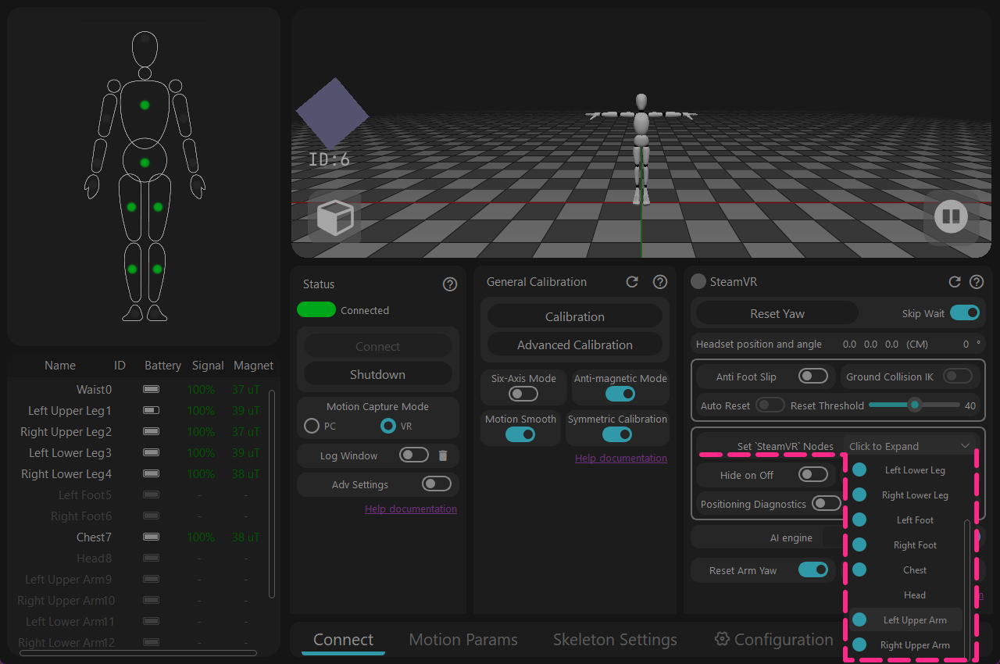
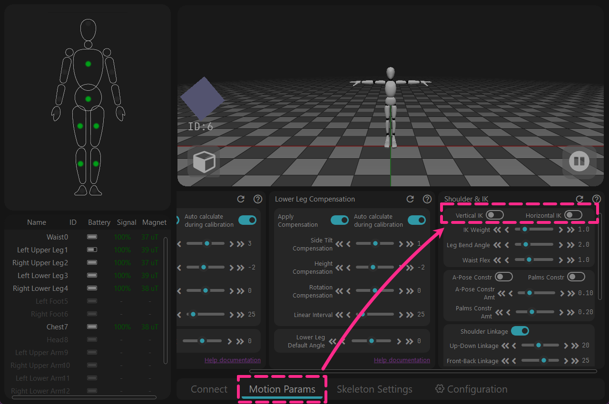
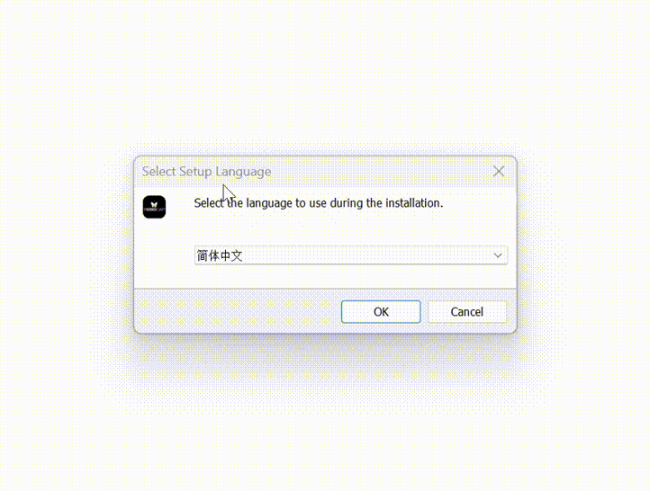

<!-- ==================== Flag A: Install software Start ==================== -->
<div style="border-left: 6px solid #88b49c; padding-left: 20px; margin-top: 10px; margin-bottom: 20px;">

## Загрузка {#software-download-toc}
<h2 class="tutorial-heading-flag" style="background: #88b49c; margin-top: 0; display: inline-block;">Загрузка</h2>

<div class="os-switch">
<input type="radio" name="os-platform" id="os-platform-win" />
<input type="radio" name="os-platform" id="os-platform-linux" />
<input type="radio" name="os-platform" id="os-platform-android" />

<div class="os-switch-tabs" role="group" aria-label="Выбор операционной системы">
<label class="os-switch-tab os-switch-tab-win" for="os-platform-win">
<svg class="os-switch-tab-icon" viewBox="0 0 24 24" width="22" height="22" aria-hidden="true" focusable="false"><path d="M0,0H11.377V11.372H0ZM12.623,0H24V11.372H12.623ZM0,12.623H11.377V24H0Zm12.623,0H24V24H12.623"></path></svg>
<span class="os-switch-tab-name">Windows</span>
</label>
<label class="os-switch-tab os-switch-tab-linux" for="os-platform-linux">
<svg class="os-switch-tab-icon" viewBox="0 0 24 24" width="22" height="22" aria-hidden="true" focusable="false"><path d="M12.504 0c-.155 0-.315.008-.48.021-4.226.333-3.105 4.807-3.17 6.298-.076 1.092-.3 1.953-1.05 3.02-.885 1.051-2.127 2.75-2.716 4.521-.278.832-.41 1.684-.287 2.489a.424.424 0 00-.11.135c-.26.268-.45.6-.663.839-.199.199-.485.267-.797.4-.313.136-.658.269-.864.68-.09.189-.136.394-.132.602 0 .199.027.4.055.536.058.399.116.728.04.97-.249.68-.28 1.145-.106 1.484.174.334.535.47.94.601.81.2 1.91.135 2.774.6.926.466 1.866.67 2.616.47.526-.116.97-.464 1.208-.946.587-.003 1.23-.269 2.26-.334.699-.058 1.574.267 2.577.2.025.134.063.198.114.333l.003.003c.391.778 1.113 1.132 1.884 1.071.771-.06 1.592-.536 2.257-1.306.631-.765 1.683-1.084 2.378-1.503.348-.199.629-.469.649-.853.023-.4-.2-.811-.714-1.376v-.097l-.003-.003c-.17-.2-.25-.535-.338-.926-.085-.401-.182-.786-.492-1.046h-.003c-.059-.054-.123-.067-.188-.135a.357.357 0 00-.19-.064c.431-1.278.264-2.55-.173-3.694-.533-1.41-1.465-2.638-2.175-3.483-.796-1.005-1.576-1.957-1.56-3.368.026-2.152.236-6.133-3.544-6.139zm.529 3.405h.013c.213 0 .396.062.584.198.19.135.33.332.438.533.105.259.158.459.166.724 0-.02.006-.04.006-.06v.105a.086.086 0 01-.004-.021l-.004-.024a1.807 1.807 0 01-.15.706.953.953 0 01-.213.335.71.71 0 00-.088-.042c-.104-.045-.198-.064-.284-.133a1.312 1.312 0 00-.22-.066c.05-.06.146-.133.183-.198.053-.128.082-.264.088-.402v-.02a1.21 1.21 0 00-.061-.4c-.045-.134-.101-.2-.183-.333-.084-.066-.167-.132-.267-.132h-.016c-.093 0-.176.03-.262.132a.8.8 0 00-.205.334 1.18 1.18 0 00-.09.4v.019c.002.089.008.179.02.267-.193-.067-.438-.135-.607-.202a1.635 1.635 0 01-.018-.2v-.02a1.772 1.772 0 01.15-.768c.082-.22.232-.406.43-.533a.985.985 0 01.594-.2zm-2.962.059h.036c.142 0 .27.048.399.135.146.129.264.288.344.465.09.199.14.4.153.667v.004c.007.134.006.2-.002.266v.08c-.03.007-.056.018-.083.024-.152.055-.274.135-.393.2.012-.09.013-.18.003-.267v-.015c-.012-.133-.04-.2-.082-.333a.613.613 0 00-.166-.267.248.248 0 00-.183-.064h-.021c-.071.006-.13.04-.186.132a.552.552 0 00-.12.27.944.944 0 00-.023.33v.015c.012.135.037.2.08.334.046.134.098.2.166.268.01.009.02.018.034.024-.07.057-.117.07-.176.136a.304.304 0 01-.131.068 2.62 2.62 0 01-.275-.402 1.772 1.772 0 01-.155-.667 1.759 1.759 0 01.08-.668 1.43 1.43 0 01.283-.535c.128-.133.26-.2.418-.2zm1.37 1.706c.332 0 .733.065 1.216.399.293.2.523.269 1.052.468h.003c.255.136.405.266.478.399v-.131a.571.571 0 01.016.47c-.123.31-.516.643-1.063.842v.002c-.268.135-.501.333-.775.465-.276.135-.588.292-1.012.267a1.139 1.139 0 01-.448-.067 3.566 3.566 0 01-.322-.198c-.195-.135-.363-.332-.612-.465v-.005h-.005c-.4-.246-.616-.512-.686-.71-.07-.268-.005-.47.193-.6.224-.135.38-.271.483-.336.104-.074.143-.102.176-.131h.002v-.003c.169-.202.436-.47.839-.601.139-.036.294-.065.466-.065zm2.8 2.142c.358 1.417 1.196 3.475 1.735 4.473.286.534.855 1.659 1.102 3.024.156-.005.33.018.513.064.646-1.671-.546-3.467-1.089-3.966-.22-.2-.232-.335-.123-.335.59.534 1.365 1.572 1.646 2.757.13.535.16 1.104.021 1.67.067.028.135.06.205.067 1.032.534 1.413.938 1.23 1.537v-.043c-.06-.003-.12 0-.18 0h-.016c.151-.467-.182-.825-1.065-1.224-.915-.4-1.646-.336-1.77.465-.008.043-.013.066-.018.135-.068.023-.139.053-.209.064-.43.268-.662.669-.793 1.187-.13.533-.17 1.156-.205 1.869v.003c-.02.334-.17.838-.319 1.35-1.5 1.072-3.58 1.538-5.348.334a2.645 2.645 0 00-.402-.533 1.45 1.45 0 00-.275-.333c.182 0 .338-.03.465-.067a.615.615 0 00.314-.334c.108-.267 0-.697-.345-1.163-.345-.467-.931-.995-1.788-1.521-.63-.4-.986-.87-1.15-1.396-.165-.534-.143-1.085-.015-1.645.245-1.07.873-2.11 1.274-2.763.107-.065.037.135-.408.974-.396.751-1.14 2.497-.122 3.854a8.123 8.123 0 01.647-2.876c.564-1.278 1.743-3.504 1.836-5.268.048.036.217.135.289.202.218.133.38.333.59.465.21.201.477.335.876.335.039.003.075.006.11.006.412 0 .73-.134.997-.268.29-.134.52-.334.74-.4h.005c.467-.135.835-.402 1.044-.7zm2.185 8.958c.037.6.343 1.245.882 1.377.588.134 1.434-.333 1.791-.765l.211-.01c.315-.007.577.01.847.268l.003.003c.208.199.305.53.391.876.085.4.154.78.409 1.066.486.527.645.906.636 1.14l.003-.007v.018l-.003-.012c-.015.262-.185.396-.498.595-.63.401-1.746.712-2.457 1.57-.618.737-1.37 1.14-2.036 1.191-.664.053-1.237-.2-1.574-.898l-.005-.003c-.21-.4-.12-1.025.056-1.69.176-.668.428-1.344.463-1.897.037-.714.076-1.335.195-1.814.12-.465.308-.797.641-.984l.045-.022zm-10.814.049h.01c.053 0 .105.005.157.014.376.055.706.333 1.023.752l.91 1.664.003.003c.243.533.754 1.064 1.189 1.637.434.598.77 1.131.729 1.57v.006c-.057.744-.48 1.148-1.125 1.294-.645.135-1.52.002-2.395-.464-.968-.536-2.118-.469-2.857-.602-.369-.066-.61-.2-.723-.4-.11-.2-.113-.602.123-1.23v-.004l.002-.003c.117-.334.03-.752-.027-1.118-.055-.401-.083-.71.043-.94.16-.334.396-.4.69-.533.294-.135.64-.202.915-.47h.002v-.002c.256-.268.445-.601.668-.838.19-.201.38-.336.663-.336zm7.159-9.074c-.435.201-.945.535-1.488.535-.542 0-.97-.267-1.28-.466-.154-.134-.28-.268-.373-.335-.164-.134-.144-.333-.074-.333.109.016.129.134.199.2.096.066.215.2.36.333.292.2.68.467 1.167.467.485 0 1.053-.267 1.398-.466.195-.135.445-.334.648-.467.156-.136.149-.267.279-.267.128.016.034.134-.147.332a8.097 8.097 0 01-.69.468zm-1.082-1.583V5.64c-.006-.02.013-.042.029-.05.074-.043.18-.027.26.004.063 0 .16.067.15.135-.006.049-.085.066-.135.066-.055 0-.092-.043-.141-.068-.052-.018-.146-.008-.163-.065zm-.551 0c-.02.058-.113.049-.166.066-.047.025-.086.068-.14.068-.05 0-.13-.02-.136-.068-.01-.066.088-.133.15-.133.08-.031.184-.047.259-.005.019.009.036.03.03.05v.02h.003z"></path></svg>
<span class="os-switch-tab-name">Linux</span>
</label>
<label class="os-switch-tab os-switch-tab-android" for="os-platform-android">
<svg class="os-switch-tab-icon" viewBox="0 0 24 24" width="22" height="22" aria-hidden="true" focusable="false"><path d="M18.4395 5.5586c-.675 1.1664-1.352 2.3318-2.0274 3.498-.0366-.0155-.0742-.0286-.1113-.043-1.8249-.6957-3.484-.8-4.42-.787-1.8551.0185-3.3544.4643-4.2597.8203-.084-.1494-1.7526-3.021-2.0215-3.4864a1.1451 1.1451 0 0 0-.1406-.1914c-.3312-.364-.9054-.4859-1.379-.203-.475.282-.7136.9361-.3886 1.5019 1.9466 3.3696-.0966-.2158 1.9473 3.3593.0172.031-.4946.2642-1.3926 1.0177C2.8987 12.176.452 14.772 0 18.9902h24c-.119-1.1108-.3686-2.099-.7461-3.0683-.7438-1.9118-1.8435-3.2928-2.7402-4.1836a12.1048 12.1048 0 0 0-2.1309-1.6875c.6594-1.122 1.312-2.2559 1.9649-3.3848.2077-.3615.1886-.7956-.0079-1.1191a1.1001 1.1001 0 0 0-.8515-.5332c-.5225-.0536-.9392.3128-1.0488.5449zm-.0391 8.461c.3944.5926.324 1.3306-.1563 1.6503-.4799.3197-1.188.0985-1.582-.4941-.3944-.5927-.324-1.3307.1563-1.6504.4727-.315 1.1812-.1086 1.582.4941zM7.207 13.5273c.4803.3197.5506 1.0577.1563 1.6504-.394.5926-1.1038.8138-1.584.4941-.48-.3197-.5503-1.0577-.1563-1.6504.4008-.6021 1.1087-.8106 1.584-.4941z"></path></svg>
<span class="os-switch-tab-name">Android</span>
</label>
</div>

<div class="os-switch-panel os-switch-panel-win">

Версия для Windows в настоящее время доступна в вариантах Release и Beta — нажмите на ссылку для загрузки ниже.<br />
Версия Beta — это публичная тестовая сборка: она лучше работает в областях с заметными магнитными помехами, но еще не прошла масштабную проверку.

<div class="os-switch-downloads">
<a class="os-switch-download" href="https://doc.rebocap.com/img/files/rebocap_release_v01.exe">
<span class="os-switch-download-main">Скачать Rebocap V01</span>
<span class="os-switch-download-meta">Стабильная версия · текущий Release</span>
</a>
<a class="os-switch-download" href="https://doc.rebocap.com/img/files/rebocap_release_v02_beta02.exe">
<span class="os-switch-download-main">Скачать Rebocap V02 Beta02</span>
<span class="os-switch-download-meta">Бета-версия · публичное тестирование</span>
</a>
<a class="os-switch-download" data-gray-release-download="true" href="https://doc.rebocap.com/files/rebocap_v02_beta02.2_gray02-2.exe">
<span class="os-switch-download-main">Скачать Rebocap V02 Beta02.2</span>
<span class="os-switch-download-meta">Бета-версия · поэтапное тестирование</span>
</a>
</div>

- Выбор версии:\
  V01 - подходит для сред со стабильным магнитным полем, рекомендуется для танцев.<br />
  V02 Beta02.2 - для тех, кто хочет опробовать часть новых UI-модулей, а также для использования в игровых зонах с плохим магнитным окружением: там, где много металлических деталей, есть батуты и т. п.<br />


- Рекомендуется устанавливать не на системный диск (не устанавливайте на диск C).

<!-- ==================== Details Start ==================== -->

<details>
<summary> [ Прошивка ] Поддерживаемые версии и инструкции по эксплуатации.</summary>
   &emsp;&emsp; Некоторые версии прошивки имеют серьезные изменения в алгоритмах и несовместимы с более старыми версиями программного обеспечения. <br /> 


   &emsp;&emsp; При возврате к более старой версии программного обеспечения прошивку необходимо соответствующим образом понизить.<br /> 

   &emsp;&emsp;&emsp; release_v01 - ◼️трекер : V6 / V7  ,  📡приемник : V6 / V7 <br /> 

   &emsp;&emsp;&emsp; release_v02 beta02 - ◼️трекер : V15  ,  📡приемник : V6 / V7 <br /> 

   &emsp;&emsp;&emsp; (Не опубликовано) release_v02 beta02.1 - ◼️трекер : V16  ,  📡приемник : V6 / V7 / V8 <br /> 

   &emsp;&emsp;&emsp; release_v02 beta02.2 - ◼️трекер : V16 ,  📡приемник : V6 / V7 / V8 <br /> 


<div style="display: flex; flex-direction: row; gap: 20px; flex-wrap: wrap; align-items: center; margin: 15px 0;">
<div style="flex: 1; min-width: 250px; text-align: center;">

<video autoPlay loop muted playsInline width="100%" src="/img/softawre_install/show_version_log.mp4"></video>

</div>
<div style="flex: 1.5; min-width: 250px;">

**Инструкции по эксплуатации прошивки**<br />
- Откройте окно журнала, чтобы увидеть фактическую версию прошивки каждого трекера <br /> 
(окно журнала находится в разделе «Подключение и отключение питания» в программном обеспечении).

</div>
</div>

<br/>

- Трекеры обновляются по беспроводной сети 📶 — USB-кабель не нужен.<br /> 
🚫 Не обновляйте трекер и приемник одновременно.<br /> 


- Если обновление не удалось, необходимо перезагрузить трекер и снова нажать «Обновить».<br /> 
&emsp;&emsp;🟩Зеленый – быстро мигает: Трекер работает нормально<br /> 
&emsp;&emsp;🟩Зеленый – медленно мигает: Трекер ожидает сигнал приемника<br /> 
&emsp;&emsp;🟦Синий: Трекер получает данные прошивки<br /> 
&emsp;&emsp;🟨Желтый: Обновление не удалось (вручную нажмите кнопку 🔘 для перезагрузки, затем повторите попытку обновления)<br /> 
&emsp;&emsp;⬜Белый: Обновление успешно завершено (обычно автоматически перезагружается через 10 секунд; если нет, перезагрузите вручную)<br /> 

-  Когда обновление 📡приемника завершится, отключите и снова подключите USB-кабель, а затем 🔄перезапустите программное обеспечение.


</details>
<!-- ==================== Details End ==================== -->


<!-- ==================== Details Start ==================== -->
<details>
<summary>Если вы используете версию V01 в режиме VR, необходимо изменить следующие настройки.</summary>

<div style="display: flex; flex-direction: row; gap: 20px; flex-wrap: wrap; align-items: center; margin: 15px 0;">
<div style="flex: 1; min-width: 250px; text-align: center;">



</div>
<div style="flex: 1.5; min-width: 250px;">
<strong>1 - Если трекеры для плеч отсутствуют, вручную отключите дополнительные отображаемые точки отслеживания.</strong><br />
Откройте [Настройка узлов вывода 'SteamVR'] → Отключите [Левое/Правое плечо]
<details className="plain-details"><summary>Подробности</summary>
Изначально планировалось использовать функцию [Автоматически скрывать суставы] для автоматического скрытия неиспользуемых точек отслеживания,<br />
но было обнаружено, что эта функция не может выполнять проверку автоматически. Это было исправлено в программном обеспечении V02 Beta02.
</details>


</div>
</div>

<div style="display: flex; flex-direction: row; gap: 20px; flex-wrap: wrap; align-items: center; margin: 15px 0;">
<div style="flex: 1; min-width: 250px; text-align: center;">



</div>
<div style="flex: 1.5; min-width: 250px;">
<strong>2 - Отключите функцию, которая может ошибочно застрять в глобальном режиме работы.</strong><br />
→ [Параметры движения] → Отключите [Вертикальная IK и Горизонтальная IK]
<details className="plain-details"><summary>Подробности</summary>
Изначально эта функция была подфункцией в модуле [Анти-скольжение],<br />
но она неожиданно оставалась активной глобально. Это было исправлено в программном обеспечении V02 Beta02.

</details>
</div>
</div>

</details>
<!-- ==================== Details End ==================== -->

Примечания:
> В настоящее время **версия для Windows** поддерживает только Windows 10 и выше.<br>
> Программное обеспечение необходимо использовать при подключении к Интернету. Если вы хотите использовать его в автономном режиме, подключитесь через мобильную точку доступа, запустите программное обеспечение, подождите 30 секунд, а затем отключите сеть.<br>
> (Как только в [Окне журнала] появится сообщение о том, что проверка сети прошла успешно, вы можете отключить сеть)

</div>

<div class="os-switch-panel os-switch-panel-linux">

В настоящее время Linux доступен в предварительной версии Preview — этот выпуск предназначен главным образом для наблюдения за стабильностью ядра программы в среде Linux.<br>
Если при использовании вы столкнетесь с ошибками, оставляйте комментарии в соответствующих публикациях в Twitter (X) и в Discord.

<div class="os-switch-downloads">
<a class="os-switch-download" data-preview-download="true" href="https://doc.rebocap.com/files/rebocap-linux-preview-0.1-1.run">
<span class="os-switch-download-main">Скачать Rebocap Linux Preview 0.1</span>
<span class="os-switch-download-meta">Linux · предварительная версия Preview</span>
</a>
</div>

Путь установки Linux по умолчанию — `~/.local/opt/rebocap`.

<!-- ==================== Details Start ==================== -->

<details>
<summary> [ Прошивка ] Поддерживаемые версии и инструкции по эксплуатации.</summary>
   &emsp;&emsp; Некоторые версии прошивки имеют серьезные изменения в алгоритмах и несовместимы с более старыми версиями программного обеспечения. <br /> 


   &emsp;&emsp; При возврате к более старой версии программного обеспечения прошивку необходимо соответствующим образом понизить.<br /> 

 
   &emsp;&emsp;&emsp; Linux Preview 0.1 - ◼️трекер : V16 / V17 ,  📡приемник : V6 / V7 / V8 <br /> 


<div style="display: flex; flex-direction: row; gap: 20px; flex-wrap: wrap; align-items: center; margin: 15px 0;">
<div style="flex: 1; min-width: 250px; text-align: center;">

<video autoPlay loop muted playsInline width="100%" src="/img/softawre_install/show_version_log.mp4"></video>

</div>
<div style="flex: 1.5; min-width: 250px;">

**Инструкции по эксплуатации прошивки**<br />
- Откройте окно журнала, чтобы увидеть фактическую версию прошивки каждого трекера <br /> 
(окно журнала находится в разделе «Подключение и отключение питания» в программном обеспечении).

</div>
</div>

<br/>

- Трекеры обновляются по беспроводной сети 📶 — USB-кабель не нужен.<br /> 
🚫 Не обновляйте трекер и приемник одновременно.<br /> 


- Если обновление не удалось, необходимо перезагрузить трекер и снова нажать «Обновить».<br /> 
&emsp;&emsp;🟩Зеленый – быстро мигает: Трекер работает нормально<br /> 
&emsp;&emsp;🟩Зеленый – медленно мигает: Трекер ожидает сигнал приемника<br /> 
&emsp;&emsp;🟦Синий: Трекер получает данные прошивки<br /> 
&emsp;&emsp;🟨Желтый: Обновление не удалось (вручную нажмите кнопку 🔘 для перезагрузки, затем повторите попытку обновления)<br /> 
&emsp;&emsp;⬜Белый: Обновление успешно завершено (обычно автоматически перезагружается через 10 секунд; если нет, перезагрузите вручную)<br /> 

-  Когда обновление 📡приемника завершится, отключите и снова подключите USB-кабель, а затем 🔄перезапустите программное обеспечение.


</details>
<!-- ==================== Details End ==================== -->

Примечания:
> В настоящее время для версии Linux обязательно нужно настроить системные разрешения — это можно проверить в [Окне журнала],<br>
> если настройки не применились, это может повлиять на подключение USB-приемника и приводить к повторяющемуся сообщению «state -3».<br>
> <br>
> Программное обеспечение необходимо использовать при подключении к Интернету. Если вы хотите использовать его в автономном режиме, подключитесь через мобильную точку доступа, запустите программное обеспечение, подождите 30 секунд, а затем отключите сеть.<br>
> (Как только в [Окне журнала] появится сообщение о том, что проверка сети прошла успешно, вы можете отключить сеть)

</div>

<div class="os-switch-panel os-switch-panel-android">

В настоящее время Android доступен в предварительной версии Preview — этот выпуск предназначен главным образом для наблюдения за стабильностью ядра программы в среде Android.<br>
Если при использовании вы столкнетесь с ошибками, оставляйте комментарии в соответствующих публикациях в Twitter (X) и в Discord.

<div class="os-switch-downloads">
<a class="os-switch-download" data-preview-download="true" href="https://doc.rebocap.com/files/ReboCapAndroid-Preview-0.1.apk">
<span class="os-switch-download-main">Скачать Rebocap Android Preview 0.1</span>
<span class="os-switch-download-meta">Android · предварительная версия Preview</span>
</a>
</div>

<div class="os-switch-aux">
<div class="os-switch-aux-title">Дополнительные инструменты (опционально)</div>
<div class="os-switch-aux-grid">
<a class="os-switch-aux-tool" href="https://doc.rebocap.com/files/RebocapTransmitter-v1.0.18.apk">
<div class="os-switch-aux-info">
<span class="os-switch-aux-name">Приложение-мост для приёмника Rebocap</span>
<span class="os-switch-aux-meta">Android APK · v1.0.18</span>
</div>
<span class="os-switch-aux-btn">Скачать ↓</span>
</a>
<a class="os-switch-aux-tool" href="https://doc.rebocap.com/files/RBC_OSC_forward_v1.0.0.apk">
<div class="os-switch-aux-info">
<span class="os-switch-aux-name">Приложение для OSC-пересылки VRChat</span>
<span class="os-switch-aux-meta">Android APK · v1.0.0</span>
</div>
<span class="os-switch-aux-btn">Скачать ↓</span>
</a>
</div>
</div>

<div class="os-switch-otg">
<span class="os-switch-otg-label">Купить OTG-кабель:</span>
<a class="os-switch-otg-link" href="https://store.rebocap.site/products/otg-adapter-with-pd-charging">Международный магазин</a>
</div>
<p class="os-switch-otg-note">Примечание: OTG-кабель предназначен для автономных гарнитур Quest или Pico и по умолчанию не входит в комплект. OTG-кабель в официальном магазине поддерживает зарядку PD. Если зарядка во время использования не нужна, можно самостоятельно приобрести обычный OTG-переходник или кабель-переходник. Если PD-зарядка не требуется (например, для Quest 2), подойдет и обычный OTG-кабель для зарядки (5 В/2 А).</p>


<!-- ==================== Details Start ==================== -->

<details>
<summary> [ Прошивка ] Поддерживаемые версии и инструкции по эксплуатации.</summary>
   &emsp;&emsp; Некоторые версии прошивки имеют серьезные изменения в алгоритмах и несовместимы с более старыми версиями программного обеспечения. <br /> 


   &emsp;&emsp; При возврате к более старой версии программного обеспечения прошивку необходимо соответствующим образом понизить.<br /> 


   &emsp;&emsp;&emsp; Android Preview 0.1 - ◼️трекер : V16 / V17 ,  📡приемник : V6 / V7 / V8 <br /> 


<div style="display: flex; flex-direction: row; gap: 20px; flex-wrap: wrap; align-items: center; margin: 15px 0;">
<div style="flex: 1; min-width: 250px; text-align: center;">

<video autoPlay loop muted playsInline width="100%" src="/img/softawre_install/show_version_log.mp4"></video>

</div>
<div style="flex: 1.5; min-width: 250px;">

**Инструкции по эксплуатации прошивки**<br />
- Откройте окно журнала, чтобы увидеть фактическую версию прошивки каждого трекера <br /> 
(окно журнала находится в разделе «Подключение и отключение питания» в программном обеспечении).

</div>
</div>

<br/>

- Трекеры обновляются по беспроводной сети 📶 — USB-кабель не нужен.<br /> 
🚫 Не обновляйте трекер и приемник одновременно.<br /> 


- Если обновление не удалось, необходимо перезагрузить трекер и снова нажать «Обновить».<br /> 
&emsp;&emsp;🟩Зеленый – быстро мигает: Трекер работает нормально<br /> 
&emsp;&emsp;🟩Зеленый – медленно мигает: Трекер ожидает сигнал приемника<br /> 
&emsp;&emsp;🟦Синий: Трекер получает данные прошивки<br /> 
&emsp;&emsp;🟨Желтый: Обновление не удалось (вручную нажмите кнопку 🔘 для перезагрузки, затем повторите попытку обновления)<br /> 
&emsp;&emsp;⬜Белый: Обновление успешно завершено (обычно автоматически перезагружается через 10 секунд; если нет, перезагрузите вручную)<br /> 

-  Когда обновление 📡приемника завершится, отключите и снова подключите USB-кабель, а затем 🔄перезапустите программное обеспечение.


</details>
<!-- ==================== Details End ==================== -->

Примечания:
> Для подключения USB-приемника к устройству, на котором запущено ПО Rebocap, требуется кабель OTG.<br>
> Обновление прошивки, калибровку гироскопа и магнитного поля рекомендуется выполнять на телефоне.<br>
> Если разъем данных изношен и соединение часто прерывается, можно использовать приложение для перенаправления OSC или приложение-мост для приемника, чтобы поддерживать подключение программного обеспечения.<br>
> <br>
> Программное обеспечение необходимо использовать при подключении к Интернету. Если вы хотите использовать его в автономном режиме, запустите программное обеспечение, подождите 30 секунд, а затем отключите сеть.<br>
> (Как только в [Окне журнала] появится сообщение о том, что проверка сети прошла успешно, вы можете отключить сеть)

</div>
</div>
</div>
<!-- ==================== Flag A: Install software End ==================== -->


## Установка программного обеспечения

<div class="os-switch-install os-switch-install-win">

1. Дважды щелкните rebocap_release_v01.exe (текущая версия - rebocap_release_v01.exe)
2. Установите, следуя шагам, показанным на рисунке ниже
3. Откройте программное обеспечение Rebocap
   * Откройте из меню «Пуск»
   * Откройте с помощью ярлыка на рабочем столе



</div>

<div class="os-switch-install os-switch-install-linux">

Версия для Linux использует установочный пакет `.run`:

1. Откройте терминал в каталоге с установочным пакетом и сначала предоставьте права на выполнение: `chmod +x rebocap-linux-preview-0.1-1.run`
2. Запустите установщик: `./rebocap-linux-preview-0.1-1.run`
3. Следуйте подсказкам, чтобы завершить установку; путь установки по умолчанию — `~/.local/opt/rebocap`
4. После завершения установки запустите Rebocap из меню приложений или из каталога установки

Если автоматическая авторизация в системе не удалась, её можно выполнить вручную:

**Настройка разрешений устройства (обязательно, иначе приёмник не подключится)**

```bash
sudo bash ~/.local/opt/rebocap/linux/install_linux_permissions.sh --install --user "$USER"
```

После выполнения отсоедините и снова подключите приёмник, затем запустите программу.

</div>

<div class="os-switch-install os-switch-install-android">

Версия для Android использует установочный пакет `.apk`:

1. Передайте `ReboCapAndroid-Preview-0.1.apk` на телефон и нажмите для установки
2. Если система запросит, разрешите «установку неизвестных приложений»
3. После завершения установки откройте Rebocap
4. Подключите USB-приемник с помощью кабеля OTG и завершите подключение, следуя подсказкам программного обеспечения

</div>

## Примечания к обновлению программного обеспечения

### Список изменений

#### Обновление от 2026-11-11

**Прошивка**
1. 📡Прошивка приемника V8:
    > Отказались от традиционного драйвера последовательного порта CDC и перешли на режим vendor — скорость передачи выше (на практике это почти не заметно).<br>Основная причина в том, что драйвер последовательного порта легко подвергается помехам со стороны других программ системы или влиянию системных компонентов, а его стабильность слишком низкая.<br>Внимание: после обновления до новой прошивки можно использовать только самую новую версию программного обеспечения; старые версии ее не распознают, поэтому для использования старых версий придется откатить прошивку приемника.

2. ◼️Прошивка трекера V16:
    > Исправлена проблема несовпадения направления по умолчанию между новым и старым алгоритмами (прошивка v15 после перезапуска кнопкой поворачивается вправо на 90°),<br>добавлена поддержка режима без антимагнитной коррекции (ранее антимагнитный переключатель не действовал на прошивку v15, из-за чего она не подходила для танцев).

**Программное обеспечение**
1. Добавлены версии для Linux и Android — прежде всего, чтобы проверить, не возникнут ли у пользователей критические ошибки; также изменена логика работы части UI
    > Интерфейс версии для Linux будет соответствовать Windows, версия для Android переработана, но сценарий работы остается близким к версии для Windows; поддерживается переключение между портретной и альбомной ориентацией.

2. 3D-просмотрщик заменен на OGRE
    > Однако драйвер видеокарты NVIDIA может нормализовать отображение нагрузки GPU, из-за чего нагрузка GPU ошибочно показывается на уровне 20%–40%; на видеокартах AMD такого «чудесного» отображения нет, этот вопрос требует дальнейшего изучения и настройки.

3. Обновление прошивки вынесено в отдельное окно
    >Обновление прошивки с v7 по v15 для многих стало настоящим барьером, поэтому это окно было доработано.

4. [Режим шести осей] переименован в [Геомагнитная поддержка], переключатель теперь работает в обратном направлении
    >Было замечено, что игроки на разных языках ошибочно принимали режим шести осей за режим с шестью трекерами.

5. Изменена логика калибровки движения
    >Добавлена кнопка [Экстренная остановка]: если калибровка запущена случайно, ее можно остановить.<br>Добавлена сворачиваемая расширенная панель: после подходящей настройки обратный отсчет калибровки становится очень коротким; поддерживается сохранение результатов предыдущей калибровки (при отключенной функции они истекают через 7 минут после закрытия программного обеспечения).

6. Функция «постукивание трекером» заменена на [Назначение постукиваний]
    > Позволяет игрокам настраивать собственные макросы постукиваний: свободно выбирать, по какому трекеру стучать, интервал постукиваний и какое сочетание клавиш должно срабатывать.

7. Добавлен ползунок громкости
    > Удобно напрямую включать и выключать звуковые уведомления программного обеспечения.

8. Устранена ошибка перепада высоты VMC
    > Ранее VMC оказывалась выше земли из-за того, что высота от земли до hips ошибочно выводилась с коэффициентом x2.

9. У некоторых часто используемых функций убрано управление из [Расширенные настройки]
  

**end.** Улучшение UI-взаимодействия будет продолжаться; еще много пунктов, основанных на статистике ваших впечатлений от использования, ждут корректировки.


#### Обновление от 04.02.2026: Rebocap Release V02 Beta02
1. Прошивка обновлена до v15, оптимизированы антимагнитные алгоритмы и алгоритмы с 6 осями, улучшена антимагнитная стабильность, улучшена стабильность с 6 осями
   > В динамических условиях, например, при непрерывном танце в условиях слабого магнитного поля, производительность по-прежнему близка к режиму с 6 осями. С новой прошивкой, если магнитное поле хорошее, динамический танец может непрерывно корректироваться (предыдущая прошивка полагалась на прерывистые статические моменты для коррекции)
2. Добавлена функция отложенного автоматического выключения, требуется обновление прошивки приемника.
3. Переработана калибровка курса и добавлена функция калибровки курса на ПК：
   > Примечание: При выполнении калибровки курса на ПК используйте A-позу для всего тела; поднятие предплечий и ладоней вперед работает лучше. В качестве альтернативы вы можете просто принять S-позу или сесть и вытянуть руки прямо вперед - это также сработает）
4. Если программное обеспечение неожиданно закрывается и открывается снова в течение 5 минут, предыдущие результаты калибровки будут применены автоматически; нет необходимости в повторной калибровке
5. Во время калибровки курса магнитное поле будет сброшено (прямой сброс на относительное поле 1.0). Другими словами, если вы лежите в постели, оно будет использовать магнитное поле в момент калибровки в качестве начальной точки отсчета для коррекции.
6. Снято ограничение на калибровку магнитного поля; простая магнитная калибровка (рисование восьмерки) теперь доступна по умолчанию
   > По умолчанию калибровка ограничена 8 датчиками одновременно. Если вы добавите файл: `data/__no_limit_max_nodes__` в каталог данных, ограничение будет снято
7. Исправлена ошибка, из-за которой движение ступней после положения лежа могло привести к разделению скелета персонажа.

Другие обновления：
1. В строке заголовка программного обеспечения теперь отображается номер версии
2. Исправлена ошибка, из-за которой функция автоматического скрытия выключенных датчиков не работала
3. При отключенном режиме защиты от скольжения ступней ноги могут уходить под землю, и была удалена IK
4. Устранена ошибка, из-за которой поза аватара зависала после отключения приемника
5. Добавлено боковое смещение VR в настройках скелета (для моделей, у которых точка крепления шлема находится не по центру лба, а немного сбоку, вы можете выполнить необходимую настройку)


#### Обновление от 03.12.2025: Rebocap Release V01
**Раздел VR：**
1. Добавлена функция ходьбы на месте: при шагании на месте джойстик имитирует устойчивое и медленное движение вперед, подробности см. в документе Справки (Расширенная функция)
2. Добавлена регулировка высоты виртуальной земли VR, диапазон от -100 см до 100 см (Расширенная функция)
3. Добавлена функция замены контроллера: при включении трекеры для рук заменяют положение и ориентацию контроллера, подробности см. в документе Справки (Расширенная функция)
4. Обновлен плагин SteamVR и сделана попытка исправить проблему, из-за которой трекеры распознавались как контроллеры
5. Исправлен неправильный локатор ступней при импорте скелета в режиме VR (в основном влияющий на расчет IK), что приводило к проседанию ступней аватара и всего тела.
6. После сброса курса будет проактивно запускаться функция автоматического центрирования
7. Добавлен переключатель для автоматического скрытия выключенных узлов; при включении выключенные узлы будут скрываться автоматически
8. Восстановлена функция следования груди/талии VR за шлемом

**Раздел ПК：**
1. Обновлен алгоритм калибровки движения: смягчены требования к положению рук при T-позе, что решает проблемы с асимметрией рук у некоторых пользователей
2. Добавлена IK для рук. IK со сцепленными руками минимизирует скрещивание рук, когда руки вместе, а IK для A-позы решает проблему серьезного отсечения, когда плечи аватара слишком узкие, а руки расположены вертикально.
3. Добавлен экспорт движения MMD и импорт модели PMX. Обратите внимание, что движения VMD не содержат IK; вам необходимо удалить ограничения IK вручную.
4. Исправлена ошибка, из-за которой скачок частоты кадров анимации был ограничен 999

**Общее：**
1. Обновлен интерфейс: реорганизован по функциям, улучшен перевод некоторых терминов, а описания функций стали более удобными для пользователя
2. Добавлен переключатель дополнительных настроек, а также функции экспорта/импорта настроек и восстановления значений по умолчанию
3. Устранена проблема, из-за которой калибровка не могла быть продолжена из-за неудачного обнаружения неподвижности
4. Добавлена функция автоматического подключения; больше нет необходимости нажимать кнопку подключения вручную
5. Добавлено обновление прошивки приемника для решения проблем с высокой загрузкой процессора и потерей пакетов (особенно на процессорах AMD)
6. Трекеры обновлены до прошивки v07 для повышения общей стабильности
7. Добавлена возможность выбора конкретных узлов для режима с 6 осями (Расширенная функция)
8. Исправлена ошибка, из-за которой некоторые гироскопы не возвращались к нулю после калибровки

**Другое:**
1. Добавлен экран-заставка при запуске, чтобы избежать долгих периодов ожидания в фоновом режиме  
2. Улучшена стабильность 3D-окна  
3. Количество серверов аутентификации увеличено до трех (Китай, Гонконг и США); аутентификация проходит успешно, если ее подтверждает хотя бы один сервер  
4. Исправлена периодически возникающая ошибка, из-за которой данные казались не отправленными во время калибровки (на самом деле они были успешно отправлены)  
5. Скелет по умолчанию заменен на скелет, рекомендованный сообществом, и изменены другие параметры по умолчанию  
6. Добавлен запрос на повторную калибровку при включении или выключении переключателя с шестью осями  
7. Исправлена проблема компенсации бокового наклона с шестью осями  


### TODO (в произвольном порядке, здесь перечислены только основные пункты обновления)

- Улучшение работы IK  
- Улучшение стабильности программного обеспечения  
- Поддержка VR режима с 3 точками  
- Поддержка режима ПК с 6 точками (все тело)  
- Добавление документации на других языках (будет добавлено после стабилизации документации)  


### Исторические версии
> **Примечание: Версии до preview05 не поддерживают новое оборудование, выпущенное после 29.11.2025. Для нового оборудования, пожалуйста, скачайте последнюю версию Release или Beta-версию.**
