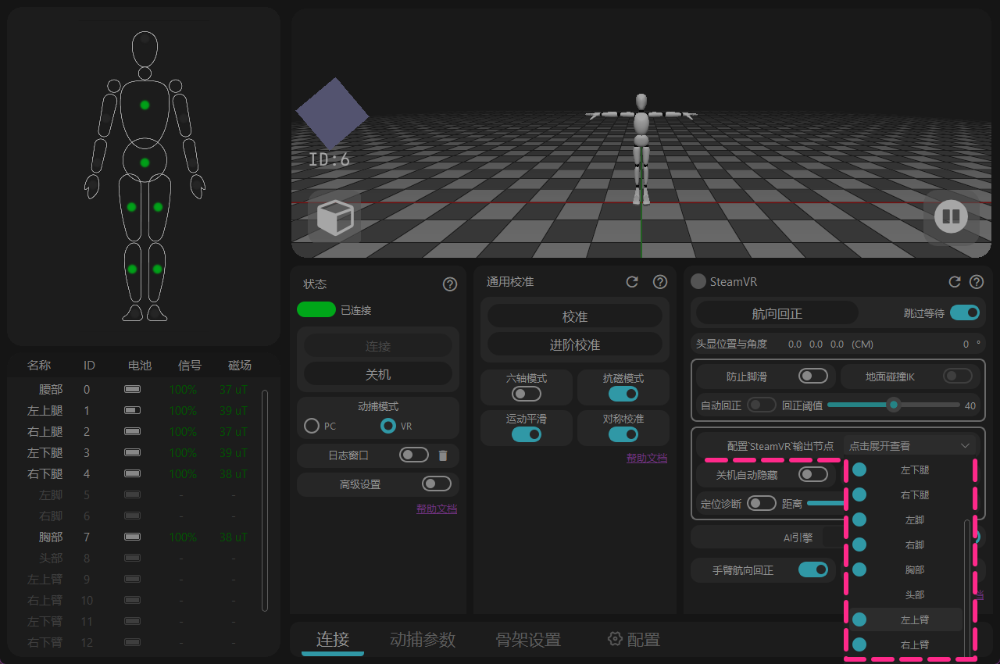
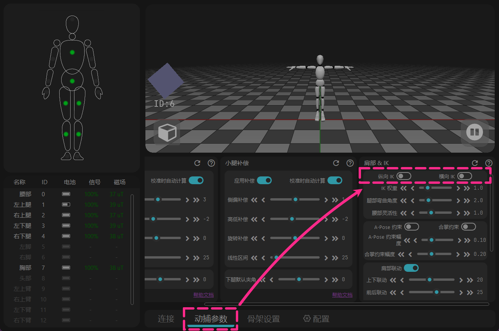
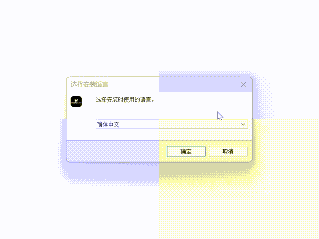

<!-- ==================== 旗帜 A：Install software 开始 ==================== -->
<div style="border-left: 6px solid #88b49c; padding-left: 20px; margin-top: 10px; margin-bottom: 20px;">

<span id="软件下载" class="legacy-anchor-alias" aria-hidden="true"></span>

## 下载 {#software-download-toc}
<h2 class="tutorial-heading-flag" style="background: #88b49c; margin-top: 0; display: inline-block;">下载</h2>

<div class="os-switch">
<input type="radio" name="os-platform" id="os-platform-win" />
<input type="radio" name="os-platform" id="os-platform-linux" />
<input type="radio" name="os-platform" id="os-platform-android" />

<div class="os-switch-tabs" role="group" aria-label="选择操作系统">
<label class="os-switch-tab os-switch-tab-win" for="os-platform-win">
<svg class="os-switch-tab-icon" viewBox="0 0 24 24" width="22" height="22" aria-hidden="true" focusable="false"><path d="M0,0H11.377V11.372H0ZM12.623,0H24V11.372H12.623ZM0,12.623H11.377V24H0Zm12.623,0H24V24H12.623"></path></svg>
<span class="os-switch-tab-name">Windows</span>
</label>
<label class="os-switch-tab os-switch-tab-linux" for="os-platform-linux">
<svg class="os-switch-tab-icon" viewBox="0 0 24 24" width="22" height="22" aria-hidden="true" focusable="false"><path d="M12.504 0c-.155 0-.315.008-.48.021-4.226.333-3.105 4.807-3.17 6.298-.076 1.092-.3 1.953-1.05 3.02-.885 1.051-2.127 2.75-2.716 4.521-.278.832-.41 1.684-.287 2.489a.424.424 0 00-.11.135c-.26.268-.45.6-.663.839-.199.199-.485.267-.797.4-.313.136-.658.269-.864.68-.09.189-.136.394-.132.602 0 .199.027.4.055.536.058.399.116.728.04.97-.249.68-.28 1.145-.106 1.484.174.334.535.47.94.601.81.2 1.91.135 2.774.6.926.466 1.866.67 2.616.47.526-.116.97-.464 1.208-.946.587-.003 1.23-.269 2.26-.334.699-.058 1.574.267 2.577.2.025.134.063.198.114.333l.003.003c.391.778 1.113 1.132 1.884 1.071.771-.06 1.592-.536 2.257-1.306.631-.765 1.683-1.084 2.378-1.503.348-.199.629-.469.649-.853.023-.4-.2-.811-.714-1.376v-.097l-.003-.003c-.17-.2-.25-.535-.338-.926-.085-.401-.182-.786-.492-1.046h-.003c-.059-.054-.123-.067-.188-.135a.357.357 0 00-.19-.064c.431-1.278.264-2.55-.173-3.694-.533-1.41-1.465-2.638-2.175-3.483-.796-1.005-1.576-1.957-1.56-3.368.026-2.152.236-6.133-3.544-6.139zm.529 3.405h.013c.213 0 .396.062.584.198.19.135.33.332.438.533.105.259.158.459.166.724 0-.02.006-.04.006-.06v.105a.086.086 0 01-.004-.021l-.004-.024a1.807 1.807 0 01-.15.706.953.953 0 01-.213.335.71.71 0 00-.088-.042c-.104-.045-.198-.064-.284-.133a1.312 1.312 0 00-.22-.066c.05-.06.146-.133.183-.198.053-.128.082-.264.088-.402v-.02a1.21 1.21 0 00-.061-.4c-.045-.134-.101-.2-.183-.333-.084-.066-.167-.132-.267-.132h-.016c-.093 0-.176.03-.262.132a.8.8 0 00-.205.334 1.18 1.18 0 00-.09.4v.019c.002.089.008.179.02.267-.193-.067-.438-.135-.607-.202a1.635 1.635 0 01-.018-.2v-.02a1.772 1.772 0 01.15-.768c.082-.22.232-.406.43-.533a.985.985 0 01.594-.2zm-2.962.059h.036c.142 0 .27.048.399.135.146.129.264.288.344.465.09.199.14.4.153.667v.004c.007.134.006.2-.002.266v.08c-.03.007-.056.018-.083.024-.152.055-.274.135-.393.2.012-.09.013-.18.003-.267v-.015c-.012-.133-.04-.2-.082-.333a.613.613 0 00-.166-.267.248.248 0 00-.183-.064h-.021c-.071.006-.13.04-.186.132a.552.552 0 00-.12.27.944.944 0 00-.023.33v.015c.012.135.037.2.08.334.046.134.098.2.166.268.01.009.02.018.034.024-.07.057-.117.07-.176.136a.304.304 0 01-.131.068 2.62 2.62 0 01-.275-.402 1.772 1.772 0 01-.155-.667 1.759 1.759 0 01.08-.668 1.43 1.43 0 01.283-.535c.128-.133.26-.2.418-.2zm1.37 1.706c.332 0 .733.065 1.216.399.293.2.523.269 1.052.468h.003c.255.136.405.266.478.399v-.131a.571.571 0 01.016.47c-.123.31-.516.643-1.063.842v.002c-.268.135-.501.333-.775.465-.276.135-.588.292-1.012.267a1.139 1.139 0 01-.448-.067 3.566 3.566 0 01-.322-.198c-.195-.135-.363-.332-.612-.465v-.005h-.005c-.4-.246-.616-.512-.686-.71-.07-.268-.005-.47.193-.6.224-.135.38-.271.483-.336.104-.074.143-.102.176-.131h.002v-.003c.169-.202.436-.47.839-.601.139-.036.294-.065.466-.065zm2.8 2.142c.358 1.417 1.196 3.475 1.735 4.473.286.534.855 1.659 1.102 3.024.156-.005.33.018.513.064.646-1.671-.546-3.467-1.089-3.966-.22-.2-.232-.335-.123-.335.59.534 1.365 1.572 1.646 2.757.13.535.16 1.104.021 1.67.067.028.135.06.205.067 1.032.534 1.413.938 1.23 1.537v-.043c-.06-.003-.12 0-.18 0h-.016c.151-.467-.182-.825-1.065-1.224-.915-.4-1.646-.336-1.77.465-.008.043-.013.066-.018.135-.068.023-.139.053-.209.064-.43.268-.662.669-.793 1.187-.13.533-.17 1.156-.205 1.869v.003c-.02.334-.17.838-.319 1.35-1.5 1.072-3.58 1.538-5.348.334a2.645 2.645 0 00-.402-.533 1.45 1.45 0 00-.275-.333c.182 0 .338-.03.465-.067a.615.615 0 00.314-.334c.108-.267 0-.697-.345-1.163-.345-.467-.931-.995-1.788-1.521-.63-.4-.986-.87-1.15-1.396-.165-.534-.143-1.085-.015-1.645.245-1.07.873-2.11 1.274-2.763.107-.065.037.135-.408.974-.396.751-1.14 2.497-.122 3.854a8.123 8.123 0 01.647-2.876c.564-1.278 1.743-3.504 1.836-5.268.048.036.217.135.289.202.218.133.38.333.59.465.21.201.477.335.876.335.039.003.075.006.11.006.412 0 .73-.134.997-.268.29-.134.52-.334.74-.4h.005c.467-.135.835-.402 1.044-.7zm2.185 8.958c.037.6.343 1.245.882 1.377.588.134 1.434-.333 1.791-.765l.211-.01c.315-.007.577.01.847.268l.003.003c.208.199.305.53.391.876.085.4.154.78.409 1.066.486.527.645.906.636 1.14l.003-.007v.018l-.003-.012c-.015.262-.185.396-.498.595-.63.401-1.746.712-2.457 1.57-.618.737-1.37 1.14-2.036 1.191-.664.053-1.237-.2-1.574-.898l-.005-.003c-.21-.4-.12-1.025.056-1.69.176-.668.428-1.344.463-1.897.037-.714.076-1.335.195-1.814.12-.465.308-.797.641-.984l.045-.022zm-10.814.049h.01c.053 0 .105.005.157.014.376.055.706.333 1.023.752l.91 1.664.003.003c.243.533.754 1.064 1.189 1.637.434.598.77 1.131.729 1.57v.006c-.057.744-.48 1.148-1.125 1.294-.645.135-1.52.002-2.395-.464-.968-.536-2.118-.469-2.857-.602-.369-.066-.61-.2-.723-.4-.11-.2-.113-.602.123-1.23v-.004l.002-.003c.117-.334.03-.752-.027-1.118-.055-.401-.083-.71.043-.94.16-.334.396-.4.69-.533.294-.135.64-.202.915-.47h.002v-.002c.256-.268.445-.601.668-.838.19-.201.38-.336.663-.336zm7.159-9.074c-.435.201-.945.535-1.488.535-.542 0-.97-.267-1.28-.466-.154-.134-.28-.268-.373-.335-.164-.134-.144-.333-.074-.333.109.016.129.134.199.2.096.066.215.2.36.333.292.2.68.467 1.167.467.485 0 1.053-.267 1.398-.466.195-.135.445-.334.648-.467.156-.136.149-.267.279-.267.128.016.034.134-.147.332a8.097 8.097 0 01-.69.468zm-1.082-1.583V5.64c-.006-.02.013-.042.029-.05.074-.043.18-.027.26.004.063 0 .16.067.15.135-.006.049-.085.066-.135.066-.055 0-.092-.043-.141-.068-.052-.018-.146-.008-.163-.065zm-.551 0c-.02.058-.113.049-.166.066-.047.025-.086.068-.14.068-.05 0-.13-.02-.136-.068-.01-.066.088-.133.15-.133.08-.031.184-.047.259-.005.019.009.036.03.03.05v.02h.003z"></path></svg>
<span class="os-switch-tab-name">Linux</span>
</label>
<label class="os-switch-tab os-switch-tab-android" for="os-platform-android">
<svg class="os-switch-tab-icon" viewBox="0 0 24 24" width="22" height="22" aria-hidden="true" focusable="false"><path d="M18.4395 5.5586c-.675 1.1664-1.352 2.3318-2.0274 3.498-.0366-.0155-.0742-.0286-.1113-.043-1.8249-.6957-3.484-.8-4.42-.787-1.8551.0185-3.3544.4643-4.2597.8203-.084-.1494-1.7526-3.021-2.0215-3.4864a1.1451 1.1451 0 0 0-.1406-.1914c-.3312-.364-.9054-.4859-1.379-.203-.475.282-.7136.9361-.3886 1.5019 1.9466 3.3696-.0966-.2158 1.9473 3.3593.0172.031-.4946.2642-1.3926 1.0177C2.8987 12.176.452 14.772 0 18.9902h24c-.119-1.1108-.3686-2.099-.7461-3.0683-.7438-1.9118-1.8435-3.2928-2.7402-4.1836a12.1048 12.1048 0 0 0-2.1309-1.6875c.6594-1.122 1.312-2.2559 1.9649-3.3848.2077-.3615.1886-.7956-.0079-1.1191a1.1001 1.1001 0 0 0-.8515-.5332c-.5225-.0536-.9392.3128-1.0488.5449zm-.0391 8.461c.3944.5926.324 1.3306-.1563 1.6503-.4799.3197-1.188.0985-1.582-.4941-.3944-.5927-.324-1.3307.1563-1.6504.4727-.315 1.1812-.1086 1.582.4941zM7.207 13.5273c.4803.3197.5506 1.0577.1563 1.6504-.394.5926-1.1038.8138-1.584.4941-.48-.3197-.5503-1.0577-.1563-1.6504.4008-.6021 1.1087-.8106 1.584-.4941z"></path></svg>
<span class="os-switch-tab-name">Android</span>
</label>
</div>

<div class="os-switch-panel os-switch-panel-win">

Windows 版目前提供 Release 与 Beta 版本，点击下方下载链接。<br />
Beta 版本为公开测试版本，应对磁场干扰明显的区域效果更好，但是尚未大规模验证。

<div class="os-switch-downloads">
<a class="os-switch-download" href="https://doc.rebocap.com/img/files/rebocap_release_v01.exe">
<span class="os-switch-download-main">下载 Rebocap V01</span>
<span class="os-switch-download-meta">正式版本 · 当前 Release</span>
</a>
<a class="os-switch-download" href="https://doc.rebocap.com/img/files/rebocap_release_v02_beta02.exe">
<span class="os-switch-download-main">下载 Rebocap V02 Beta02</span>
<span class="os-switch-download-meta">Beta 版本 · 公开测试</span>
</a>
<a class="os-switch-download" data-gray-release-download="true" href="https://doc.rebocap.com/files/rebocap_release_v02%20beta02.2_gray02-1.exe">
<span class="os-switch-download-main">下载 Rebocap V02 Beta02.2</span>
<span class="os-switch-download-meta">Beta 版本 · 灰度测试</span>
</a>
</div>


- 版本选择：\
  V01 - 适合磁场稳定的环境，适用于跳舞。<br />
  V02 Beta02.2 - 想体验部分新的ui模块，以及游玩区域金属件多、弹簧床等磁场环境不良的区域使用。<br />


- 推荐安装在非系统盘（不要装在 C 盘）。

<!-- ==================== 折叠页 开始 ==================== -->

<details>
<summary> [ 固件 ] 对应支持和操作说明。</summary>
   &emsp;&emsp; 部分固件版本有重大算法变更，与旧版软件不兼容。 <br /> 


   &emsp;&emsp; 当切换回旧版软件时，需要相应地降级固件。<br /> 

   &emsp;&emsp;&emsp; release_v01 - ◼️tracker : V6 / V7  ,  📡receiver : V6 / V7 <br /> 

   &emsp;&emsp;&emsp; release_v02 beta02 - ◼️tracker : V15  ,  📡receiver : V6 / V7 <br /> 

   &emsp;&emsp;&emsp; (未公开) release_v02 beta02.1 - ◼️tracker : V16  ,  📡receiver : V6 / V7 / V8 <br /> 

   &emsp;&emsp;&emsp; release_v02 beta02.2 - ◼️tracker : V16 ,  📡receiver : V6 / V7 / V8 <br /> 


<div style="display: flex; flex-direction: row; gap: 20px; flex-wrap: wrap; align-items: center; margin: 15px 0;">
<div style="flex: 1; min-width: 250px; text-align: center;">

<video autoPlay loop muted playsInline width="100%" src="/img/softawre_install/show_version_log.mp4"></video>

</div>
<div style="flex: 1.5; min-width: 250px;">

**固件操作说明**<br />
- 打开日志窗口以查看每个追踪器的实际固件版本 <br /> 
（日志窗口位于软件中的“连接与关机”下方）。

</div>
</div>

<br/>

- 追踪器是通过无线 📶 进行更新的 — 无需使用 USB 数据线。<br /> 
🚫 请勿同时更新追踪器和接收器。<br /> 


- 如果更新失败，需要重启追踪器并再次点击更新。<br /> 
&emsp;&emsp;🟩绿灯 – 快闪：追踪器工作正常<br /> 
&emsp;&emsp;🟩绿灯 – 慢闪：追踪器正在等待接收器信号<br /> 
&emsp;&emsp;🟦蓝灯：追踪器正在接收固件数据<br /> 
&emsp;&emsp;🟨黄灯：更新失败（手动按下 🔘 按钮重启，然后重新更新）<br /> 
&emsp;&emsp;⬜白色：更新成功（通常在 10s 后自动重启，如果无法自动重启需要手动重启）<br /> 

- 当 📡接收器更新完成后，断开并重新插入 USB，然后 🔄重启软件。


</details>
<!-- ==================== 折叠页 结束 ==================== -->


<!-- ==================== 折叠页 开始 ==================== -->
<details>
<summary>如果在VR模式使用 V01 版本，需要更改以下设置。</summary>

<div style="display: flex; flex-direction: row; gap: 20px; flex-wrap: wrap; align-items: center; margin: 15px 0;">
<div style="flex: 1; min-width: 250px; text-align: center;">



</div>
<div style="flex: 1.5; min-width: 250px;">
<strong>1 - 没有大臂追踪器时，手动关闭额外显示的追踪点。</strong><br />
打开 [配置'SteamVR'输出节点] → 关闭 [左/右上臂]
<details className="plain-details"><summary>详情</summary>
软件原计划使用[关节自动隐藏]功能自动隐藏未使用的追踪点，<br />
后发现该功能无法自动检查，在V02 Beta02软件中已修复。
</details>

</div>
</div>

<div style="display: flex; flex-direction: row; gap: 20px; flex-wrap: wrap; align-items: center; margin: 15px 0;">
<div style="flex: 1; min-width: 250px; text-align: center;">



</div>
<div style="flex: 1.5; min-width: 250px;">
<strong>2 - 关闭会错误卡在全局工作的功能。</strong><br />
→ [运动参数] → 关闭 [纵向 IK & 横向 IK]
<details className="plain-details"><summary>详情</summary>
该功能原定为[防止脚滑]模块里的子功能，<br />
但会意外处于全局工作状态，在V02 Beta02软件中已修复。

</details>
</div>
</div>

</details>
<!-- ==================== 折叠页 结束 ==================== -->

注意事项：
> 当前 **Windows 版**仅支持 Windows 10 及以上系统版本。<br>
> 软件必须在联网状态下使用，如果希望离线使用，请使用手机热点网络，开启软件30秒以后再断开网络即可。<br>
> （在[日志窗口]中只要显示网络校验成功，即可断开网络）

</div>

<div class="os-switch-panel os-switch-panel-linux">

Linux 目前为 Preview 预览版，本次发布主要用于观察程序核心在 Linux 环境下的稳定性。<br>
使用中如遇到 Bug，欢迎到 Twitter（X）的相关贴文和 Discord 留言。

<div class="os-switch-downloads">
<a class="os-switch-download" data-preview-download="true" href="https://doc.rebocap.com/files/rebocap-linux-preview-0.1-1.run">
<span class="os-switch-download-main">下载 Rebocap Linux Preview 0.1</span>
<span class="os-switch-download-meta">Linux · Preview 预览版</span>
</a>
</div>

Linux 默认安装路径为 `~/.local/opt/rebocap`。

<!-- ==================== 折叠页 开始 ==================== -->

<details>
<summary> [ 固件 ] 对应支持和操作说明。</summary>
   &emsp;&emsp; 部分固件版本有重大算法变更，与旧版软件不兼容。 <br /> 


   &emsp;&emsp; 当切换回旧版软件时，需要相应地降级固件。<br /> 

 
   &emsp;&emsp;&emsp; Linux Preview 0.1 - ◼️tracker : V16 / V17 ,  📡receiver : V6 / V7 / V8 <br /> 


<div style="display: flex; flex-direction: row; gap: 20px; flex-wrap: wrap; align-items: center; margin: 15px 0;">
<div style="flex: 1; min-width: 250px; text-align: center;">

<video autoPlay loop muted playsInline width="100%" src="/img/softawre_install/show_version_log.mp4"></video>

</div>
<div style="flex: 1.5; min-width: 250px;">

**固件操作说明**<br />
- 打开日志窗口以查看每个追踪器的实际固件版本 <br /> 
（日志窗口位于软件中的“连接与关机”下方）。

</div>
</div>

<br/>

- 追踪器是通过无线 📶 进行更新的 — 无需使用 USB 数据线。<br /> 
🚫 请勿同时更新追踪器和接收器。<br /> 


- 如果更新失败，需要重启追踪器并再次点击更新。<br /> 
&emsp;&emsp;🟩绿灯 – 快闪：追踪器工作正常<br /> 
&emsp;&emsp;🟩绿灯 – 慢闪：追踪器正在等待接收器信号<br /> 
&emsp;&emsp;🟦蓝灯：追踪器正在接收固件数据<br /> 
&emsp;&emsp;🟨黄灯：更新失败（手动按下 🔘 按钮重启，然后重新更新）<br /> 
&emsp;&emsp;⬜白色：更新成功（通常在 10s 后自动重启，如果无法自动重启需要手动重启）<br /> 

- 当 📡接收器更新完成后，断开并重新插入 USB，然后 🔄重启软件。


</details>
<!-- ==================== 折叠页 结束 ==================== -->

注意事项：
> 当前 Linux 版务必设置系统权限，在[日志窗口]可查看，<br>
> 如果没修改成功可能会影响 USB 接收器连接，反复提示“state -3”。<br>
> <br>
> 软件必须在联网状态下使用，如果希望离线使用，请使用手机热点网络，开启软件30秒以后再断开网络即可。<br>
> （在[日志窗口]中只要显示网络校验成功，即可断开网络）

</div>

<div class="os-switch-panel os-switch-panel-android">

Android 目前为 Preview 预览版，本次发布主要用于观察程序核心在 Android 环境下的稳定性。<br>
使用中如遇到 Bug，欢迎到 Twitter（X）的相关贴文和 Discord 留言。

<div class="os-switch-downloads">
<a class="os-switch-download" data-preview-download="true" href="https://doc.rebocap.com/files/ReboCapAndroid-Preview-0.1.apk">
<span class="os-switch-download-main">下载 Rebocap Android Preview 0.1</span>
<span class="os-switch-download-meta">Android · Preview 预览版</span>
</a>
</div>

<div class="os-switch-aux">
<div class="os-switch-aux-title">配套工具（可选）</div>
<div class="os-switch-aux-grid">
<a class="os-switch-aux-tool" href="https://doc.rebocap.com/files/RebocapTransmitter-v1.0.18.apk">
<div class="os-switch-aux-info">
<span class="os-switch-aux-name">Rebocap 接收器桥接 App</span>
<span class="os-switch-aux-meta">Android APK · v1.0.18</span>
</div>
<span class="os-switch-aux-btn">下载 ↓</span>
</a>
<a class="os-switch-aux-tool" href="https://doc.rebocap.com/files/RBC_OSC_forward_v1.0.0.apk">
<div class="os-switch-aux-info">
<span class="os-switch-aux-name">VRChat OSC 转发 App</span>
<span class="os-switch-aux-meta">Android APK · v1.0.0</span>
</div>
<span class="os-switch-aux-btn">下载 ↓</span>
</a>
</div>
</div>

<div class="os-switch-otg">
<span class="os-switch-otg-label">OTG 数据线购买：</span>
<a class="os-switch-otg-link" href="https://item.taobao.com/item.htm?id=1095599547785">淘宝</a>
</div>
<p class="os-switch-otg-note">说明：OTG 数据线仅适用于 Quest 或 Pico 一体机，官方默认不随设备附赠。官方商店提供的 OTG 数据线兼具 PD 充电功能；如果不需要充电，可以自行购买普通 OTG 转接头或转接线。如果不需要 PD 充电（例如 Quest 2），也可以使用普通 OTG 充电线（5V/2A）。</p>


<!-- ==================== 折叠页 开始 ==================== -->

<details>
<summary> [ 固件 ] 对应支持和操作说明。</summary>
   &emsp;&emsp; 部分固件版本有重大算法变更，与旧版软件不兼容。 <br /> 


   &emsp;&emsp; 当切换回旧版软件时，需要相应地降级固件。<br /> 


   &emsp;&emsp;&emsp; Android Preview 0.1 - ◼️tracker : V16 / V17 ,  📡receiver : V6 / V7 / V8 <br /> 


<div style="display: flex; flex-direction: row; gap: 20px; flex-wrap: wrap; align-items: center; margin: 15px 0;">
<div style="flex: 1; min-width: 250px; text-align: center;">

<video autoPlay loop muted playsInline width="100%" src="/img/softawre_install/show_version_log.mp4"></video>

</div>
<div style="flex: 1.5; min-width: 250px;">

**固件操作说明**<br />
- 打开日志窗口以查看每个追踪器的实际固件版本 <br /> 
（日志窗口位于软件中的“连接与关机”下方）。

</div>
</div>

<br/>

- 追踪器是通过无线 📶 进行更新的 — 无需使用 USB 数据线。<br /> 
🚫 请勿同时更新追踪器和接收器。<br /> 


- 如果更新失败，需要重启追踪器并再次点击更新。<br /> 
&emsp;&emsp;🟩绿灯 – 快闪：追踪器工作正常<br /> 
&emsp;&emsp;🟩绿灯 – 慢闪：追踪器正在等待接收器信号<br /> 
&emsp;&emsp;🟦蓝灯：追踪器正在接收固件数据<br /> 
&emsp;&emsp;🟨黄灯：更新失败（手动按下 🔘 按钮重启，然后重新更新）<br /> 
&emsp;&emsp;⬜白色：更新成功（通常在 10s 后自动重启，如果无法自动重启需要手动重启）<br /> 

- 当 📡接收器更新完成后，断开并重新插入 USB，然后 🔄重启软件。


</details>
<!-- ==================== 折叠页 结束 ==================== -->

注意事项：
> 需要使用 OTG 数据线将 USB 接收器连接运行 Rebocap 软件的设备。<br>
> 固件更新、陀螺仪和磁场校准建议使用手机操作。<br>
> 如果数据接口老化容易断开连接，可使用 OSC 转发 App 或接收器桥接 App 来保持软件连接。<br>
> <br>
> 软件必须在联网状态下使用，如果希望离线使用，开启软件30秒以后再断开网络即可。<br>
> （在[日志窗口]中只要显示网络校验成功，即可断开网络）

</div>
</div>


</div>
<!-- ==================== 旗帜 A：Install software 结束 ==================== -->


## 软件安装

<div class="os-switch-install os-switch-install-win">

1. 双击 rebocap_release_v01.exe（当前版本为 rebocap_release_v01.exe）
2. 按照下图所示进行安装
3. 打开 rebocap 软件
   * 开始菜单打开
   * 桌面快捷方式打开



</div>

<div class="os-switch-install os-switch-install-linux">

Linux 版使用 `.run` 安装包：

1. 在安装包所在目录打开终端，先赋予执行权限：`chmod +x rebocap-linux-preview-0.1-1.run`
2. 运行安装程序：`./rebocap-linux-preview-0.1-1.run`
3. 按提示完成安装，默认安装路径为 `~/.local/opt/rebocap`
4. 安装完成后，从应用菜单或安装目录启动 Rebocap

为了确保自动系统授权失败时能手动补上：

**设备权限配置（必做，否则接收器连不上）**

```bash
sudo bash ~/.local/opt/rebocap/linux/install_linux_permissions.sh --install --user "$USER"
```

执行后拔插一次接收器，再启动软件。

</div>

<div class="os-switch-install os-switch-install-android">

Android 版使用 `.apk` 安装包：

1. 将 `ReboCapAndroid-Preview-0.1.apk` 传输到手机并点击安装
2. 如系统提示，请允许“安装未知应用”
3. 安装完成后打开 Rebocap
4. 使用 OTG 数据线连接 USB 接收器，并按软件提示完成连接

</div>

## 软件更新说明

### 更新日志

#### 2026-11-11 更新

**固件**
1. 📡接收器固件 V8 ：
    > 丢弃传统的 CDC 串口驱动，使用 vendor 模式，传输速率更快（基本无影响），<br> 主要是串口驱动容易被系统其它程序干扰，或者容易被系统组件影响，稳定性太差。<br>注意：一旦升级到新固件，只能用最新版本软件，老版本无法识别，只能回退接收器固件才能使用老版本软件。

2. ◼️追踪器固件 V16：
    > 修改新老算法默认方向不一致问题（v15固件按钮重启后会朝右90°）,<br>支持非抗磁模式（之前抗磁开关对v15固件无效，导致不适合用于跳舞），。

**软件**
1. 新增Linux和Android端，主要观察大家是否会出现核心bug，以及改动部分ui的操作逻辑
    > Linux端ui界面会与Windows保持一致，安卓端为重新设计，但操作动线保持与Windows端相近，支持竖屏横屏切换。

2. 3d预览器更换为OGRE
    > 但nvidia显卡驱动可能会把GPU用量归一化显示，导致错误的显示GPU使用率达到20%~40%，AMD显卡无该‘奇妙’显示，有待后续调查和调整。 

3. 固件升级制作为独立窗口
    >v7 ~ v15的固件升级成为很多人都一道门槛，由此改进此窗口。

4. [六轴模式]改名为[地磁辅助]，并且开关反向
    >发现各语言玩家都出现把6轴误认为6个追踪器模式。

5. 动作校准逻辑调整
    >增加[紧急停止]按钮，如果误触校准时可以停下。<br>增加折叠扩展栏，适当调节后校准的倒计时会非常短，支持保留上一次校准的记录（不启用时关闭软件7分钟后过期）。

6. 追踪器敲一敲改为[敲击分配]   
    > 允许玩家自定义敲击宏，自由搭配敲谁、敲打间隔、触发什么快捷键。

7. 增加音量滑条    
    > 方便直接开关软件提示音

8. 消除VMC高度差bug
    > 之前vmc比地面高出一段的bug为地面到hips的高度被错误的 x2 倍输出。

9. 部分使用率高的功能移除[高级设置]的控制 
  

**end.** UI 交互的改进会持续进行，还有很多看到大家的使用感受统计条目有待调整。


#### 2026-02-04 更新: rebocap Release V02 Beta02
1. 更新固件到v15，优化抗磁和6轴算法，抗磁稳定性提升，6轴稳定性提升
   > 动态情况下，比如一直跳舞，并且磁场不好的情况下，还是和6轴性能接近。新固件在磁场良好的情况下，动态跳舞基本能够一直修正（以前的固件则是依赖中间存在静止状态进行修正）
2. 增加延迟自动关机功能，需要升级新的接收器固件。
3. 航向校准重构，同时新增 PC航向校准 功能：
   > 注意：PC航向校准的时候，也是全身A-pose，小臂和手掌也抬起来向前会更好，或者直接做S-Pose也可以，或者坐着把手伸向正前方也行）
4. 软件意外闪退，5分钟内打开，还会自动应用上次校准结果，无需再次动作校准
5. 航向校准时，会重置磁场（直接重置到相对磁场1.0），也就是躺床上的话，会按照校准时刻作为初始磁场来回正。
6. 放开磁场校准限制，简易磁场校准（画8字）默认可展示点击
   > 默认限制8个传感器同时校准，如果data目录新增文件： `data/__no_limit_max_nodes__`，即可放开校准数量限制
7. 修复躺下后脚底运动可能导致人物骨架分离的bug

其它更新：
1. 软件头部显示版本号
2. 修复自动隐藏关机传感器功能不生效的bug
3. 关闭脚底防滑模式下，脚底可以到地面以下，并且移除了IK
4. 解决拔掉接收器后人物姿态冻结的bug
5. 骨架设置增加了VR侧向偏移（部分模型的头显挂载点不在眉心，而是侧边一点点，可以自行根据实际情况调试）


#### 2025-12-03 更新: rebocap Release V01
**VR 部分：**
1. 增加原地行走的功能，可以原地踏步的时候，模拟摇杆稳定缓慢向前推进，具体请阅读帮助文档（高级功能）
2. 增加 VR 虚拟地面高度，-100cm~100cm范围调节（高级功能）
3. 增加替换控制器功能，开启后会使用手掌跟踪器替换手柄控制器的位置和姿态，具体请阅读帮助文档（高级功能）
4. 升级 SteamVR 插件，并尝试修复跟踪器识别为控制器的现象
5. 修复VR模式导入骨架下，脚底定位点错误问题（主要影响 IK 计算），导致人物脚底以及整体被拉低。
6. 航向回正以后，会主动触发 自动回正功能
7. 增加自动隐藏关闭的节点开关，开启以后，会自动隐藏关机的节点
8. 恢复 VR 的 胸腰跟随头显功能

**PC 部分：**
1. 动作校准算法更新，减低 Tpose 手臂姿态要求，解决部分用户两只手臂不对称问题
2. 增加手臂 IK，合掌 IK 可以尽可能降低合掌状态下手臂交叉问题，Apose IK用于解决虚拟人物肩膀太窄，手臂垂直的时候导致严重穿模问题
3. 新增 MMD 动作导出，以及 PMX 模型导入。注意，VMD动作没有IK，需要自行移除 IK 约束。
4. 修复动画帧率跳转，最大999 的bug

**通用部分：**
1. UI 更新，按照功能进行分区，以及部分名词翻译优化，功能描述更人性化
2. 增加高级设置开关，以及设置导出和设置加载，恢复默认设置功能
3. 移除静止判定不过导致无法校准的问题
4. 增加自动连接功能，现在不需要手动点击连接按钮
5. 增加接收器固件升级，解决CPU高负载丢包问题（特别是 AMD CPU）
6. 跟踪器升级到 v07 固件，整体更稳定
7. 增加可选取部分节点进行六轴的能力（高级功能）
8. 修复个别陀螺仪校准后不归零的bug

**其它：**
1. 增加启动界面，避免长时间后台等待
2. 增强 3D 窗口稳定性
3. 验证服务器增加到三个（中国、香港和美国），只要其中一个验证服务器通过就验证通过。
4. 修复校准的时候偶发数据发送失败的bug（实际上是发送成功了）
5. 默认骨架修改为社区推荐的默认骨架，以及其它默认参数修改
6. 六轴开关开启关闭增加重新校准提示
7. 修复六轴侧偏补偿问题


<span id="todo（排名不分先后，这里只介绍大的更新点）" class="legacy-anchor-alias" aria-hidden="true"></span>

### TODO（排名不分先后，这里只介绍大的更新点）

- 优化 IK 效果
- 优化软件稳定性
- VR 3点模式支持
- PC 全身6点模式支持
- 文档增加其它语言（后续文档稳定以后再增加）


### 历史版本
> **请注意，preview05以前的版本不支持 2025-11-29 号以后的新版本硬件，新版本硬件请下载最新 Release 版本 或者 Beta 版本**
