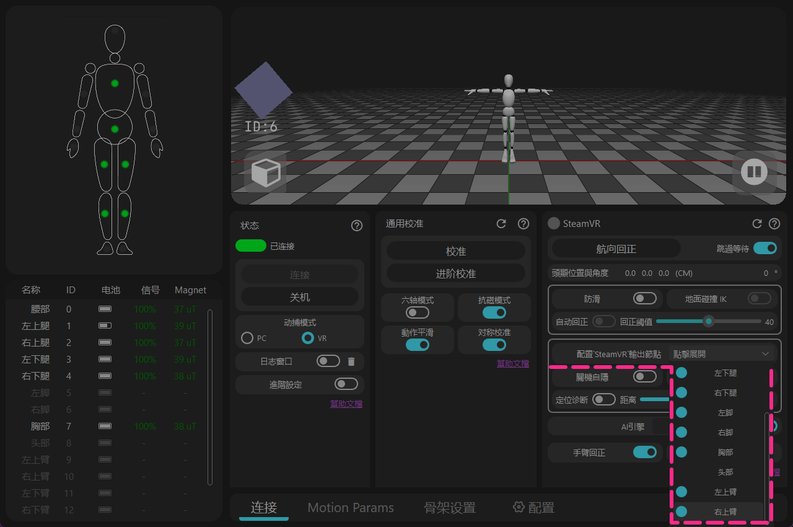
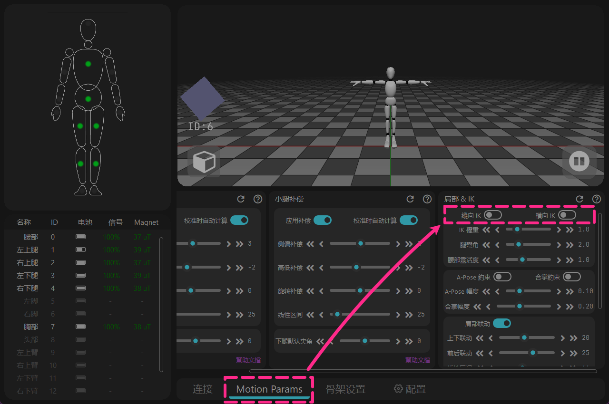
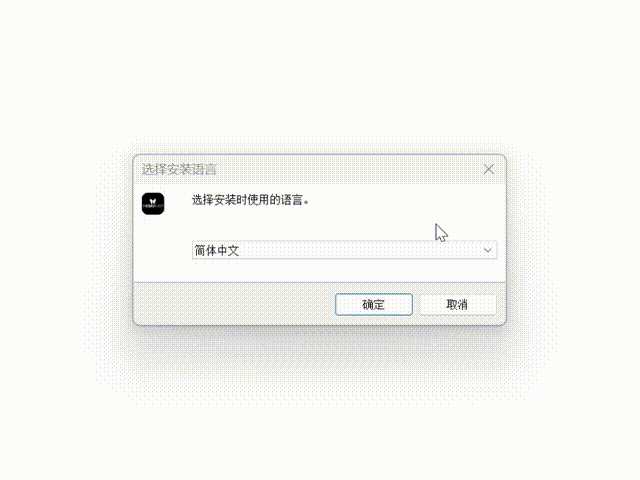

<!-- ==================== 旗帜 A：Install software 开始 ==================== -->
<div style="border-left: 6px solid #88b49c; padding-left: 20px; margin-top: 10px; margin-bottom: 20px;">

<span id="軟體下載" class="legacy-anchor-alias" aria-hidden="true"></span>

## 下載 {#software-download-toc}
<h2 class="tutorial-heading-flag" style="background: #88b49c; margin-top: 0; display: inline-block;">下載</h2>

<div class="os-switch">
<input type="radio" name="os-platform" id="os-platform-win" />
<input type="radio" name="os-platform" id="os-platform-linux" />
<input type="radio" name="os-platform" id="os-platform-android" />

<div class="os-switch-tabs" role="group" aria-label="選擇作業系統">
<label class="os-switch-tab os-switch-tab-win" for="os-platform-win">
<svg class="os-switch-tab-icon" viewBox="0 0 24 24" width="22" height="22" aria-hidden="true" focusable="false"><path d="M0,0H11.377V11.372H0ZM12.623,0H24V11.372H12.623ZM0,12.623H11.377V24H0Zm12.623,0H24V24H12.623"></path></svg>
<span class="os-switch-tab-name">Windows</span>
</label>
<label class="os-switch-tab os-switch-tab-linux" for="os-platform-linux">
<svg class="os-switch-tab-icon" viewBox="0 0 24 24" width="22" height="22" aria-hidden="true" focusable="false"><path d="M12.504 0c-.155 0-.315.008-.48.021-4.226.333-3.105 4.807-3.17 6.298-.076 1.092-.3 1.953-1.05 3.02-.885 1.051-2.127 2.75-2.716 4.521-.278.832-.41 1.684-.287 2.489a.424.424 0 00-.11.135c-.26.268-.45.6-.663.839-.199.199-.485.267-.797.4-.313.136-.658.269-.864.68-.09.189-.136.394-.132.602 0 .199.027.4.055.536.058.399.116.728.04.97-.249.68-.28 1.145-.106 1.484.174.334.535.47.94.601.81.2 1.91.135 2.774.6.926.466 1.866.67 2.616.47.526-.116.97-.464 1.208-.946.587-.003 1.23-.269 2.26-.334.699-.058 1.574.267 2.577.2.025.134.063.198.114.333l.003.003c.391.778 1.113 1.132 1.884 1.071.771-.06 1.592-.536 2.257-1.306.631-.765 1.683-1.084 2.378-1.503.348-.199.629-.469.649-.853.023-.4-.2-.811-.714-1.376v-.097l-.003-.003c-.17-.2-.25-.535-.338-.926-.085-.401-.182-.786-.492-1.046h-.003c-.059-.054-.123-.067-.188-.135a.357.357 0 00-.19-.064c.431-1.278.264-2.55-.173-3.694-.533-1.41-1.465-2.638-2.175-3.483-.796-1.005-1.576-1.957-1.56-3.368.026-2.152.236-6.133-3.544-6.139zm.529 3.405h.013c.213 0 .396.062.584.198.19.135.33.332.438.533.105.259.158.459.166.724 0-.02.006-.04.006-.06v.105a.086.086 0 01-.004-.021l-.004-.024a1.807 1.807 0 01-.15.706.953.953 0 01-.213.335.71.71 0 00-.088-.042c-.104-.045-.198-.064-.284-.133a1.312 1.312 0 00-.22-.066c.05-.06.146-.133.183-.198.053-.128.082-.264.088-.402v-.02a1.21 1.21 0 00-.061-.4c-.045-.134-.101-.2-.183-.333-.084-.066-.167-.132-.267-.132h-.016c-.093 0-.176.03-.262.132a.8.8 0 00-.205.334 1.18 1.18 0 00-.09.4v.019c.002.089.008.179.02.267-.193-.067-.438-.135-.607-.202a1.635 1.635 0 01-.018-.2v-.02a1.772 1.772 0 01.15-.768c.082-.22.232-.406.43-.533a.985.985 0 01.594-.2zm-2.962.059h.036c.142 0 .27.048.399.135.146.129.264.288.344.465.09.199.14.4.153.667v.004c.007.134.006.2-.002.266v.08c-.03.007-.056.018-.083.024-.152.055-.274.135-.393.2.012-.09.013-.18.003-.267v-.015c-.012-.133-.04-.2-.082-.333a.613.613 0 00-.166-.267.248.248 0 00-.183-.064h-.021c-.071.006-.13.04-.186.132a.552.552 0 00-.12.27.944.944 0 00-.023.33v.015c.012.135.037.2.08.334.046.134.098.2.166.268.01.009.02.018.034.024-.07.057-.117.07-.176.136a.304.304 0 01-.131.068 2.62 2.62 0 01-.275-.402 1.772 1.772 0 01-.155-.667 1.759 1.759 0 01.08-.668 1.43 1.43 0 01.283-.535c.128-.133.26-.2.418-.2zm1.37 1.706c.332 0 .733.065 1.216.399.293.2.523.269 1.052.468h.003c.255.136.405.266.478.399v-.131a.571.571 0 01.016.47c-.123.31-.516.643-1.063.842v.002c-.268.135-.501.333-.775.465-.276.135-.588.292-1.012.267a1.139 1.139 0 01-.448-.067 3.566 3.566 0 01-.322-.198c-.195-.135-.363-.332-.612-.465v-.005h-.005c-.4-.246-.616-.512-.686-.71-.07-.268-.005-.47.193-.6.224-.135.38-.271.483-.336.104-.074.143-.102.176-.131h.002v-.003c.169-.202.436-.47.839-.601.139-.036.294-.065.466-.065zm2.8 2.142c.358 1.417 1.196 3.475 1.735 4.473.286.534.855 1.659 1.102 3.024.156-.005.33.018.513.064.646-1.671-.546-3.467-1.089-3.966-.22-.2-.232-.335-.123-.335.59.534 1.365 1.572 1.646 2.757.13.535.16 1.104.021 1.67.067.028.135.06.205.067 1.032.534 1.413.938 1.23 1.537v-.043c-.06-.003-.12 0-.18 0h-.016c.151-.467-.182-.825-1.065-1.224-.915-.4-1.646-.336-1.77.465-.008.043-.013.066-.018.135-.068.023-.139.053-.209.064-.43.268-.662.669-.793 1.187-.13.533-.17 1.156-.205 1.869v.003c-.02.334-.17.838-.319 1.35-1.5 1.072-3.58 1.538-5.348.334a2.645 2.645 0 00-.402-.533 1.45 1.45 0 00-.275-.333c.182 0 .338-.03.465-.067a.615.615 0 00.314-.334c.108-.267 0-.697-.345-1.163-.345-.467-.931-.995-1.788-1.521-.63-.4-.986-.87-1.15-1.396-.165-.534-.143-1.085-.015-1.645.245-1.07.873-2.11 1.274-2.763.107-.065.037.135-.408.974-.396.751-1.14 2.497-.122 3.854a8.123 8.123 0 01.647-2.876c.564-1.278 1.743-3.504 1.836-5.268.048.036.217.135.289.202.218.133.38.333.59.465.21.201.477.335.876.335.039.003.075.006.11.006.412 0 .73-.134.997-.268.29-.134.52-.334.74-.4h.005c.467-.135.835-.402 1.044-.7zm2.185 8.958c.037.6.343 1.245.882 1.377.588.134 1.434-.333 1.791-.765l.211-.01c.315-.007.577.01.847.268l.003.003c.208.199.305.53.391.876.085.4.154.78.409 1.066.486.527.645.906.636 1.14l.003-.007v.018l-.003-.012c-.015.262-.185.396-.498.595-.63.401-1.746.712-2.457 1.57-.618.737-1.37 1.14-2.036 1.191-.664.053-1.237-.2-1.574-.898l-.005-.003c-.21-.4-.12-1.025.056-1.69.176-.668.428-1.344.463-1.897.037-.714.076-1.335.195-1.814.12-.465.308-.797.641-.984l.045-.022zm-10.814.049h.01c.053 0 .105.005.157.014.376.055.706.333 1.023.752l.91 1.664.003.003c.243.533.754 1.064 1.189 1.637.434.598.77 1.131.729 1.57v.006c-.057.744-.48 1.148-1.125 1.294-.645.135-1.52.002-2.395-.464-.968-.536-2.118-.469-2.857-.602-.369-.066-.61-.2-.723-.4-.11-.2-.113-.602.123-1.23v-.004l.002-.003c.117-.334.03-.752-.027-1.118-.055-.401-.083-.71.043-.94.16-.334.396-.4.69-.533.294-.135.64-.202.915-.47h.002v-.002c.256-.268.445-.601.668-.838.19-.201.38-.336.663-.336zm7.159-9.074c-.435.201-.945.535-1.488.535-.542 0-.97-.267-1.28-.466-.154-.134-.28-.268-.373-.335-.164-.134-.144-.333-.074-.333.109.016.129.134.199.2.096.066.215.2.36.333.292.2.68.467 1.167.467.485 0 1.053-.267 1.398-.466.195-.135.445-.334.648-.467.156-.136.149-.267.279-.267.128.016.034.134-.147.332a8.097 8.097 0 01-.69.468zm-1.082-1.583V5.64c-.006-.02.013-.042.029-.05.074-.043.18-.027.26.004.063 0 .16.067.15.135-.006.049-.085.066-.135.066-.055 0-.092-.043-.141-.068-.052-.018-.146-.008-.163-.065zm-.551 0c-.02.058-.113.049-.166.066-.047.025-.086.068-.14.068-.05 0-.13-.02-.136-.068-.01-.066.088-.133.15-.133.08-.031.184-.047.259-.005.019.009.036.03.03.05v.02h.003z"></path></svg>
<span class="os-switch-tab-name">Linux</span>
</label>
<label class="os-switch-tab os-switch-tab-android" for="os-platform-android">
<svg class="os-switch-tab-icon" viewBox="0 0 24 24" width="22" height="22" aria-hidden="true" focusable="false"><path d="M18.4395 5.5586c-.675 1.1664-1.352 2.3318-2.0274 3.498-.0366-.0155-.0742-.0286-.1113-.043-1.8249-.6957-3.484-.8-4.42-.787-1.8551.0185-3.3544.4643-4.2597.8203-.084-.1494-1.7526-3.021-2.0215-3.4864a1.1451 1.1451 0 0 0-.1406-.1914c-.3312-.364-.9054-.4859-1.379-.203-.475.282-.7136.9361-.3886 1.5019 1.9466 3.3696-.0966-.2158 1.9473 3.3593.0172.031-.4946.2642-1.3926 1.0177C2.8987 12.176.452 14.772 0 18.9902h24c-.119-1.1108-.3686-2.099-.7461-3.0683-.7438-1.9118-1.8435-3.2928-2.7402-4.1836a12.1048 12.1048 0 0 0-2.1309-1.6875c.6594-1.122 1.312-2.2559 1.9649-3.3848.2077-.3615.1886-.7956-.0079-1.1191a1.1001 1.1001 0 0 0-.8515-.5332c-.5225-.0536-.9392.3128-1.0488.5449zm-.0391 8.461c.3944.5926.324 1.3306-.1563 1.6503-.4799.3197-1.188.0985-1.582-.4941-.3944-.5927-.324-1.3307.1563-1.6504.4727-.315 1.1812-.1086 1.582.4941zM7.207 13.5273c.4803.3197.5506 1.0577.1563 1.6504-.394.5926-1.1038.8138-1.584.4941-.48-.3197-.5503-1.0577-.1563-1.6504.4008-.6021 1.1087-.8106 1.584-.4941z"></path></svg>
<span class="os-switch-tab-name">Android</span>
</label>
</div>

<div class="os-switch-panel os-switch-panel-win">

Windows 版目前提供 Release 與 Beta 版本，點擊下方下載連結。<br />
Beta 版本為公開測試版本，應對磁場干擾明顯的區域效果更好，但是尚未大規模驗證。

<div class="os-switch-downloads">
<a class="os-switch-download" href="https://doc.rebocap.com/img/files/rebocap_release_v01.exe">
<span class="os-switch-download-main">下載 Rebocap V01</span>
<span class="os-switch-download-meta">正式版本 · 目前 Release</span>
<span class="os-switch-download-date">上傳時間：2025.12.03</span>
</a>
<a class="os-switch-download" href="https://doc.rebocap.com/img/files/rebocap_release_v02_beta02.exe">
<span class="os-switch-download-main">下載 Rebocap V02 Beta02</span>
<span class="os-switch-download-meta">Beta 版本 · 公開測試</span>
<span class="os-switch-download-date">上傳時間：2026.02.24</span>
</a>
<a class="os-switch-download" data-gray-release-download="true" href="https://doc.rebocap.com/files/rebocap_v02_beta02.2_gray02-2.exe">
<span class="os-switch-download-main">下載 Rebocap V02 Beta02.2</span>
<span class="os-switch-download-meta">Beta 版本 · 灰度測試</span>
<span class="os-switch-download-date">上傳時間：2026.11.11</span>
</a>
</div>


- 版本選擇：\
  V01 - 適合磁場穩定的環境，適用於跳舞。<br />
  V02 Beta02.2 - 想體驗部分新的 UI 模組，以及在遊玩區域金屬件多、彈簧床等磁場環境不良的區域使用。<br />


- 推薦安裝在非系統碟（不要裝在 C 碟）。

<!-- ==================== 折叠页 开始 ==================== -->

<details>
<summary> [ 韌體 ] 對應支援和操作說明。</summary>
   &emsp;&emsp; 部分韌體版本有重大演算法變更，與舊版軟體不相容。 <br /> 


   &emsp;&emsp; 當切換回舊版軟體時，需要相應地降級韌體。<br /> 

   &emsp;&emsp;&emsp; release_v01 - ◼️tracker : V6 / V7  ,  📡receiver : V6 / V7 <br /> 

   &emsp;&emsp;&emsp; release_v02 beta02 - ◼️tracker : V15  ,  📡receiver : V6 / V7 <br /> 

   &emsp;&emsp;&emsp; (未公開) release_v02 beta02.1 - ◼️tracker : V16  ,  📡receiver : V6 / V7 / V8 <br /> 

   &emsp;&emsp;&emsp; release_v02 beta02.2 - ◼️tracker : V16 ,  📡receiver : V6 / V7 / V8 <br /> 


<div style="display: flex; flex-direction: row; gap: 20px; flex-wrap: wrap; align-items: center; margin: 15px 0;">
<div style="flex: 1; min-width: 250px; text-align: center;">

<video autoPlay loop muted playsInline width="100%" src="/img/softawre_install/show_version_log.mp4"></video>

</div>
<div style="flex: 1.5; min-width: 250px;">

**韌體操作說明**<br />
- 打開日誌視窗以查看每個追蹤器的實際韌體版本 <br /> 
（日誌視窗位於軟體中的“連接與關機”下方）。

</div>
</div>

<br/>

- 追蹤器是透過無線 📶 進行更新的 — 無需使用 USB 數據線。<br /> 
🚫 請勿同時更新追蹤器和接收器。<br /> 


- 如果更新失敗，需要重啟追蹤器並再次點擊更新。<br /> 
&emsp;&emsp;🟩綠燈 – 快閃：追蹤器工作正常<br /> 
&emsp;&emsp;🟩綠燈 – 慢閃：追蹤器正在等待接收器訊號<br /> 
&emsp;&emsp;🟦藍燈：追蹤器正在接收韌體數據<br /> 
&emsp;&emsp;🟨黃燈：更新失敗（手動按下 🔘 按鈕重啟，然後重新更新）<br /> 
&emsp;&emsp;⬜白色：更新成功（通常在 10s 後自動重啟，如果無法自動重啟需要手動重啟）<br /> 

- 當 📡接收器更新完成後，斷開並重新插入 USB，然後 🔄重啟軟體。


</details>
<!-- ==================== 折叠页 结束 ==================== -->


<!-- ==================== 折叠页 开始 ==================== -->
<details>
<summary>如果在 VR 模式使用 V01 版本，需要更改以下設定。</summary>

<div style="display: flex; flex-direction: row; gap: 20px; flex-wrap: wrap; align-items: center; margin: 15px 0;">
<div style="flex: 1; min-width: 250px; text-align: center;">



</div>
<div style="flex: 1.5; min-width: 250px;">
<strong>1 - 沒有大臂追蹤器時，手動關閉額外顯示的追蹤點。</strong><br />
打開 [配置'SteamVR'輸出節點] → 關閉 [左/右上臂]
<details className="plain-details"><summary>詳情</summary>
軟體原計畫使用[關節自動隱藏]功能自動隱藏未使用的追蹤點，<br />
後發現該功能無法自動檢查，在 V02 Beta02 軟體中已修復。
</details>

</div>
</div>

<div style="display: flex; flex-direction: row; gap: 20px; flex-wrap: wrap; align-items: center; margin: 15px 0;">
<div style="flex: 1; min-width: 250px; text-align: center;">



</div>
<div style="flex: 1.5; min-width: 250px;">
<strong>2 - 關閉會錯誤卡在全局工作的功能。</strong><br />
→ [運動參數] → 關閉 [縱向 IK & 橫向 IK]
<details className="plain-details"><summary>詳情</summary>
該功能原定為[防止腳滑]模組裡的子功能，<br />
但會意外處於全局工作狀態，在 V02 Beta02 軟體中已修復。

</details>
</div>
</div>

</details>
<!-- ==================== 折叠页 结束 ==================== -->

注意事項：
> 目前 **Windows 版**僅支援 Windows 10 及以上系統版本。<br>
> 軟體必須在連網狀態下使用，如果希望離線使用，請使用手機熱點網路，開啟軟體 30 秒以後再斷開網路即可。<br>
> （在[日誌視窗]中只要顯示網路驗證成功，即可斷開網路）

</div>

<div class="os-switch-panel os-switch-panel-linux">

Linux 目前為 Preview 預覽版，本次發布主要用於觀察程式核心在 Linux 環境下的穩定性。<br>
使用中如遇到 Bug，歡迎到 Twitter（X）的相關貼文和 Discord 留言。

<div class="os-switch-downloads">
<a class="os-switch-download" data-preview-download="true" href="https://doc.rebocap.com/files/rebocap-linux-preview-0.1-1.run">
<span class="os-switch-download-main">下載 Rebocap Linux Preview 0.1</span>
<span class="os-switch-download-meta">Linux · Preview 預覽版</span>
<span class="os-switch-download-date">上傳時間：2026.11.11</span>
</a>
</div>

Linux 預設安裝路徑為 `~/.local/opt/rebocap`。

<!-- ==================== 折叠页 开始 ==================== -->

<details>
<summary> [ 韌體 ] 對應支援和操作說明。</summary>
   &emsp;&emsp; 部分韌體版本有重大演算法變更，與舊版軟體不相容。 <br /> 


   &emsp;&emsp; 當切換回舊版軟體時，需要相應地降級韌體。<br /> 

 
   &emsp;&emsp;&emsp; Linux Preview 0.1 - ◼️tracker : V16 / V17 ,  📡receiver : V6 / V7 / V8 <br /> 


<div style="display: flex; flex-direction: row; gap: 20px; flex-wrap: wrap; align-items: center; margin: 15px 0;">
<div style="flex: 1; min-width: 250px; text-align: center;">

<video autoPlay loop muted playsInline width="100%" src="/img/softawre_install/show_version_log.mp4"></video>

</div>
<div style="flex: 1.5; min-width: 250px;">

**韌體操作說明**<br />
- 打開日誌視窗以查看每個追蹤器的實際韌體版本 <br /> 
（日誌視窗位於軟體中的“連接與關機”下方）。

</div>
</div>

<br/>

- 追蹤器是透過無線 📶 進行更新的 — 無需使用 USB 數據線。<br /> 
🚫 請勿同時更新追蹤器和接收器。<br /> 


- 如果更新失敗，需要重啟追蹤器並再次點擊更新。<br /> 
&emsp;&emsp;🟩綠燈 – 快閃：追蹤器工作正常<br /> 
&emsp;&emsp;🟩綠燈 – 慢閃：追蹤器正在等待接收器訊號<br /> 
&emsp;&emsp;🟦藍燈：追蹤器正在接收韌體數據<br /> 
&emsp;&emsp;🟨黃燈：更新失敗（手動按下 🔘 按鈕重啟，然後重新更新）<br /> 
&emsp;&emsp;⬜白色：更新成功（通常在 10s 後自動重啟，如果無法自動重啟需要手動重啟）<br /> 

- 當 📡接收器更新完成後，斷開並重新插入 USB，然後 🔄重啟軟體。


</details>
<!-- ==================== 折叠页 结束 ==================== -->

注意事項：
> 目前 Linux 版務必設定系統權限，在[日誌視窗]可查看，<br>
> 如果沒修改成功，可能會影響 USB 接收器連接，反覆提示“state -3”。<br>
> <br>
> 軟體必須在連網狀態下使用，如果希望離線使用，請使用手機熱點網路，開啟軟體 30 秒以後再斷開網路即可。<br>
> （在[日誌視窗]中只要顯示網路驗證成功，即可斷開網路）

</div>

<div class="os-switch-panel os-switch-panel-android">

Android 目前為 Preview 預覽版，本次發布主要用於觀察程式核心在 Android 環境下的穩定性。<br>
使用中如遇到 Bug，歡迎到 Twitter（X）的相關貼文和 Discord 留言。

<div class="os-switch-downloads">
<a class="os-switch-download" data-preview-download="true" href="https://doc.rebocap.com/files/ReboCapAndroid-Preview-0.1.apk">
<span class="os-switch-download-main">下載 Rebocap Android Preview 0.1</span>
<span class="os-switch-download-meta">Android · Preview 預覽版</span>
<span class="os-switch-download-date">上傳時間：2026.11.11</span>
</a>
</div>

<div class="os-switch-aux">
<div class="os-switch-aux-title">配套工具（選用）</div>
<div class="os-switch-aux-grid">
<a class="os-switch-aux-tool" href="https://doc.rebocap.com/files/RebocapTransmitter-v1.0.18.apk">
<div class="os-switch-aux-info">
<span class="os-switch-aux-name">Rebocap 接收器橋接 App</span>
<span class="os-switch-aux-meta">Android APK · v1.0.18</span>
<span class="os-switch-aux-date">上傳時間：2026.11.11</span>
</div>
<span class="os-switch-aux-btn">下載 ↓</span>
</a>
<a class="os-switch-aux-tool" href="https://doc.rebocap.com/files/RBC_OSC_forward_v1.0.0.apk">
<div class="os-switch-aux-info">
<span class="os-switch-aux-name">VRChat OSC 轉發 App</span>
<span class="os-switch-aux-meta">Android APK · v1.0.0</span>
<span class="os-switch-aux-date">上傳時間：2026.11.11</span>
</div>
<span class="os-switch-aux-btn">下載 ↓</span>
</a>
</div>
</div>

<div class="os-switch-otg">
<span class="os-switch-otg-label">OTG 數據線購買：</span>
<a class="os-switch-otg-link" href="https://item.taobao.com/item.htm?id=1095599547785">淘寶</a>
</div>
<p class="os-switch-otg-note">說明：OTG 數據線僅適用於 Quest 或 Pico 一體機，官方預設不隨設備附贈。官方商店提供的 OTG 數據線兼具 PD 充電功能；若不需要充電，可自行購買一般 OTG 轉接頭或轉接線。若不需要 PD 充電（例如 Quest 2），也可使用一般 OTG 充電線（5V/2A）。</p>


<!-- ==================== 折叠页 开始 ==================== -->

<details>
<summary> [ 韌體 ] 對應支援和操作說明。</summary>
   &emsp;&emsp; 部分韌體版本有重大演算法變更，與舊版軟體不相容。 <br /> 


   &emsp;&emsp; 當切換回舊版軟體時，需要相應地降級韌體。<br /> 


   &emsp;&emsp;&emsp; Android Preview 0.1 - ◼️tracker : V16 / V17 ,  📡receiver : V6 / V7 / V8 <br /> 


<div style="display: flex; flex-direction: row; gap: 20px; flex-wrap: wrap; align-items: center; margin: 15px 0;">
<div style="flex: 1; min-width: 250px; text-align: center;">

<video autoPlay loop muted playsInline width="100%" src="/img/softawre_install/show_version_log.mp4"></video>

</div>
<div style="flex: 1.5; min-width: 250px;">

**韌體操作說明**<br />
- 打開日誌視窗以查看每個追蹤器的實際韌體版本 <br /> 
（日誌視窗位於軟體中的“連接與關機”下方）。

</div>
</div>

<br/>

- 追蹤器是透過無線 📶 進行更新的 — 無需使用 USB 數據線。<br /> 
🚫 請勿同時更新追蹤器和接收器。<br /> 


- 如果更新失敗，需要重啟追蹤器並再次點擊更新。<br /> 
&emsp;&emsp;🟩綠燈 – 快閃：追蹤器工作正常<br /> 
&emsp;&emsp;🟩綠燈 – 慢閃：追蹤器正在等待接收器訊號<br /> 
&emsp;&emsp;🟦藍燈：追蹤器正在接收韌體數據<br /> 
&emsp;&emsp;🟨黃燈：更新失敗（手動按下 🔘 按鈕重啟，然後重新更新）<br /> 
&emsp;&emsp;⬜白色：更新成功（通常在 10s 後自動重啟，如果無法自動重啟需要手動重啟）<br /> 

- 當 📡接收器更新完成後，斷開並重新插入 USB，然後 🔄重啟軟體。


</details>
<!-- ==================== 折叠页 结束 ==================== -->

注意事項：
> 需要使用 OTG 數據線將 USB 接收器連接到執行 Rebocap 軟體的裝置。<br>
> 韌體更新、陀螺儀和磁場校準建議使用手機操作。<br>
> 如果數據接口老化容易斷開連接，可使用 OSC 轉發 App 或接收器橋接 App 來保持軟體連接。<br>
> <br>
> 軟體必須在連網狀態下使用，如果希望離線使用，開啟軟體 30 秒以後再斷開網路即可。<br>
> （在[日誌視窗]中只要顯示網路驗證成功，即可斷開網路）

</div>
</div>


</div>
<!-- ==================== 旗帜 A：Install software 结束 ==================== -->


## 軟體安裝

<div class="os-switch-install os-switch-install-win">

1. 雙擊 rebocap_release_v01.exe（目前版本為 rebocap_release_v01.exe）
2. 按照下圖所示進行安裝
3. 開啟 rebocap 軟體
   * 從開始選單開啟
   * 從桌面捷徑開啟



</div>

<div class="os-switch-install os-switch-install-linux">

Linux 版使用 `.run` 安裝包：

1. 在安裝包所在目錄開啟終端機，先賦予執行權限：`chmod +x rebocap-linux-preview-0.1-1.run`
2. 執行安裝程式：`./rebocap-linux-preview-0.1-1.run`
3. 依提示完成安裝，預設安裝路徑為 `~/.local/opt/rebocap`
4. 安裝完成後，從應用程式選單或安裝目錄啟動 Rebocap

為了確保自動系統授權失敗時能手動補上：

**裝置權限配置（必做，否則接收器連不上）**

```bash
sudo bash ~/.local/opt/rebocap/linux/install_linux_permissions.sh --install --user "$USER"
```

執行後拔插一次接收器，再啟動軟體。

</div>

<div class="os-switch-install os-switch-install-android">

Android 版使用 `.apk` 安裝包：

1. 將 `ReboCapAndroid-Preview-0.1.apk` 傳輸到手機並點擊安裝
2. 如系統提示，請允許「安裝未知應用程式」
3. 安裝完成後開啟 Rebocap
4. 使用 OTG 數據線連接 USB 接收器，並依軟體提示完成連接

</div>

## 軟體更新說明

### 更新日誌

#### 2026-11-11 更新

**韌體**
1. 📡接收器韌體 V8 ：
    > 捨棄傳統的 CDC 序列埠驅動程式，改用 vendor 模式，傳輸速率更快（基本上無影響），<br> 主要是序列埠驅動程式容易被系統其他程式干擾，或者容易被系統元件影響，穩定性太差。<br>注意：一旦升級到新韌體，就只能使用最新版本軟體，舊版本無法識別，必須降級接收器韌體才能使用舊版本軟體。

2. ◼️追蹤器韌體 V16：
    > 修正新舊演算法預設方向不一致的問題（v15 韌體按鈕重啟後會朝右 90°），<br>支援非抗磁模式（之前抗磁開關對 v15 韌體無效，導致不適合用於跳舞）。

**軟體**
1. 新增 Linux 與 Android 版本，主要觀察大家是否會出現核心 bug，以及調整部分 UI 的操作邏輯
    > Linux 端 UI 介面會與 Windows 保持一致，Android 端為重新設計，但操作動線保持與 Windows 端相近，支援直向／橫向切換。

2. 3D 預覽器更換為 OGRE
    > 但 NVIDIA 顯示卡驅動程式可能會把 GPU 用量正規化顯示，導致錯誤顯示 GPU 使用率達到 20%~40%，AMD 顯示卡沒有這種「奇妙」顯示，有待後續調查與調整。 

3. 韌體升級製作成獨立視窗
    >v7 ~ v15 的韌體升級對很多人來說都是一道門檻，因此改進此視窗。

4. [六軸模式]改名為[地磁輔助]，並且開關反向
    >發現各語言玩家都出現把 6 軸誤認為 6 個追蹤器模式的情況。

5. 動作校準邏輯調整
    >新增[緊急停止]按鈕，如果誤觸校準時可以停下。<br>新增折疊擴展欄，適當調節後校準的倒數計時會非常短，支援保留上一次校準的記錄（不啟用時關閉軟體 7 分鐘後過期）。

6. 追蹤器敲一敲改為[敲擊分配]
    >允許玩家自訂敲擊巨集，自由搭配敲誰、敲擊間隔、觸發什麼快捷鍵。

7. 新增音量滑桿
    >方便直接開關軟體提示音

8. 消除 VMC 高度差 bug
    >之前 VMC 比地面高出一段的 bug，是因為地面到 hips 的高度被錯誤地以 x2 倍輸出。

9. 部分使用率高的功能移除[進階設定]的控制
  

**end.** UI 互動的改進會持續進行，還有許多來自大家使用感受統計的條目有待調整。


#### 2026-02-04 更新: rebocap Release V02 Beta02
1. 更新韌體至 v15，優化抗磁與 6 軸演算法，抗磁穩定性提升，6 軸穩定性提升  
   > 動態情況下，例如持續跳舞且磁場環境不佳時，仍與 6 軸性能接近。新韌體在磁場良好時，動態跳舞基本能持續回正（舊韌體需依賴中間存在靜止狀態才能回正）。
2. 新增延遲自動關機功能，需要升級新的接收器韌體。
3. 航向校準重構，同時新增 PC 航向校準 功能：  
   > 注意：進行 PC 航向校準時，需全身 A-pose，小臂與手掌抬起向前更佳，或直接做 S-Pose 亦可，或坐著將雙手伸向正前方亦可。
4. 軟體意外閃退後，於 5 分鐘內重新開啟，會自動套用上次校準結果，無需再次動作校準。
5. 航向校準時，會重置磁場（直接重置為相對磁場 1.0），若躺在床上，將以校準時刻作為初始磁場進行回正。
6. 解除磁場校準限制，簡易磁場校準（畫 8 字）預設可點擊顯示  
   > 預設限制 8 個感測器同時校準；若在 data 目錄新增檔案：`data/__no_limit_max_nodes__`，即可取消校準數量限制。
7. 修復躺下後腳底運動可能導致角色骨架分離的 bug。

其它更新：
1. 軟體頂部顯示版本號
2. 修復自動隱藏關機感測器功能無效的 bug
3. 關閉腳底防滑模式時，腳底可深入地面以下，並移除 IK
4. 解決拔掉接收器後角色姿態凍結的 bug
5. 骨架設定新增 VR 側向偏移（部分模型的頭顯掛載點不在眉心，而是在側邊，可依實際情況調整）


#### 2025-12-03 更新: rebocap Release V01
**VR 部分：**
1. 新增原地行走功能，可於原地踏步時模擬搖桿穩定緩慢向前推進，詳情請閱讀說明文件（進階功能）
2. 新增 VR 虛擬地面高度，-100 cm ~ 100 cm 範圍調整（進階功能）
3. 新增替換控制器功能，開啟後將以手掌追蹤器替換手柄控制器的位置與姿態，詳情請閱讀說明文件（進階功能）
4. 升級 SteamVR 外掛，並嘗試修復追蹤器被識別為控制器的現象
5. 修復 VR 模式匯入骨架時，腳底定位點錯誤問題（主要影響 IK 計算），導致角色腳底以及整體被拉低
6. 航向回正後，將主動觸發 自動回正功能
7. 新增自動隱藏關閉的節點開關，開啟後會自動隱藏已關機的節點
8. 恢復 VR 的 胸腰跟隨頭顯功能

**PC 部分：**
1. 動作校準演算法更新，降低 T-pose 手臂姿勢要求，解決部分使用者雙手臂不對稱問題
2. 新增手臂 IK，合掌 IK 盡量減少合掌時手臂交叉問題，A-pose IK 用於解決虛擬角色肩膀過窄、手臂下垂時嚴重穿模問題
3. 新增 MMD 動作匯出，以及 PMX 模型匯入。注意，VMD 動作無 IK，需要自行移除 IK 約束
4. 修復動畫幀率跳轉，最大 999 的 bug

**通用部分：**
1. UI 更新，依功能進行分區，並優化部分名詞翻譯，功能描述更人性化
2. 新增進階設定開關，以及設定匯出、設定載入、還原預設設定功能
3. 移除靜止判定失敗導致無法校準的問題
4. 新增自動連線功能，現在無需手動點擊連線按鈕
5. 新增接收器韌體升級，解決 CPU 高負載丟包問題（特別是 AMD CPU）
6. 追蹤器升級至 v07 韌體，整體更穩定
7. 新增可選取部分節點進行六軸功能（進階功能）
8. 修復個別陀螺儀校準後不歸零的 bug

**其他：**
1. 增加啟動畫面，避免長時間後台等待
2. 加強 3D 視窗穩定性
3. 驗證伺服器增加到三個（中國、香港和美國），只要其中一個驗證伺服器通過就驗證成功。
4. 修復校準時偶發資料傳送失敗的bug（實際上是傳送成功了）
5. 預設骨架修改為社群推薦的預設骨架，以及其他預設參數修改
6. 六軸開關開啟關閉增加重新校準提示
7. 修復六軸側偏補償問題


<span id="todo（排名不分先後，這裡只介紹大的更新點）" class="legacy-anchor-alias" aria-hidden="true"></span>

### TODO（排名不分先後，這裡只介紹大的更新點）

- 優化 IK 效果
- 優化軟體穩定性
- VR 3 點模式支援
- PC 全身 6 點模式支援
- 文件增加其他語言（後續文件穩定之後再增加）


### 歷史版本
> **請注意，preview05以前的版本不支援 2025-11-29 號以後的新版本硬體，新版本硬體請下載最新 Release 版本 或者 Beta 版本**
